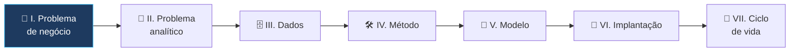

# 🎯 Business Problem Framing — CAP-Essentials

> **Exame:** CAP-Essentials (Certified Analytics Professional), INFORMS
> **Domínio:** I — Business Problem (Question) Framing (**15%** da prova)
> **No plano de estudos:** dezembro de 2026 · aula de quarta-feira
>
> **Ideia central:** entender **qual é o problema de negócio** e **o tamanho dele** antes de pensar em dados, modelos ou ferramentas.

---

## 📑 Índice
1. [Por que este domínio existe](#1-por-que-este-domínio-existe)
2. [Receber e entender a declaração do problema](#2-receber-e-entender-a-declaração-do-problema)
3. [Identificar os stakeholders](#3-identificar-os-stakeholders)
4. [Avaliar se o problema pode ser resolvido com analytics](#4-avaliar-se-o-problema-pode-ser-resolvido-com-analytics)
5. [Refinar o problema: escopo, restrições e premissas](#5-refinar-o-problema-escopo-restrições-e-premissas)
6. [Definir os benefícios de negócio](#6-definir-os-benefícios-de-negócio)
7. [Obter o acordo dos stakeholders](#7-obter-o-acordo-dos-stakeholders)
8. [Exemplo completo: Trama Store](#8-exemplo-completo-trama-store)
9. [Glossário inglês → português](#9-glossário-inglês--português)
10. [Resumo mental para a prova](#10-resumo-mental-para-a-prova)
11. [Possíveis pegadinhas da prova](#11-possíveis-pegadinhas-da-prova)
12. [Questões no estilo da prova (em inglês)](#12-questões-no-estilo-da-prova-em-inglês)
13. [Fontes](#13-fontes)

---

## 1. Por que este domínio existe

Muitos projetos de dados fracassam sem nenhum erro técnico: o modelo funciona, o dashboard é bonito, mas **ninguém usa**, porque o projeto **resolveu o problema errado**.

> 🎯 **Resolver bem o problema errado é pior do que não resolver**: gasta tempo, dinheiro e credibilidade.

Este domínio é a **primeira etapa** do processo de analytics da INFORMS. Tudo o que vem depois depende dele:



As seis tarefas deste domínio seguem uma ordem lógica:

```
Receber o problema → Quem está envolvido? → Analytics resolve? → Delimitar → Qual o ganho? → Acordo
```

---

## 2. Receber e entender a declaração do problema

**Problem statement** (declaração do problema) é a descrição inicial do que a área de negócio quer resolver. Ela quase sempre chega **vaga**, **misturando sintoma com causa** ou **já trazendo uma solução pronta**.

| Como o pedido chega | O que há de errado |
| :--- | :--- |
| "As vendas estão caindo." | É um **sintoma**; não diz onde, quanto nem desde quando |
| "Precisamos de um dashboard de vendas." | É uma **solução**; qual decisão o dashboard vai apoiar? |
| "Queremos usar IA no marketing." | É uma **tecnologia**; qual problema ela resolveria? |

### Como entender de verdade: separar sintoma de causa

**Técnica dos 5 porquês** (*5 Whys*): pergunte "por quê?" até chegar a uma causa que dá para atacar.

```
As vendas da loja caíram.
  └─ Por quê? Menos clientes compraram.
      └─ Por quê? Muitos saíram sem levar o que queriam.
          └─ Por quê? O tamanho procurado estava em falta.
              └─ Por quê? A reposição chega atrasada.
                  └─ Por quê? A previsão de demanda não considera o fim de semana.
```

### As perguntas que todo analista faz

| Pergunta | Exemplo de resposta |
| :--- | :--- |
| **O quê?** Qual é o problema, em uma frase? | Queda nas vendas por falta de produto |
| **Onde?** Em que lojas, canais, produtos? | Lojas do Nordeste, categoria Calçados |
| **Quando?** Desde quando? Com que frequência? | Desde agosto, principalmente aos sábados |
| **Quanto?** Qual o tamanho do impacto? | Estimativa de R$ 2 milhões por trimestre |
| **Quem?** Quem sente o problema? Quem decide? | Gerentes de loja sentem; diretoria de supply decide |
| **Qual decisão** será tomada com a resposta? | Mudar a regra de reposição das lojas |

> 💡 **A pergunta mais importante:** *"Que decisão você vai tomar com essa resposta?"* Se não houver decisão, provavelmente não há problema de negócio, só curiosidade.

---

## 3. Identificar os stakeholders

**Stakeholders** (partes interessadas) são todas as pessoas ou áreas que **afetam** o projeto ou **são afetadas** por ele.

### Os papéis mais comuns

| Papel | Quem é | O que espera |
| :--- | :--- | :--- |
| **Sponsor** (patrocinador) | Executivo que paga e defende o projeto | Retorno para o negócio; resultados no prazo |
| **Dono do processo** (*process owner*) | Responsável pela área onde o problema acontece | Que a solução funcione no dia a dia |
| **Usuários finais** (*end users*) | Quem vai usar o resultado | Algo simples, confiável e útil |
| **Equipe de dados e TI** | Quem fornece dados e infraestrutura | Requisitos claros e viáveis |
| **Jurídico e compliance** | Quem garante regras e privacidade | Respeito à LGPD e às políticas internas |

### Mapa de poder × interesse

Ajuda a decidir **como se relacionar** com cada stakeholder:

| | **Baixo interesse** | **Alto interesse** |
| :--- | :--- | :--- |
| **Alto poder** | **Manter satisfeito** (ex.: diretor financeiro) | **Gerenciar de perto** (ex.: sponsor) |
| **Baixo poder** | **Monitorar** (ex.: outras áreas) | **Manter informado** (ex.: gerentes de loja) |

### Matriz RACI

Deixa claro **quem faz o quê** em cada decisão:

| Letra | Significado | Exemplo |
| :--- | :--- | :--- |
| **R** · Responsible | Quem **executa** | Analista de dados |
| **A** · Accountable | Quem **responde** pelo resultado (só uma pessoa) | Sponsor |
| **C** · Consulted | Quem é **consultado** antes | Gerentes de loja, jurídico |
| **I** · Informed | Quem é **informado** depois | Diretoria de marketing |

> ⚠️ Stakeholders diferentes costumam ter **objetivos em conflito**. Ex.: o comercial quer mais estoque nas lojas, e o financeiro quer menos capital parado. Identificar isso **cedo** evita surpresas no fim do projeto.

---

## 4. Avaliar se o problema pode ser resolvido com analytics

Nem todo problema é de dados. Antes de seguir, responda:

| Critério | Pergunta | Se a resposta for "não"... |
| :--- | :--- | :--- |
| **Decisão** | Existe uma decisão que a análise vai apoiar? | É curiosidade, não projeto |
| **Dados** | Os dados existem ou podem ser obtidos a um custo aceitável? | O projeto não é viável agora |
| **Valor** | O benefício esperado é maior que o custo da análise? | Não vale o investimento |
| **Natureza** | O problema é de informação, e não de processo, pessoas ou política? | Analytics não resolve |
| **Ação** | A organização está disposta e preparada para agir com o resultado? | O resultado vai para a gaveta |

### Quando a resposta **não** é analytics

| Situação | O que resolve de verdade |
| :--- | :--- |
| A loja vende pouco porque o sistema de caixa trava | Correção técnica (TI) |
| Os vendedores não seguem o procedimento de reposição | Treinamento e gestão de pessoas |
| A diretoria já decidiu e só quer "um número que confirme" | Não é um problema analítico; é validação política |
| O problema acontece uma vez e nunca mais | Uma investigação pontual pode bastar |

> 💡 **Dizer "isso não é um problema de analytics" também é uma entrega profissional.** Economiza tempo e dinheiro da empresa.

---

## 5. Refinar o problema: escopo, restrições e premissas

Com o problema entendido, é hora de **delimitar**.

### Escopo (*scope*): o que entra e o que fica de fora

| Dentro do escopo (*in scope*) | Fora do escopo (*out of scope*) |
| :--- | :--- |
| Lojas físicas do Nordeste | E-commerce |
| Categoria Calçados | Outras categorias |
| Dados de 2025 e 2026 | Dados anteriores a 2025 |

> ⚠️ **Scope creep** (crescimento descontrolado do escopo): pedidos que vão sendo acrescentados no meio do projeto ("já que está fazendo, inclui também..."). Um escopo escrito e aprovado é a defesa.

### Restrições (*constraints*): os limites do projeto

| Tipo | Exemplo |
| :--- | :--- |
| **Prazo** | Resultado antes da Black Friday |
| **Custo** | Orçamento máximo de R$ 50 mil |
| **Dados** | O sistema das lojas só guarda 18 meses de histórico |
| **Regulatórias** | A LGPD restringe o uso de dados pessoais de clientes |
| **Técnicas** | A solução precisa rodar no Databricks que a empresa já usa |
| **Organizacionais** | Só há um analista disponível para o projeto |

### Premissas (*assumptions*): o que estamos assumindo como verdade

Exemplo: *"Assumimos que os dados de estoque do WMS estão corretos."* Premissas devem ser **escritas** e, quando possível, **verificadas**, porque se uma premissa estiver errada, a conclusão pode estar errada também.

### Problema refinado: o formato SMART

Um bom problema refinado é **SMART**:

| Letra | Significado | No exemplo |
| :--- | :--- | :--- |
| **S** · Specific | Específico | Rupturas de Calçados nas lojas do Nordeste |
| **M** · Measurable | Mensurável | Taxa de ruptura e vendas perdidas em R$ |
| **A** · Achievable | Alcançável | Com os dados e a equipe disponíveis |
| **R** · Relevant | Relevante | Ligado à meta de vendas da diretoria |
| **T** · Time-bound | Com prazo | Até novembro de 2026 |

---

## 6. Definir os benefícios de negócio

**Business benefits** (benefícios de negócio) respondem: *"o que a empresa ganha se o problema for resolvido?"*

### Tipos de benefício

| Tipo | Exemplo | Como medir |
| :--- | :--- | :--- |
| **Aumento de receita** | Recuperar vendas perdidas por ruptura | R$ em vendas adicionais |
| **Redução de custo** | Diminuir estoque parado | R$ em capital liberado |
| **Redução de risco** | Evitar multas por descumprir a LGPD | Probabilidade × impacto |
| **Benefícios intangíveis** | Melhorar a satisfação do cliente | Pesquisas (NPS), reclamações |

### Linha de base (*baseline*)

Sem saber **onde estamos hoje**, não dá para provar que melhorou:

| Indicador | Hoje (baseline) | Meta |
| :--- | :--- | :--- |
| Taxa de ruptura em Calçados no Nordeste | 12% | 6% |
| Vendas perdidas por trimestre | R$ 2 milhões | R$ 1 milhão |

> 💡 Na fase de enquadramento, uma **estimativa de ordem de grandeza** basta ("algo entre R$ 1 e 3 milhões por trimestre"). O número exato vem depois, com os dados.

---

## 7. Obter o acordo dos stakeholders

A última tarefa é **formalizar** tudo em um documento e conseguir o **acordo** (*stakeholder agreement* ou *sign-off*) de quem decide.

### O que o documento deve ter

Costuma se chamar **problem statement** ou **project charter**:

- [ ] O problema de negócio, em uma ou duas frases
- [ ] A decisão que será apoiada
- [ ] Os stakeholders e seus papéis (RACI)
- [ ] O escopo: o que entra e o que fica de fora
- [ ] As restrições e as premissas
- [ ] Os benefícios esperados, com a linha de base
- [ ] Como o sucesso será medido (KPIs)
- [ ] O prazo

### Por que o acordo é obrigatório

- Garante que **todos entenderam o mesmo problema**.
- Protege contra o **scope creep**.
- Dá uma referência para **medir o sucesso** no fim.
- Se os stakeholders **não concordam**, o projeto **não deve avançar**: volte e refine o problema.

---

## 8. Exemplo completo: Trama Store

**1. Como o pedido chegou:**
> *"A diretoria quer um dashboard porque as vendas das lojas estão caindo."*

**2. Entendendo (5 porquês e perguntas-chave):** a queda está concentrada nas **lojas do Nordeste**, na categoria **Calçados**, desde agosto. Clientes saem sem comprar porque falta o tamanho procurado (**ruptura**).

**3. Stakeholders:**

| Stakeholder | Papel | Interesse |
| :--- | :--- | :--- |
| Diretora comercial | Sponsor (A) | Recuperar as vendas |
| Gerente de supply chain | Dono do processo (C) | Ajustar a reposição sem aumentar o estoque total |
| Gerentes de loja | Usuários (I) | Ter o produto na prateleira |
| Engenharia de dados | Executa (R) | Acesso aos dados de vendas e estoque |

**4. Analytics resolve?** Sim: existe uma **decisão** (mudar a regra de reposição), os **dados** existem (vendas do PDV e estoque do WMS) e o **valor** estimado é alto.

**5. Escopo e restrições:** lojas do Nordeste, categoria Calçados, dados desde janeiro de 2025; resultado antes da Black Friday; sem dados pessoais de clientes (LGPD).

**6. Benefício esperado:** reduzir a ruptura de 12% para 6% e recuperar cerca de R$ 1 milhão por trimestre.

**7. Problema refinado (SMART):**
> *"Reduzir a taxa de ruptura de Calçados nas lojas do Nordeste de 12% para 6% até novembro de 2026, ajustando a regra de reposição com base na previsão de demanda, para recuperar cerca de R$ 1 milhão em vendas por trimestre."*

**8. Acordo:** documento aprovado pela diretora comercial e pelo gerente de supply chain.

Repare: o pedido começou como **"um dashboard"** e terminou como **"mudar a regra de reposição"**. O dashboard pode até fazer parte da solução, mas não é o problema.

---

## 9. Glossário inglês → português

| Inglês | Português |
| :--- | :--- |
| Problem statement | Declaração do problema |
| Business problem framing | Enquadramento do problema de negócio |
| Stakeholder | Parte interessada |
| Sponsor | Patrocinador |
| Process owner | Dono do processo |
| End user | Usuário final |
| Root cause | Causa raiz |
| Symptom | Sintoma |
| Scope / scope creep | Escopo / crescimento descontrolado do escopo |
| Constraint | Restrição |
| Assumption | Premissa |
| Business benefit / value | Benefício / valor de negócio |
| Baseline | Linha de base |
| Key performance indicator (KPI) | Indicador-chave de desempenho |
| Project charter | Termo de abertura do projeto |
| Sign-off / agreement | Aprovação / acordo |
| Amenable to an analytics solution | Passível de solução com analytics |

---

## 10. Resumo mental para a prova

- **Primeiro o problema, depois os dados.** Nenhuma coleta, ferramenta ou modelo antes de entender o problema de negócio.
- Pedidos chegam como **sintoma**, **solução pronta** ou **tecnologia**: transforme em problema com os **5 porquês** e a pergunta *"que decisão você vai tomar?"*.
- Mapeie **todos os stakeholders**, seus interesses e conflitos (**poder × interesse** e **RACI**).
- Nem todo problema é de analytics: precisa de **decisão**, **dados**, **valor** e **disposição para agir**.
- Delimite **escopo**, **restrições** e **premissas**; refine no formato **SMART**.
- Defina **benefícios** com **linha de base**.
- Formalize e obtenha o **acordo dos stakeholders** antes de avançar.

---

## 11. Possíveis pegadinhas da prova

| ❌ Armadilha | ✅ O correto |
| :--- | :--- |
| "O primeiro passo é coletar e explorar os dados." | O primeiro passo é **entender o problema de negócio** com os stakeholders. |
| "Se o pedido é um dashboard, o problema é construir o dashboard." | O dashboard é uma **solução proposta**; descubra a **decisão** que ele apoiaria. |
| "Basta ouvir o sponsor." | É preciso identificar **todos** os stakeholders, inclusive usuários e compliance. |
| "Todo problema de negócio pode ser resolvido com analytics." | Problemas de processo, pessoas ou política podem exigir outras soluções. |
| "Se os stakeholders discordam, o analista escolhe a melhor versão e segue." | Sem **acordo**, volte e refine o problema antes de avançar. |
| "Os benefícios são definidos depois que o modelo fica pronto." | Os benefícios esperados e a **linha de base** são definidos **no início**. |
| "Premissas não precisam ser documentadas." | Premissas devem ser **escritas** e, se possível, verificadas. |

> 💡 **Dica de leitura:** quando a questão pergunta *"what should the analyst do FIRST?"*, a resposta quase sempre é **conversar com os stakeholders para entender o problema**, e não mexer em dados.

---

## 12. Questões no estilo da prova (em inglês)

**1. A sales director asks the analytics team to "build a dashboard because sales are falling." What should the analyst do FIRST?**
- a) Start building the dashboard with the available sales data
- b) Meet with the director to understand the business problem and the decision the dashboard should support
- c) Collect all sales data from the last five years
- d) Select the best visualization tool

**2. Which of the following BEST describes a symptom rather than a business problem?**
- a) "Stock-outs of footwear in the Northeast stores are causing an estimated loss of R$ 2 million per quarter."
- b) "Sales are going down."
- c) "We need to reduce the stock-out rate from 12% to 6% by November."
- d) "The replenishment rule does not consider weekend demand."

**3. During problem framing, the finance team wants lower inventory while the sales team wants more products in stores. What is the MOST appropriate action?**
- a) Ignore the finance team, since sales is the project sponsor
- b) Document both objectives and reconcile them with the stakeholders before defining the scope
- c) Build two separate models, one for each team
- d) Let the data decide which team is right

**4. Which situation is LEAST amenable to an analytics solution?**
- a) Predicting weekly demand by store and product
- b) Identifying customer segments for a marketing campaign
- c) Store employees are not following the existing replenishment procedure
- d) Estimating the effect of discounts on sales

**5. A stakeholder keeps adding new requests in the middle of the project ("since you are doing this, also include..."). What is this called, and what helps prevent it?**
- a) Data drift; prevented by retraining the model
- b) Scope creep; prevented by a documented and agreed scope
- c) Overfitting; prevented by cross-validation
- d) Bias; prevented by random sampling

**6. Why is it important to define a baseline during problem framing?**
- a) To choose the best machine learning algorithm
- b) To be able to measure whether the solution actually improved the situation
- c) To reduce the size of the dataset
- d) To avoid talking to stakeholders

**7. "We assume the inventory data from the warehouse system is accurate." In problem framing, this statement is an example of:**
- a) A constraint
- b) A business benefit
- c) An assumption
- d) A KPI

**8. The analyst wrote the problem statement, but the sponsor and the process owner disagree on the scope. What should happen next?**
- a) Proceed with the analyst's version to avoid delays
- b) Refine the problem with the stakeholders until there is agreement before moving forward
- c) Start collecting data while the discussion continues
- d) Cancel the project immediately

<details>
<summary><b>📝 Gabarito (clique para abrir)</b></summary>

| Questão | Resposta | Por quê |
| :--- | :--- | :--- |
| 1 | b | Antes de qualquer dado ou ferramenta, entenda o problema e a decisão que será apoiada. |
| 2 | b | "As vendas estão caindo" é um sintoma: não diz onde, quanto, por quê nem qual decisão tomar. |
| 3 | b | Objetivos em conflito precisam ser documentados e conciliados com os stakeholders. |
| 4 | c | Não seguir um procedimento é um problema de pessoas e gestão, não de informação. |
| 5 | b | Scope creep é o crescimento descontrolado do escopo; um escopo escrito e aprovado o evita. |
| 6 | b | Sem linha de base, não há como provar o benefício. |
| 7 | c | É algo que se assume como verdade, sem verificação: uma premissa. |
| 8 | b | Sem acordo dos stakeholders, o projeto não deve avançar para a próxima etapa. |

</details>

---

## 13. Fontes

- [CAP-Essentials Exam Blueprint — INFORMS](https://certifiedanalytics.org/cap-essentials-blueprint): domínios e pesos oficiais
- [CAP-Essentials — INFORMS](https://www.certifiedanalytics.org/cap-essentials)
- Roteiro de estudos do CAP-Essentials (neste repositório)

*Os tópicos detalhados seguem o framework de analytics da INFORMS. Confira a lista completa de tarefas no blueprint oficial.*
