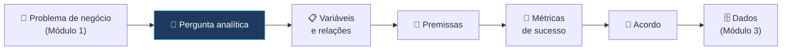
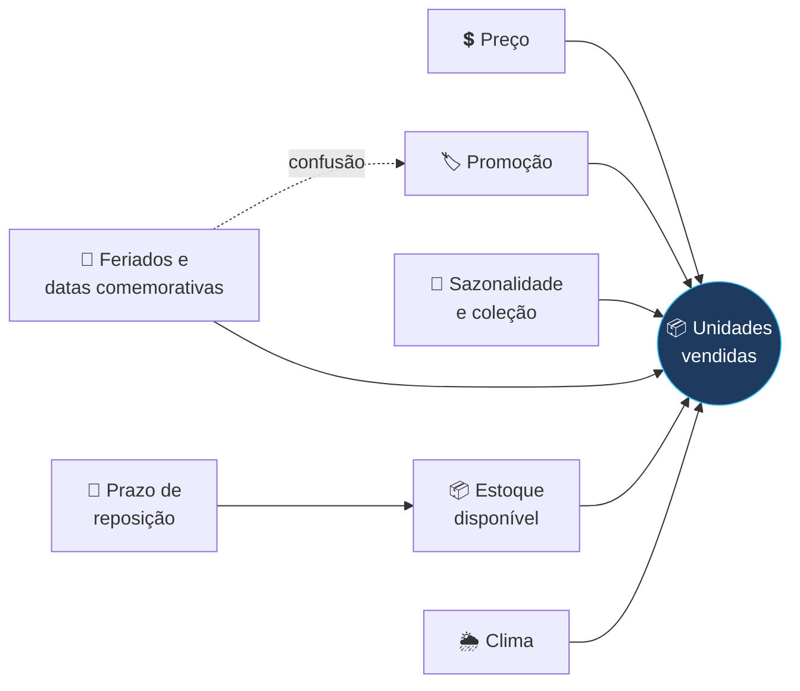

# 🧩 Analytics Problem Framing — CAP-Essentials

> **Exame:** CAP-Essentials (Certified Analytics Professional), INFORMS
> **Domínio:** II — Analytics Problem Framing (**16%** da prova)
> **No plano de estudos:** janeiro de 2027 · aula de quarta-feira
>
> **Ideia central:** **traduzir a pergunta de negócio em uma pergunta analítica**, que dados e métodos conseguem responder.
>
> 📎 **Pré-requisito:** Módulo 1 — Business Problem Framing.

---

## 📑 Índice
1. [Do problema de negócio ao problema analítico](#1-do-problema-de-negócio-ao-problema-analítico)
2. [Reformular o problema de negócio como problema analítico](#2-reformular-o-problema-de-negócio-como-problema-analítico)
3. [Levantar as variáveis e as relações entre elas](#3-levantar-as-variáveis-e-as-relações-entre-elas)
4. [Declarar as premissas](#4-declarar-as-premissas)
5. [Definir as métricas de sucesso](#5-definir-as-métricas-de-sucesso)
6. [Obter o acordo dos stakeholders](#6-obter-o-acordo-dos-stakeholders)
7. [Exemplo completo: Trama Store](#7-exemplo-completo-trama-store)
8. [Glossário inglês → português](#8-glossário-inglês--português)
9. [Resumo mental para a prova](#9-resumo-mental-para-a-prova)
10. [Possíveis pegadinhas da prova](#10-possíveis-pegadinhas-da-prova)
11. [Questões no estilo da prova (em inglês)](#11-questões-no-estilo-da-prova-em-inglês)
12. [Fontes](#12-fontes)

---

## 1. Do problema de negócio ao problema analítico

No Módulo 1, o resultado foi um **problema de negócio** acordado com os stakeholders. Ele fala a língua da empresa: vendas, clientes, custo, prazo.

Neste módulo, ele vira um **problema analítico**: uma pergunta escrita na língua dos **dados**, com uma **variável a explicar ou prever**, as **variáveis que a influenciam** e uma forma de **medir se a análise funcionou**.

| | Problema de negócio | Problema analítico |
| :--- | :--- | :--- |
| **Linguagem** | Negócio | Dados e métodos |
| **Pergunta** | "Como reduzir as rupturas de Calçados no Nordeste?" | "Qual será a demanda semanal de cada SKU de Calçados por loja do Nordeste, considerando sazonalidade, promoções e dia da semana?" |
| **Resultado esperado** | Recuperar R$ 1 milhão por trimestre | Previsão com erro médio abaixo de 15% |
| **Quem valida** | Sponsor e dono do processo | Sponsor, dono do processo **e** equipe analítica |

> 🎯 **Uma única pergunta de negócio pode virar várias perguntas analíticas.** Escolher a certa é a principal decisão deste domínio.

---

## 2. Reformular o problema de negócio como problema analítico

### 2.1 Os três tipos de pergunta analítica

| Tipo | Pergunta | Exemplo no varejo |
| :--- | :--- | :--- |
| **Descritiva** | O que aconteceu? Por quê? | "Quais lojas e SKUs tiveram mais ruptura nos últimos 6 meses?" |
| **Preditiva** | O que vai acontecer? | "Qual será a demanda de cada SKU por loja na próxima semana?" |
| **Prescritiva** | O que devemos fazer? | "Quanto repor de cada SKU em cada loja para minimizar ruptura e excesso de estoque?" |

Os três costumam se encadear: **entender** o passado (descritiva), **prever** o futuro (preditiva) e **decidir** a melhor ação (prescritiva).

### 2.2 Os componentes de uma boa pergunta analítica

| Componente | O que define | Exemplo |
| :--- | :--- | :--- |
| **Variável-alvo** (*target / dependent variable*) | O que queremos explicar ou prever | Unidades vendidas por SKU, loja e semana |
| **Unidade de análise** (*unit of analysis*) | O "grão": cada linha representa o quê? | Uma combinação de SKU × loja × semana |
| **Horizonte** (*time horizon*) | Para quando é a resposta? | Próximas 4 semanas |
| **População e escopo** | Sobre quem/o quê? | Calçados, 9 lojas do Nordeste |
| **Saída esperada** (*output*) | O que a análise entrega? | Uma previsão numérica por SKU e loja, atualizada toda segunda-feira |

### 2.3 Fórmula para escrever a pergunta

> **"[Verbo analítico] + [variável-alvo] + [unidade de análise] + [escopo] + [horizonte], considerando [principais variáveis]."**

Exemplo:
> *"**Prever** as **unidades vendidas** de cada **SKU por loja e semana**, para **Calçados nas lojas do Nordeste**, nas **próximas 4 semanas**, considerando sazonalidade, promoções e estoque disponível."*

### 2.4 Teste de qualidade

Uma pergunta analítica boa:

- [ ] **Responde** ao problema de negócio (se a análise funcionar, a decisão do Módulo 1 fica mais fácil).
- [ ] Tem **uma variável-alvo mensurável**.
- [ ] Pode ser respondida com **dados que existem** (ou que podem ser obtidos).
- [ ] Gera um resultado **acionável** (alguém sabe o que fazer com ele).

---

## 3. Levantar as variáveis e as relações entre elas

### 3.1 Tipos de variável

| Tipo | Significado | Exemplo |
| :--- | :--- | :--- |
| **Dependente / alvo** (*dependent*) | O que queremos explicar | Unidades vendidas |
| **Independente / explicativa** (*independent, predictor, feature*) | O que pode influenciar o alvo | Preço, promoção, dia da semana, clima |
| **Controlável** (*decision variable*) | A empresa **pode mudar** | Preço, quantidade reposta, data da promoção |
| **Não controlável** (*uncontrollable*) | A empresa **não pode mudar** | Clima, feriados, ações da concorrência |
| **De confusão** (*confounding*) | Influencia o alvo **e** uma variável explicativa ao mesmo tempo, criando uma relação falsa | Datas comemorativas: aumentam vendas **e** coincidem com promoções |

> 💡 A diferença entre **controlável** e **não controlável** é essencial para análises **prescritivas**: só se otimiza o que dá para mudar.

### 3.2 Como levantar as variáveis

- **Conversar com quem conhece o processo:** gerentes de loja e supply chain sabem o que move as vendas.
- **Revisar análises anteriores** e o histórico da empresa.
- **Ler sobre o setor:** sazonalidade de moda, coleções, Black Friday.
- **Desenhar um mapa de influências**, como o abaixo.

### 3.3 Mapa de influências (*influence diagram*)

### 3.4 Relações entre variáveis

| Relação | Significado | Exemplo |
| :--- | :--- | :--- |
| **Positiva** | Uma sobe, a outra sobe | Mais promoção → mais vendas |
| **Negativa** | Uma sobe, a outra desce | Preço maior → menos vendas |
| **Não linear** | O efeito muda de intensidade | Desconto de 10% muda pouco; de 50%, muito |
| **Interação** | O efeito de uma depende da outra | Promoção vende mais **no fim de semana** |
| **Defasagem** (*lag*) | O efeito aparece depois | Campanha de hoje aumenta vendas na semana seguinte |

> ⚠️ **Correlação não é causalidade.** Vendas de sandálias e de sorvete sobem juntas, mas uma não causa a outra: o calor causa as duas. O mapa de influências ajuda a pensar em **causas**, e não só em coincidências.

---

## 4. Declarar as premissas

**Premissas** (*assumptions*) são o que a análise **assume como verdade** sem provar. No Módulo 1 havia premissas de **negócio**; aqui elas são **analíticas**.

| Tipo de premissa | Exemplo |
| :--- | :--- |
| **Sobre os dados** | "As vendas registradas no PDV representam a demanda real." ⚠️ *Em ruptura, a venda é zero mesmo havendo procura: a demanda é **censurada**.* |
| **Sobre a estabilidade** | "O comportamento de compra de 2025 se repete em 2026." |
| **Sobre as relações** | "O efeito de uma promoção dura no máximo uma semana." |
| **Sobre o escopo** | "As lojas do Nordeste podem ser analisadas em conjunto." |
| **Sobre fatores externos** | "Não haverá mudança relevante na concorrência no período." |

### Boas práticas

1. **Escreva todas** as premissas, mesmo as "óbvias".
2. Para cada uma, registre o **risco** se ela estiver errada.
3. **Teste** as que puder, quando os dados chegarem (Módulo 3).
4. **Revise** se o contexto mudar.

| Premissa | Risco se estiver errada | Como verificar |
| :--- | :--- | :--- |
| Vendas = demanda | Previsão subestima a demanda das lojas com ruptura | Comparar vendas com dias de estoque zerado |
| 2025 se repete em 2026 | Previsão erra em mudanças de coleção | Comparar padrões dos dois anos |

---

## 5. Definir as métricas de sucesso

São **dois níveis** de métrica, e a prova cobra a diferença:

| Nível | Pergunta | Exemplos |
| :--- | :--- | :--- |
| **Métricas de negócio** (*business KPIs*) | A empresa ganhou o que queria? | Taxa de ruptura, vendas recuperadas (R$), estoque parado |
| **Métricas do modelo / analíticas** (*model metrics*) | A análise está correta? | Erro da previsão, acurácia da classificação |

> 🎯 **Um modelo pode ser tecnicamente excelente e não gerar resultado de negócio.** Por isso, os dois níveis são definidos **antes** de começar e ligados um ao outro.

### Métricas analíticas mais comuns

| Tipo de problema | Métricas | Em uma frase |
| :--- | :--- | :--- |
| **Previsão de número** (regressão) | MAE, RMSE, MAPE | Quanto a previsão erra, em média |
| **Classificação** (sim/não) | Acurácia, precisão, recall | Quantos acertos, e de que tipo |
| **Otimização** | Valor da função objetivo | Quanto custo/lucro a solução gera |

- **MAE** (*Mean Absolute Error*): erro médio, na unidade do alvo ("erra 3 pares por semana").
- **MAPE** (*Mean Absolute Percentage Error*): erro médio em % ("erra 12%").
- **Precisão**: dos que o modelo disse "sim", quantos eram mesmo? **Recall**: dos que eram "sim", quantos o modelo encontrou?

### Como definir uma boa métrica de sucesso

| Elemento | Exemplo |
| :--- | :--- |
| **Métrica** | MAPE da previsão semanal por SKU e loja |
| **Linha de base** | Método atual (média das últimas 4 semanas): MAPE de 28% |
| **Meta** | MAPE abaixo de 15% |
| **Ligação com o negócio** | Previsão melhor → reposição correta → ruptura de 12% para 6% |
| **Como e quando medir** | Em dados de teste e, depois, nas 8 primeiras semanas em produção |

> 💡 Sempre compare com uma **linha de base** simples (como "repetir a média das últimas semanas"). Se o modelo não superar o método atual, ele não agrega valor.

---

## 6. Obter o acordo dos stakeholders

Como no Módulo 1, o problema analítico precisa ser **formalizado e aprovado** antes de avançar.

### O que deve ser apresentado

- [ ] A **pergunta analítica** e como ela responde ao problema de negócio
- [ ] O **tipo de análise** (descritiva, preditiva, prescritiva)
- [ ] A **variável-alvo**, a **unidade de análise** e o **horizonte**
- [ ] As **principais variáveis** consideradas (e as que ficaram de fora)
- [ ] As **premissas** e seus riscos
- [ ] As **métricas de sucesso**: de negócio e do modelo, com linha de base e meta
- [ ] O **formato do resultado** (relatório, tabela atualizada, painel)

### Cuidados

- **Traduza para a linguagem do negócio:** "MAPE de 15%" vira "a previsão erra, em média, 15% para mais ou para menos".
- **Alinhe expectativas:** nenhum modelo acerta 100%; deixe claro o que é um resultado bom.
- Se os stakeholders **não concordam** com a pergunta ou com as métricas, **volte e refine**. Às vezes isso significa voltar ao **problema de negócio** (Módulo 1).

---

## 7. Exemplo completo: Trama Store

**Problema de negócio (vindo do Módulo 1):**
> *Reduzir a ruptura de Calçados nas lojas do Nordeste de 12% para 6% até novembro de 2026, ajustando a regra de reposição.*

**1. Pergunta analítica:**
> *Prever as unidades vendidas de cada SKU de Calçados por loja do Nordeste e por semana, nas próximas 4 semanas, para alimentar a regra de reposição.*

| Componente | Definição |
| :--- | :--- |
| Tipo | **Preditiva** (que depois alimenta uma decisão **prescritiva** de reposição) |
| Variável-alvo | Unidades vendidas |
| Unidade de análise | SKU × loja × semana |
| Horizonte | 4 semanas |
| Saída | Tabela de previsões atualizada toda segunda-feira |

**2. Variáveis consideradas:**

| Variável | Tipo |
| :--- | :--- |
| Preço e promoção | Controláveis |
| Semana do ano, feriados, coleção | Não controláveis (sazonalidade) |
| Estoque disponível | Controlável (indiretamente) |
| Clima | Não controlável (avaliar se há dados) |

**3. Premissas:**
- As vendas em dias **sem ruptura** representam a demanda real (os dias com estoque zerado serão tratados à parte).
- O comportamento de 2025 é uma boa referência para 2026, exceto nas trocas de coleção.

**4. Métricas de sucesso:**

| Nível | Métrica | Linha de base | Meta |
| :--- | :--- | :--- | :--- |
| Modelo | MAPE semanal por SKU e loja | 28% (média das 4 últimas semanas) | Abaixo de 15% |
| Negócio | Taxa de ruptura | 12% | 6% |
| Negócio | Vendas recuperadas | — | R$ 1 milhão por trimestre |

**5. Acordo:** aprovado pela diretora comercial (sponsor) e pelo gerente de supply chain (dono do processo), que confirmou que a previsão semanal se encaixa no calendário de reposição.

Repare na **premissa de demanda censurada**: se a loja não tinha o produto, a venda foi zero, mas a procura não. Ignorar isso faria o modelo **aprender que ninguém quer** os produtos que mais faltam, o oposto do objetivo.

---

## 8. Glossário inglês → português

| Inglês | Português |
| :--- | :--- |
| Analytics problem framing | Enquadramento do problema analítico |
| Analytics question | Pergunta analítica |
| Descriptive / predictive / prescriptive | Descritiva / preditiva / prescritiva |
| Dependent (target) variable | Variável dependente (alvo) |
| Independent variable / predictor / feature | Variável independente / explicativa |
| Decision variable | Variável de decisão (controlável) |
| Confounding variable | Variável de confusão |
| Unit of analysis | Unidade de análise (grão) |
| Time horizon | Horizonte de tempo |
| Influence diagram | Mapa / diagrama de influências |
| Correlation vs. causation | Correlação × causalidade |
| Lag | Defasagem |
| Assumption | Premissa |
| Censored demand | Demanda censurada |
| Success metric / KPI | Métrica de sucesso / indicador-chave |
| Baseline | Linha de base |
| Accuracy / precision / recall | Acurácia / precisão / revocação |
| Mean absolute error (MAE) | Erro absoluto médio |

---

## 9. Resumo mental para a prova

- O problema analítico **traduz** o problema de negócio para a linguagem dos dados, e **precisa continuar respondendo a ele**.
- Escolha o **tipo**: descritiva (o que aconteceu), preditiva (o que vai acontecer), prescritiva (o que fazer).
- Defina **variável-alvo**, **unidade de análise**, **escopo** e **horizonte**.
- Levante as **variáveis explicativas**, separe **controláveis** de **não controláveis** e cuidado com **confusão**: correlação não é causalidade.
- **Escreva as premissas**, com o risco de cada uma, e teste quando possível.
- Defina métricas em **dois níveis** (negócio e modelo), com **linha de base** e **meta**.
- Obtenha o **acordo** dos stakeholders, traduzindo as métricas para a linguagem do negócio.

---

## 10. Possíveis pegadinhas da prova

| ❌ Armadilha | ✅ O correto |
| :--- | :--- |
| "A pergunta analítica pode ser diferente do problema de negócio, desde que seja interessante." | Ela precisa **responder ao problema de negócio** acordado. |
| "Basta medir a acurácia do modelo para saber se o projeto deu certo." | É preciso medir também os **KPIs de negócio**. |
| "Se duas variáveis são correlacionadas, uma causa a outra." | Pode haver uma **variável de confusão**; correlação não é causalidade. |
| "Premissas óbvias não precisam ser escritas." | **Todas** as premissas devem ser documentadas, com seus riscos. |
| "As métricas de sucesso são definidas depois que o modelo fica pronto." | São definidas **antes**, com linha de base e meta. |
| "Um modelo com 95% de acurácia é sempre bom." | Depende da **linha de base** e do problema (ex.: se 95% dos casos são "não", acertar "não" sempre já dá 95%). |
| "Em análise prescritiva, otimizamos todas as variáveis." | Só as **controláveis** (variáveis de decisão). |
| "Vendas registradas sempre representam a demanda." | Em ruptura, a demanda é **censurada**: a venda zero não significa procura zero. |

> 💡 **Dica de leitura:** se a questão pergunta *"which metric best shows the project's success?"*, procure a alternativa que liga o resultado ao **objetivo de negócio**, e não só ao desempenho técnico.

---

## 11. Questões no estilo da prova (em inglês)

**1. The business problem is "reduce stock-outs in Northeast stores." Which analytics question BEST supports it?**
- a) "What is the average customer age in the Northeast?"
- b) "What will the weekly demand be for each SKU in each Northeast store over the next four weeks?"
- c) "Which marketing channel has the highest click-through rate?"
- d) "How many employees work in each store?"

**2. A retailer wants to know "how much of each product should be ordered to minimize total cost." This is an example of which type of analytics?**
- a) Descriptive
- b) Predictive
- c) Prescriptive
- d) Diagnostic only

**3. Ice cream sales and sandal sales are highly correlated. What is the MOST likely explanation?**
- a) Ice cream sales cause sandal sales
- b) Sandal sales cause ice cream sales
- c) A confounding variable, such as hot weather, influences both
- d) The data must be wrong

**4. In a demand forecasting project, which of the following is a decision (controllable) variable for the retailer?**
- a) Weather
- b) Public holidays
- c) Product price
- d) Competitor promotions

**5. Sales are recorded as zero on days when a product was out of stock. Assuming that recorded sales equal true demand would MOST likely cause:**
- a) Overestimation of demand for frequently out-of-stock products
- b) Underestimation of demand for frequently out-of-stock products
- c) No effect on the forecast
- d) Better model accuracy

**6. Which pair BEST represents a business KPI and a model metric, respectively?**
- a) Mean absolute error and stock-out rate
- b) Stock-out rate and mean absolute percentage error
- c) Recall and precision
- d) Revenue and profit

**7. A new model reaches 20% forecast error. What information is MOST needed to judge whether this is a good result?**
- a) The programming language used
- b) The error of the current method (baseline)
- c) The number of variables in the model
- d) The size of the analytics team

**8. The analyst proposes an analytics question, but the process owner says the weekly forecast does not fit the daily replenishment calendar. What should the analyst do?**
- a) Proceed with the weekly forecast, since it is technically easier
- b) Refine the analytics problem with the stakeholders until there is agreement
- c) Start collecting data and decide later
- d) Replace the process owner as stakeholder

<b>📝 Gabarito (clique para abrir)</b>

| Questão | Resposta | Por quê |
| :--- | :--- | :--- |
| 1 | b | A previsão de demanda por SKU e loja apoia diretamente a decisão de reposição. |
| 2 | c | Decidir a melhor ação (quanto pedir) é análise prescritiva. |
| 3 | c | O calor influencia as duas vendas: variável de confusão. |
| 4 | c | O preço é definido pela empresa; clima, feriados e concorrência não. |
| 5 | b | Em ruptura, a demanda é censurada: tratar venda zero como procura zero subestima a demanda. |
| 6 | b | Taxa de ruptura é KPI de negócio; MAPE é métrica do modelo. |
| 7 | b | Sem a linha de base, não dá para saber se o modelo melhora o método atual. |
| 8 | b | Sem acordo dos stakeholders, o problema analítico precisa ser refinado. |

---

## 12. Fontes

- [CAP-Essentials Exam Blueprint — INFORMS](https://certifiedanalytics.org/cap-essentials-blueprint): domínios e pesos oficiais
- [CAP-Essentials — INFORMS](https://www.certifiedanalytics.org/cap-essentials)
- Roteiro de estudos do CAP-Essentials e Módulo 1 — Business Problem Framing (neste repositório)

*Os tópicos detalhados seguem o framework de analytics da INFORMS. Confira a lista completa de tarefas no blueprint oficial.*
