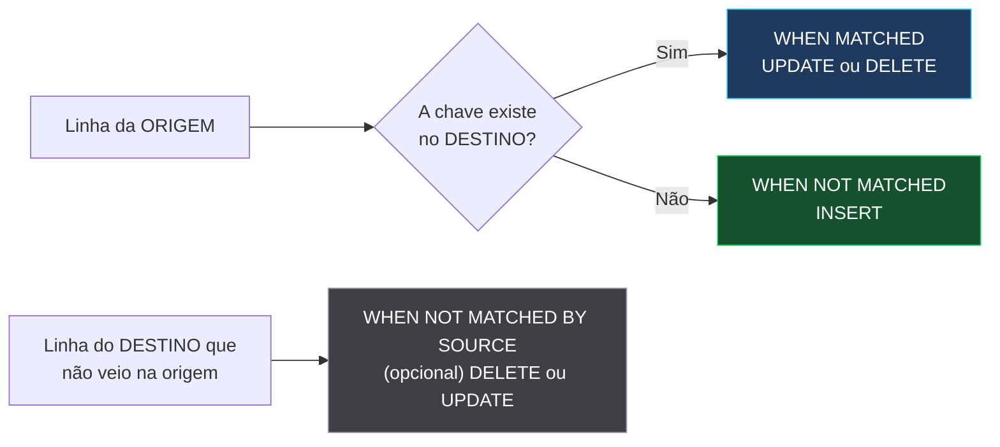
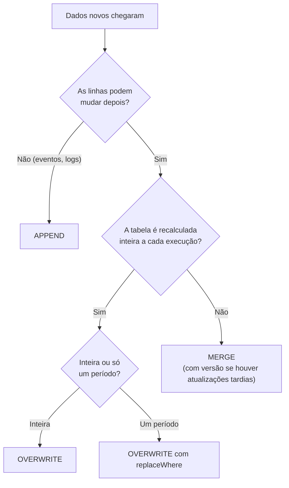

# 🔀 MERGE e Sobrescrita no Delta Lake — Data Engineer Associate

> **Exame:** Databricks Certified Data Engineer Associate
> **Complemento do:** Módulo 1 — Databricks Intelligence Platform (seção 3, *Delta Lake no nível Associate*)
> **Também cobrado em:** Domínio 3 — Data Transformation and Modeling (camadas Silver e Gold)
>
> **Objetivo desta nota:** entender **o conceito de MERGE**, as **três formas de gravar** numa tabela (append, overwrite e merge) e **o que acontece com os arquivos** quando o Delta Lake "sobrescreve" dados.

---

## 📑 Índice
1. [As três formas de gravar numa tabela](#1-as-três-formas-de-gravar-numa-tabela)
2. [O conceito de MERGE](#2-o-conceito-de-merge)
3. [Exemplo passo a passo](#3-exemplo-passo-a-passo)
4. [Por baixo dos panos: como o Delta "sobrescreve" arquivos](#4-por-baixo-dos-panos-como-o-delta-sobrescreve-arquivos)
5. [Na prática: os comandos](#5-na-prática-os-comandos)
6. [Idempotência: por que o MERGE é seguro para reexecutar](#6-idempotência-por-que-o-merge-é-seguro-para-reexecutar)
7. [Quando usar cada forma de gravar](#7-quando-usar-cada-forma-de-gravar)
8. [Os erros mais comuns](#8-os-erros-mais-comuns)
9. [Resumo mental para a prova](#9-resumo-mental-para-a-prova)
10. [Possíveis pegadinhas da prova](#10-possíveis-pegadinhas-da-prova)
11. [Questões no estilo da prova](#11-questões-no-estilo-da-prova)
12. [Fontes](#12-fontes)

---

## 1. As três formas de gravar numa tabela

Pense na tabela como um **caderno de cadastro de clientes**:

| Forma | Analogia do caderno | O que acontece com a tabela |
| :--- | :--- | :--- |
| **APPEND** | Escrever as linhas novas **no fim** | Só acrescenta. Se a mesma cliente vier de novo, ela fica **duplicada** |
| **OVERWRITE** | **Arrancar todas as folhas** e reescrever do zero | Apaga tudo e grava só o que veio agora. O que não veio **some** |
| **MERGE** | Pegar a caneta, **corrigir só as linhas que mudaram** e acrescentar quem é novo | Atualiza o que existe e insere o que é novo: o **upsert** (*update + insert*) |

---

## 2. O conceito de MERGE

O MERGE compara duas tabelas:

- **Destino** (*target*): a tabela que você quer manter atualizada (ex.: `silver.clientes`).
- **Origem** (*source*): os dados que acabaram de chegar.

Para **cada linha**, ele usa uma **chave** (a condição `ON`) e decide o que fazer:



| Cláusula | Quando dispara | Ações possíveis |
| :--- | :--- | :--- |
| `WHEN MATCHED` | A chave existe na origem **e** no destino | `UPDATE` ou `DELETE` |
| `WHEN NOT MATCHED` | A chave existe só na **origem** | `INSERT` |
| `WHEN NOT MATCHED BY SOURCE` | A chave existe só no **destino** | `UPDATE` ou `DELETE` |

Cada cláusula pode ter uma **condição extra** (`WHEN MATCHED AND ...`) e pode aparecer mais de uma vez.

---

## 3. Exemplo passo a passo

**Destino antes** (`silver.clientes`):

| id_cliente | nome | email |
| :--- | :--- | :--- |
| 1 | Ana | ana@email.com |
| 2 | Bruno | bruno@antigo.com |
| 3 | Carla | carla@email.com |

**Origem** (dados que chegaram hoje):

| id_cliente | nome | email |
| :--- | :--- | :--- |
| 2 | Bruno | **bruno@novo.com** |
| 4 | **Diego** | diego@email.com |

```sql
MERGE INTO silver.clientes AS destino
USING novos_clientes AS origem
ON destino.id_cliente = origem.id_cliente
WHEN MATCHED THEN UPDATE SET *
WHEN NOT MATCHED THEN INSERT *;
```

**Destino depois:**

| id_cliente | nome | email | O que aconteceu |
| :--- | :--- | :--- | :--- |
| 1 | Ana | ana@email.com | Não veio na origem: **intacta** |
| 2 | Bruno | **bruno@novo.com** | Veio e existia: **atualizada** (MATCHED) |
| 3 | Carla | carla@email.com | Não veio na origem: **intacta** |
| 4 | Diego | diego@email.com | Veio e não existia: **inserida** (NOT MATCHED) |

### Comparando com as outras formas de gravar

| Forma | Resultado com a mesma origem |
| :--- | :--- |
| **APPEND** | 5 linhas: o Bruno aparece **duas vezes** (e-mail antigo e novo) |
| **OVERWRITE** | 2 linhas: só Bruno e Diego. **Ana e Carla foram perdidas** |
| **MERGE** | 4 linhas: Bruno atualizado, Diego inserido, Ana e Carla intactas ✅ |

---

## 4. Por baixo dos panos: como o Delta "sobrescreve" arquivos

> 🎯 **Ponto central:** o Delta Lake **nunca edita um arquivo existente**. Os arquivos Parquet são **imutáveis**: não dá para alterar uma linha lá dentro.

Então como uma linha é "sobrescrita"? Existem duas formas.

### 4.1 Copy-on-write (copiar e regravar)

```
VERSÃO 0
  part-A.parquet        → clientes 1, 2, 3
  _delta_log/000.json   → "a tabela é formada por: part-A"

        ⬇️  MERGE (Bruno mudou, Diego é novo)

VERSÃO 1
  part-A.parquet        → continua no disco, intacto!
  part-B.parquet        → clientes 1, 2 (e-mail novo), 3   ← cópia do A com a correção
  part-C.parquet        → cliente 4 (Diego)
  _delta_log/001.json   → "remove part-A; adiciona part-B e part-C"
```

O passo a passo:

1. O Delta descobre **quais arquivos** têm linhas afetadas (aqui, o `part-A`).
2. **Copia** esses arquivos para arquivos novos, já com as alterações (`part-B`).
3. Grava as linhas inseridas em outro arquivo (`part-C`).
4. Registra no **`_delta_log`** que a versão nova usa B e C, e não mais A.

**O `part-A` continua no disco.** Por isso funcionam:

| Recurso | Por quê |
| :--- | :--- |
| **Time travel** | `SELECT * FROM silver.clientes VERSION AS OF 0` lê o `part-A` e mostra o e-mail antigo |
| **Atomicidade** | Se o MERGE falhar no meio, o log não registra a versão 1, e todos continuam lendo a versão 0 inteira |
| **Isolamento** | Quem estava lendo durante o MERGE continua vendo a versão 0 até terminar |

O `part-A` só é apagado de verdade pelo **`VACUUM`**, depois do período de retenção (**7 dias** por padrão).

### 4.2 Deletion vectors (marcar sem regravar)

Se o `part-A` tivesse **1 milhão de linhas** e só **uma** mudasse, regravar o arquivo inteiro seria caro. Com **deletion vectors**, o Delta:

1. **Não regrava** o `part-A`.
2. Cria um pequeno arquivo que marca: *"a linha do Bruno no part-A está apagada"*.
3. Grava o Bruno corrigido num arquivo novo.

```
VERSÃO 1 (com deletion vectors)
  part-A.parquet        → clientes 1, 2, 3 (sem alteração física)
  deletion_vector_x.bin → "no part-A, ignorar a linha do cliente 2"
  part-C.parquet        → cliente 2 (e-mail novo) e cliente 4
```

Quem lê a tabela **pula a linha marcada**. Depois, o **`OPTIMIZE`** faz a limpeza física, regravando os arquivos sem as linhas marcadas.

Para saber se uma tabela usa deletion vectors:

```sql
SHOW TBLPROPERTIES silver.clientes ('delta.enableDeletionVectors');
```

| | Copy-on-write | Deletion vectors |
| :--- | :--- | :--- |
| **Escrita (MERGE, UPDATE, DELETE)** | Mais lenta: regrava arquivos inteiros | Mais rápida: só marca linhas |
| **Leitura** | Direta | Precisa ignorar as linhas marcadas |
| **Limpeza** | `VACUUM` apaga os arquivos antigos | `OPTIMIZE` regrava; depois `VACUUM` apaga |

> 🎯 **Resumo do "sobrescrever":** o Delta **escreve arquivos novos**, **marca** os antigos (ou linhas deles) como substituídos **no log**, e só apaga de verdade no `VACUUM` ou no `OPTIMIZE`.

---

## 5. Na prática: os comandos

### 5.1 APPEND

```python
df_eventos.write.mode("append").saveAsTable("bronze.eventos")
```

### 5.2 OVERWRITE total

Substitui todo o conteúdo da tabela.

```python
df_kpis.write.mode("overwrite").saveAsTable("gold.faturamento_mensal")
```

```sql
-- Equivalente em SQL
CREATE OR REPLACE TABLE gold.faturamento_mensal AS
SELECT date_trunc('month', data_venda) AS mes, SUM(valor) AS faturamento
FROM silver.vendas
GROUP BY ALL;

-- Ou, mantendo a definição da tabela
INSERT OVERWRITE gold.faturamento_mensal
SELECT date_trunc('month', data_venda), SUM(valor)
FROM silver.vendas
GROUP BY ALL;
```

> ⚠️ Mesmo no overwrite, os arquivos antigos **continuam no disco** até o `VACUUM`. Dá para voltar com time travel.

### 5.3 OVERWRITE parcial (`replaceWhere`)

Substitui **só um pedaço** da tabela. Ex.: reprocessar apenas outubro.

```python
(df_outubro.write
    .mode("overwrite")
    .option("replaceWhere", "data_venda >= '2026-10-01' AND data_venda < '2026-11-01'")
    .saveAsTable("silver.vendas"))
```

Setembro e novembro continuam intactos.

```sql
-- Equivalente em SQL
INSERT INTO TABLE silver.vendas
REPLACE WHERE data_venda >= '2026-10-01' AND data_venda < '2026-11-01'
SELECT * FROM vendas_outubro_reprocessadas;
```

### 5.4 MERGE simples (upsert)

```sql
MERGE INTO silver.clientes AS t
USING novos_clientes AS s
ON t.id_cliente = s.id_cliente
WHEN MATCHED THEN UPDATE SET *
WHEN NOT MATCHED THEN INSERT *;
```

### 5.5 MERGE com versão (só atualiza se for mais recente)

Padrão usado no projeto Trama Store. Um pedido **aprovado** vira **cancelado** quando o evento de cancelamento chega horas depois. E se chegar um evento **antigo atrasado**, ele **não** sobrescreve o mais novo.

```sql
MERGE INTO silver.vendas_itens AS t
USING lote AS s
ON t.id_venda = s.id_venda AND t.id_item = s.id_item
WHEN MATCHED AND s.atualizado_em > t.atualizado_em THEN UPDATE SET *
WHEN NOT MATCHED THEN INSERT *;
```

### 5.6 MERGE atualizando só algumas colunas

```sql
MERGE INTO silver.clientes AS t
USING novos_clientes AS s
ON t.id_cliente = s.id_cliente
WHEN MATCHED THEN UPDATE SET
  t.email = s.email,
  t.atualizado_em = s.atualizado_em
WHEN NOT MATCHED THEN INSERT (id_cliente, nome, email, atualizado_em)
  VALUES (s.id_cliente, s.nome, s.email, s.atualizado_em);
```

### 5.7 MERGE com exclusão

Quando a origem é a **foto completa** (ex.: o catálogo inteiro de produtos), o que sumiu da origem deve sumir do destino:

```sql
MERGE INTO silver.produtos AS t
USING bronze_produtos_completo AS s
ON t.sku = s.sku
WHEN MATCHED THEN UPDATE SET *
WHEN NOT MATCHED THEN INSERT *
WHEN NOT MATCHED BY SOURCE THEN DELETE;   -- produto saiu do catálogo
```

Ou apagar quando a origem indica exclusão:

```sql
MERGE INTO silver.clientes AS t
USING eventos_crm AS s
ON t.id_cliente = s.id_cliente
WHEN MATCHED AND s.operacao = 'EXCLUIDO' THEN DELETE
WHEN MATCHED THEN UPDATE SET *
WHEN NOT MATCHED AND s.operacao != 'EXCLUIDO' THEN INSERT *;
```

### 5.8 MERGE com evolução de schema

Se a origem trouxer uma **coluna nova**, o MERGE comum ignora ou falha. Para aceitar:

```sql
MERGE WITH SCHEMA EVOLUTION INTO silver.clientes AS t
USING novos_clientes AS s
ON t.id_cliente = s.id_cliente
WHEN MATCHED THEN UPDATE SET *
WHEN NOT MATCHED THEN INSERT *;
```

### 5.9 MERGE em PySpark

```python
from delta.tables import DeltaTable

destino = DeltaTable.forName(spark, "silver.clientes")

(destino.alias("t")
    .merge(df_novos.alias("s"), "t.id_cliente = s.id_cliente")
    .whenMatchedUpdateAll(condition="s.atualizado_em > t.atualizado_em")
    .whenNotMatchedInsertAll()
    .execute())
```

### 5.10 MERGE incremental com streaming (`foreachBatch`)

Para aplicar MERGE em cada lote novo da Bronze, como no Trama Store:

```python
def upsert_lote(lote_df, lote_id):
    lote_df.createOrReplaceTempView("lote")
    lote_df.sparkSession.sql("""
        MERGE INTO silver.clientes AS t
        USING lote AS s
        ON t.id_cliente = s.id_cliente
        WHEN MATCHED AND s.atualizado_em > t.atualizado_em THEN UPDATE SET *
        WHEN NOT MATCHED THEN INSERT *
    """)

(spark.readStream.table("bronze.clientes")
    .writeStream
    .foreachBatch(upsert_lote)
    .option("checkpointLocation", "/Volumes/catalogo/bronze/checkpoints/silver_clientes")
    .trigger(availableNow=True)
    .start())
```

### 5.11 Conferir o que cada operação fez

```sql
DESCRIBE HISTORY silver.clientes;
```

A coluna `operationMetrics` do MERGE traz, entre outros:

| Métrica | Significado |
| :--- | :--- |
| `numTargetRowsUpdated` | Linhas atualizadas |
| `numTargetRowsInserted` | Linhas inseridas |
| `numTargetRowsDeleted` | Linhas apagadas |
| `numTargetFilesAdded` / `numTargetFilesRemoved` | Arquivos criados / substituídos |

E se algo deu errado:

```sql
RESTORE TABLE silver.clientes TO VERSION AS OF 5;
```

---

## 6. Idempotência: por que o MERGE é seguro para reexecutar

**Idempotência** = rodar duas vezes dá o mesmo resultado que rodar uma. É essencial porque jobs falham e são reexecutados (retries).

| Se o job rodar duas vezes com os mesmos dados... | Resultado |
| :--- | :--- |
| **APPEND** | ❌ Tudo **duplicado** |
| **OVERWRITE** | ✅ Mesmo resultado |
| **OVERWRITE com `replaceWhere`** | ✅ Mesmo resultado |
| **MERGE** | ✅ Mesmo resultado: na 2ª vez, tudo é MATCHED e nada muda |

> 💡 APPEND é seguro quando combinado com um mecanismo que evita reler os mesmos dados, como o **checkpoint do Auto Loader** ou o histórico de arquivos do **COPY INTO**.

---

## 7. Quando usar cada forma de gravar

| Situação | Use | Por quê |
| :--- | :--- | :--- |
| Logs e eventos que nunca mudam | **APPEND** (com Auto Loader) | Cada linha é um fato novo |
| Camada Bronze | **APPEND** | Guarda o histórico bruto, sem alterar nada |
| Tabela recalculada inteira (KPIs, Gold) | **OVERWRITE** | Simples e sempre coerente com a origem |
| Reprocessar só um período | **OVERWRITE com `replaceWhere`** | Não toca no resto da tabela |
| Cadastros que mudam (clientes, produtos) | **MERGE** | Atualiza sem duplicar e sem perder o que não veio |
| Pedidos que mudam de status | **MERGE com versão** | Evita que um evento antigo sobrescreva o novo |
| Origem é a foto completa e itens podem sumir | **MERGE com `NOT MATCHED BY SOURCE`** | Remove do destino o que saiu da origem |



---

## 8. Os erros mais comuns

### 8.1 Chave duplicada na origem

Se a origem tem **duas linhas do mesmo cliente**, o MERGE não sabe qual usar e **falha** com um erro do tipo `DELTA_MULTIPLE_SOURCE_ROW_MATCHING_TARGET_ROW_IN_MERGE`.

**Solução:** deduplicar a origem antes, mantendo a versão mais recente.

```python
from pyspark.sql import Window, functions as F

janela = Window.partitionBy("id_cliente").orderBy(F.col("atualizado_em").desc())

origem_limpa = (df_novos
    .withColumn("ordem", F.row_number().over(janela))
    .filter("ordem = 1")
    .drop("ordem"))
```

### 8.2 Usar OVERWRITE achando que é MERGE

Gravar só os clientes novos com `mode("overwrite")` **apaga todos os antigos**.

**Solução imediata:** `RESTORE TABLE ... TO VERSION AS OF <versão anterior>` (enquanto o `VACUUM` não tiver apagado os arquivos).

### 8.3 Chave incompleta no `ON`

Numa tabela de itens, a chave é `id_venda` **e** `id_item`. Usar só `id_venda` faz cada item da origem casar com **todos** os itens da venda no destino.

### 8.4 Apagar arquivos à mão para "limpar" a tabela

Apagar arquivos Parquet pelo storage quebra a tabela: o `_delta_log` ainda aponta para eles. Use `DELETE` para remover dados e `VACUUM` para remover arquivos antigos.

---

## 9. Resumo mental para a prova

- **APPEND** acrescenta; **OVERWRITE** substitui tudo (ou um pedaço, com `replaceWhere`); **MERGE** atualiza o que existe e insere o que é novo.
- **MERGE** = `ON` (chave) + `WHEN MATCHED` + `WHEN NOT MATCHED` + (opcional) `WHEN NOT MATCHED BY SOURCE`.
- **Parquet é imutável:** "sobrescrever" = escrever arquivos novos e registrar no log que os antigos saíram da versão.
- Os arquivos antigos ficam no disco → **time travel** e **RESTORE** funcionam até o **`VACUUM`**.
- **Deletion vectors** marcam linhas como apagadas sem regravar o arquivo; o **`OPTIMIZE`** faz a limpeza física.
- **MERGE e OVERWRITE são idempotentes**; APPEND não (a menos que o Auto Loader/COPY INTO controle o que já foi lido).
- **Origem com chave duplicada faz o MERGE falhar**: deduplique antes.
- `DESCRIBE HISTORY` mostra o que cada MERGE fez (`operationMetrics`).

---

## 10. Possíveis pegadinhas da prova

| ❌ Afirmação falsa (armadilha) | ✅ O correto |
| :--- | :--- |
| "O MERGE edita as linhas dentro do arquivo Parquet." | Parquet é imutável: o MERGE **escreve arquivos novos** (ou deletion vectors) e atualiza o log. |
| "Depois de um OVERWRITE, os dados antigos são perdidos na hora." | Continuam no disco até o `VACUUM`; dá para voltar com time travel ou `RESTORE`. |
| "O MERGE apaga do destino o que não veio na origem." | Só se você usar `WHEN NOT MATCHED BY SOURCE THEN DELETE`. |
| "Origem com chaves duplicadas é resolvida automaticamente pelo MERGE." | O MERGE **falha**; é preciso deduplicar a origem antes. |
| "APPEND é idempotente." | Reexecutar duplica os dados, a menos que um checkpoint controle o que já foi lido. |
| "`replaceWhere` apaga a tabela inteira." | Substitui **só** as linhas que atendem à condição. |
| "Deletion vectors apagam os dados fisicamente." | Só **marcam** as linhas; a remoção física vem com `OPTIMIZE` e `VACUUM`. |
| "`UPDATE SET *` adiciona colunas novas automaticamente." | Para aceitar colunas novas, use `MERGE WITH SCHEMA EVOLUTION`. |

> 💡 **Dica de leitura:** se a questão diz "os dados podem chegar de novo" ou "o job pode ser reexecutado", a resposta envolve **idempotência** (MERGE ou OVERWRITE). Se diz "atualizações tardias" ou "evento mais antigo chegou depois", a resposta é **MERGE com condição de versão**.

---

## 11. Questões no estilo da prova

**1. Uma tabela `silver.clientes` recebe diariamente clientes novos e alterados do CRM. Qual operação mantém a tabela atualizada sem duplicar nem perder clientes que não vieram no dia?**
- a) `INSERT INTO` (append)
- b) `INSERT OVERWRITE`
- c) `MERGE INTO` com `WHEN MATCHED THEN UPDATE` e `WHEN NOT MATCHED THEN INSERT`
- d) `CREATE OR REPLACE TABLE`

**2. Um MERGE atualizou uma linha de um arquivo Parquet com 500 mil linhas, numa tabela sem deletion vectors. O que acontece com esse arquivo?**
- a) A linha é alterada dentro do próprio arquivo
- b) O arquivo é copiado para um novo com a alteração; o antigo continua no disco e é marcado como removido no log
- c) O arquivo é apagado imediatamente
- d) O Delta cria uma nova tabela

**3. Por que é possível consultar a versão anterior de uma tabela depois de um MERGE?**
- a) O MERGE faz backup automático em outra tabela
- b) Os arquivos substituídos continuam no storage até o `VACUUM`, e o log guarda as versões
- c) O Unity Catalog guarda uma cópia de todas as tabelas
- d) Não é possível consultar versões anteriores após um MERGE

**4. Um MERGE falha com erro informando que várias linhas da origem casam com a mesma linha do destino. Qual é a correção?**
- a) Trocar o MERGE por APPEND
- b) Deduplicar a origem pela chave antes do MERGE, mantendo a versão mais recente
- c) Rodar `VACUUM` no destino
- d) Remover a cláusula `WHEN NOT MATCHED`

**5. Eventos de pedidos podem chegar fora de ordem. Um evento "aprovado" de 10h chega depois do evento "cancelado" de 14h. Como evitar que o status volte para "aprovado"?**
- a) `WHEN MATCHED AND s.atualizado_em > t.atualizado_em THEN UPDATE SET *`
- b) Usar `INSERT OVERWRITE`
- c) Usar `WHEN NOT MATCHED BY SOURCE THEN DELETE`
- d) Ordenar a origem por data antes do APPEND

**6. Uma equipe precisa reprocessar apenas as vendas de outubro de `silver.vendas`, sem tocar nos outros meses. Qual opção é a mais adequada?**
- a) `df.write.mode("overwrite").saveAsTable("silver.vendas")`
- b) `df.write.mode("overwrite").option("replaceWhere", "data_venda >= '2026-10-01' AND data_venda < '2026-11-01'").saveAsTable("silver.vendas")`
- c) `df.write.mode("append").saveAsTable("silver.vendas")`
- d) `DROP TABLE silver.vendas`

**7. O catálogo de produtos chega todo dia completo. Produtos descontinuados simplesmente deixam de aparecer. Como removê-los do destino no MERGE?**
- a) `WHEN MATCHED THEN DELETE`
- b) `WHEN NOT MATCHED THEN DELETE`
- c) `WHEN NOT MATCHED BY SOURCE THEN DELETE`
- d) Não é possível remover linhas com MERGE

**8. Um job de ingestão grava com `mode("append")` sem nenhum controle de arquivos já lidos. Ele falhou e foi reexecutado. O que provavelmente aconteceu?**
- a) Nada: append é idempotente
- b) Parte dos dados foi gravada duas vezes (duplicatas)
- c) A tabela foi apagada
- d) O Delta descartou automaticamente as linhas repetidas

**9. Numa tabela com deletion vectors habilitados, um `DELETE` remove 10 linhas de um arquivo grande. O que acontece?**
- a) O arquivo é regravado imediatamente sem as 10 linhas
- b) As 10 linhas são marcadas como apagadas em um deletion vector; a limpeza física vem depois, com `OPTIMIZE`
- c) O `VACUUM` roda automaticamente
- d) As linhas continuam aparecendo nas consultas

**10. A origem de um MERGE tem uma coluna nova, `telefone`, que não existe no destino. Como permitir que ela seja adicionada?**
- a) `MERGE WITH SCHEMA EVOLUTION INTO ...`
- b) Rodar `OPTIMIZE` antes
- c) Trocar `UPDATE SET *` por `INSERT *`
- d) Não é possível; é preciso recriar a tabela

<details>
<summary><b>📝 Gabarito (clique para abrir)</b></summary>

| Questão | Resposta | Por quê |
| :--- | :--- | :--- |
| 1 | c | MERGE atualiza os existentes, insere os novos e mantém os que não vieram. |
| 2 | b | Parquet é imutável: copy-on-write regrava o arquivo; o antigo fica para o time travel até o `VACUUM`. |
| 3 | b | O log guarda as versões e os arquivos antigos continuam no storage. |
| 4 | b | Chaves duplicadas na origem fazem o MERGE falhar; deduplique antes. |
| 5 | a | A condição de versão impede que um evento mais antigo sobrescreva o mais novo. |
| 6 | b | `replaceWhere` substitui só as linhas que atendem à condição. |
| 7 | c | `NOT MATCHED BY SOURCE` pega as linhas que existem só no destino. |
| 8 | b | Append sem controle não é idempotente: a reexecução duplica dados. |
| 9 | b | Deletion vectors marcam as linhas; o `OPTIMIZE` faz a limpeza física. |
| 10 | a | `MERGE WITH SCHEMA EVOLUTION` permite adicionar colunas novas. |

</details>

---

## 12. Fontes

- [Upsert into a Delta Lake table using merge — Azure Databricks](https://learn.microsoft.com/en-ca/azure/databricks/delta/merge)
- [MERGE INTO (referência SQL) — Azure Databricks](https://learn.microsoft.com/en-gb/azure/databricks/sql/language-manual/delta-merge-into)
- [Selectively overwrite data with Delta Lake (replaceWhere) — Databricks](https://docs.databricks.com/aws/delta/selective-overwrite)
- [Erro DELTA_MULTIPLE_SOURCE_ROW_MATCHING_TARGET_ROW_IN_MERGE — Databricks Community](https://community.databricks.com/t5/data-engineering/strange-delta-multiple-source-row-matching-target-row-in-merge/m-p/143017)

*Consultado em novembro de 2026.*
