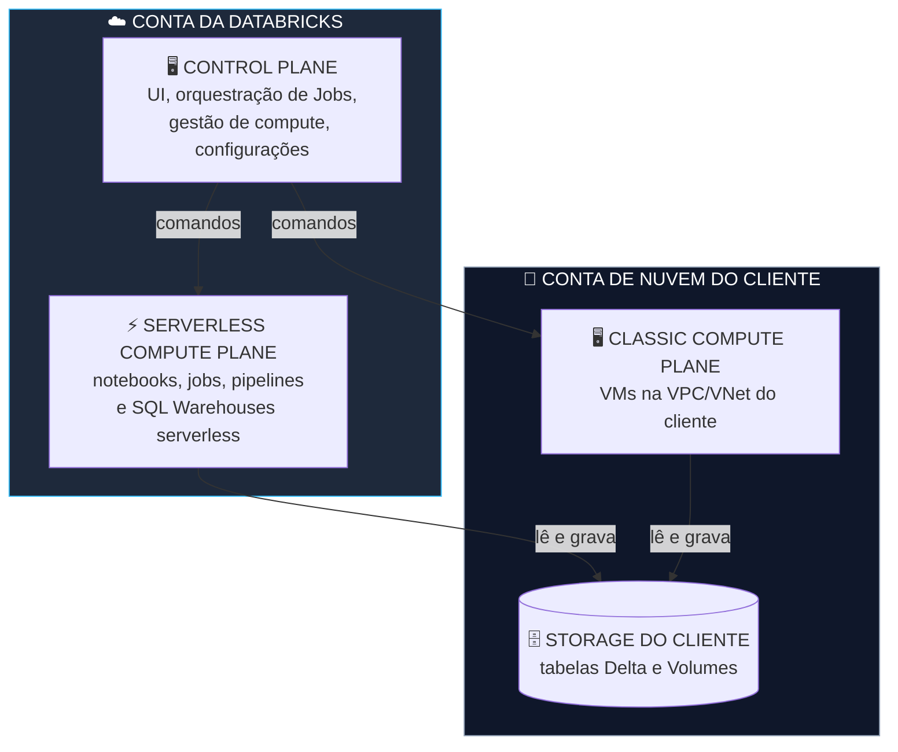
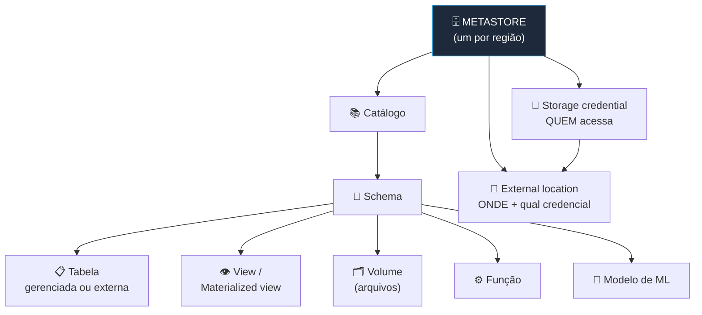
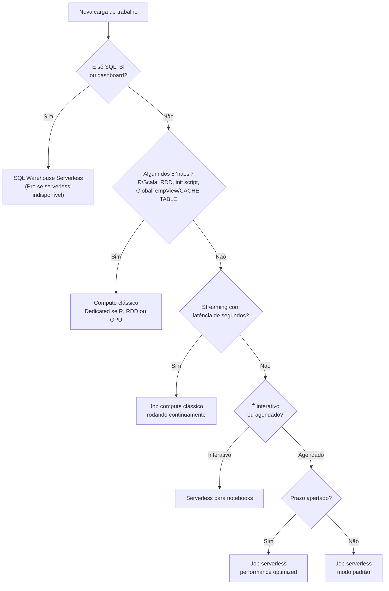

# 🏗️ Databricks Intelligence Platform — Data Engineer Associate

> **Exame:** Databricks Certified Data Engineer Associate
> **Domínio:** 1 — Databricks Intelligence Platform (~10% da prova)
> **Objetivos oficiais:**
> - Componentes centrais: arquitetura (Control Plane, Classic e Serverless Compute Plane), Delta Lake e Unity Catalog.
> - Serviços de compute: all-purpose, job compute, serverless e SQL Warehouses — seus limites, modelos de custo e como escolher o compute ideal para cada carga de trabalho.
>
> 📎 **Pré-requisito:** Fundamentals Módulos 1 (Arquitetura e Clusters), 4 (Delta Lake) e 5 (Unity Catalog).

---

## 📑 Índice
1. [O que muda da Fundamentals para a Associate](#1-o-que-muda-da-fundamentals-para-a-associate)
2. [Arquitetura: os três planos](#2-arquitetura-os-três-planos)
3. [Delta Lake no nível Associate](#3-delta-lake-no-nível-associate)
4. [Unity Catalog: o mapa completo](#4-unity-catalog-o-mapa-completo)
5. [Os quatro tipos de compute](#5-os-quatro-tipos-de-compute)
6. [Os limites do serverless](#6-os-limites-do-serverless)
7. [Configurações do compute clássico](#7-configurações-do-compute-clássico)
8. [Modelos de custo](#8-modelos-de-custo)
9. [Como escolher o compute: roteiro de decisão](#9-como-escolher-o-compute-roteiro-de-decisão)
10. [Estudos de caso comentados](#10-estudos-de-caso-comentados)
11. [Resumo mental para a prova](#11-resumo-mental-para-a-prova)
12. [Possíveis pegadinhas da prova](#12-possíveis-pegadinhas-da-prova)
13. [Questões no estilo da prova](#13-questões-no-estilo-da-prova)
14. [Fontes](#14-fontes)

---

## 1. O que muda da Fundamentals para a Associate

Na **Fundamentals**, a prova perguntava *"o que é cada coisa?"*. Na **Associate**, a pergunta vira:

> 🎯 **"Dada esta situação, qual é a escolha certa — e por quê?"**

As questões descrevem um cenário com **um detalhe decisivo** escondido no enunciado: uma linguagem, uma linha de código, um requisito de latência ou de custo. Saber o conceito não basta; é preciso **ligar o detalhe à consequência**.

| Fundamentals | Associate |
| :--- | :--- |
| "O que é serverless?" | "Este notebook usa `rdd.map()`. Ele roda em serverless?" |
| "O que é auto-termination?" | "O cluster fica ocioso à noite. O que reduz o custo sem atrapalhar o time?" |
| "O que é o Unity Catalog?" | "O que precisa existir antes de criar uma tabela externa em `s3://...`?" |

---

## 2. Arquitetura: os três planos

A plataforma é dividida em planos. A pergunta-chave é: **em qual conta cada um fica, e o que isso muda na prática?**



| Plano | Onde fica | Consequência prática |
| :--- | :--- | :--- |
| **Control Plane** | Conta da Databricks | Hospeda a interface, o agendamento de Jobs e a gestão de compute. Se ele fica indisponível, nada novo é agendado, mas **seus dados continuam intactos** no seu storage |
| **Classic Compute Plane** | Sua conta de nuvem (sua VPC/VNet) | Você controla rede, tipo de VM e configurações. Paga **DBU para a Databricks + VM para a nuvem** |
| **Serverless Compute Plane** | Conta da Databricks, mesma região do workspace | Liga em segundos e não há VM para gerenciar. Paga **só DBU**, mas aceita menos configurações (seção 6) |

> 🎯 **Regra que não muda:** em todos os casos, **os dados ficam no storage do cliente** (S3, ADLS Gen2, GCS).

---

## 3. Delta Lake no nível Associate

Você já sabe que **Delta Lake = arquivos Parquet + transaction log (`_delta_log`)**. Na Associate, entram as **consequências** disso.

### 3.1 O log é a fonte da verdade

Quem lê uma tabela Delta **consulta o log primeiro** para saber quais arquivos Parquet formam a versão atual. Por isso:

- **Nunca apague arquivos Parquet "na mão"** pelo storage ou com `dbutils.fs.rm`: o log continua apontando para eles e a tabela quebra.
- Para remover dados, use `DELETE`; para remover arquivos antigos, use `VACUUM`.

### 3.2 Operações que reescrevem arquivos

`UPDATE`, `DELETE` e `MERGE` **não alteram** arquivos Parquet existentes (Parquet é imutável). Eles:

1. Escrevem **novos arquivos** com os dados alterados.
2. Registram no log que os arquivos antigos foram **removidos** daquela versão.

```
Versão 3: arquivos A, B, C
UPDATE em linhas do arquivo B
Versão 4: arquivos A, C, B'   ← B continua no storage, mas fora da versão atual
```

É por isso que o **time travel** funciona (o arquivo B ainda existe) e é por isso que o **`VACUUM`** existe (para apagar o B depois do período de retenção, 7 dias por padrão).

### 3.3 Organização física

| Recurso | O que faz | Quando usar |
| :--- | :--- | :--- |
| `OPTIMIZE` | Compacta muitos arquivos pequenos em arquivos maiores | Tabelas com muitas escritas pequenas (streaming, cargas frequentes) |
| **Liquid Clustering** (`CLUSTER BY`) | Organiza os dados pelas colunas mais filtradas | Recomendado para tabelas novas; substitui particionamento e Z-order |
| **Predictive optimization** | Executa `OPTIMIZE` e `VACUUM` automaticamente | Tabelas **gerenciadas** pelo Unity Catalog |

```sql
-- Liquid Clustering na criação
CREATE TABLE silver.vendas (id BIGINT, data_venda DATE, canal STRING, valor DECIMAL(12,2))
CLUSTER BY (data_venda, canal);

-- Ou em uma tabela existente
ALTER TABLE silver.vendas CLUSTER BY (data_venda, canal);
OPTIMIZE silver.vendas;  -- aplica o clustering
```

---

## 4. Unity Catalog: o mapa completo



### 4.1 A ponte com o storage externo

O Unity Catalog acessa storage externo em **dois passos**:

| Objeto | Responde a | Exemplo |
| :--- | :--- | :--- |
| **Storage credential** | **Quem** acessa? | Uma IAM Role (AWS), uma Managed Identity via Access Connector (Azure) ou uma Service Account (GCP) |
| **External location** | **Onde**, e com qual credencial? | `s3://lake-vendas/` + a credencial acima |

```sql
-- 1. (admin) Credencial criada pela UI ou API com a identidade de nuvem
-- 2. External location ligando o caminho à credencial
CREATE EXTERNAL LOCATION lake_vendas
URL 's3://lake-vendas/'
WITH (STORAGE CREDENTIAL cred_lake_vendas);

-- 3. Agora é possível criar uma tabela externa dentro desse caminho
CREATE TABLE silver.vendas_externa
LOCATION 's3://lake-vendas/silver/vendas/';
```

> 🎯 Tabelas e Volumes **externos** só podem ser criados **dentro de uma external location**. Mounts (`/mnt/...`) e instance profiles são o modelo **legado**.

### 4.2 Gerenciada × externa (revisão)

| | Gerenciada | Externa |
| :--- | :--- | :--- |
| **Quem decide onde ficam os arquivos** | Unity Catalog | Você (`LOCATION`) |
| **`DROP TABLE`** | Apaga **metadados e dados** | Apaga **só os metadados** |
| **Predictive optimization** | ✅ Sim | ❌ Não |
| **Recomendação** | Padrão | Dados já existentes ou lidos por outros sistemas |

---

## 5. Os quatro tipos de compute

| | All-purpose (clássico) | Job compute (clássico) | Serverless (notebooks, jobs, pipelines) | SQL Warehouse |
| :--- | :--- | :--- | :--- | :--- |
| **Para quê** | Desenvolvimento interativo | Jobs em produção | Interativo **e** produção | SQL, BI e dashboards |
| **Vida útil** | Você liga; desliga por inatividade (auto-termination) | Nasce e morre com o job | Gerenciado pela Databricks | Liga sob demanda; para por inatividade (auto-stop) |
| **Tempo de início** | Minutos | Minutos | Segundos (jobs no modo padrão: 4 a 6 min) | Serverless: segundos · Pro e Classic: minutos |
| **O que você configura** | Tudo: VM, workers, runtime, access mode | Tudo | Quase nada: só o ambiente (bibliotecas) | Tamanho (T-shirt) e escala |
| **Cobrança** | DBU (taxa mais alta) + VM | DBU (taxa menor) + VM | Só DBU | Serverless: só DBU · Pro e Classic: DBU + VM |
| **Linguagens** | Python, SQL, Scala, R | Python, SQL, Scala, R | Python e SQL nos notebooks (JAR em jobs) | SQL |

### 5.1 SQL Warehouses: os três tipos

| Tipo | Início | Onde roda | Quando usar |
| :--- | :--- | :--- | :--- |
| **Serverless** | ~2 a 6 segundos | Conta da Databricks | **Recomendado**: demanda variável, dashboards, BI |
| **Pro** | ~4 minutos | Conta do cliente | Serverless indisponível na região ou rede customizada |
| **Classic** | ~4 minutos | Conta do cliente | Nível de entrada, exploração interativa |

Os três usam **Photon**. Dois ajustes importam para custo e desempenho:
- **Auto-stop:** desliga o warehouse depois de alguns minutos sem consultas.
- **Escala (mínimo e máximo de clusters):** absorve muitas consultas ao mesmo tempo, como todo mundo abrindo o dashboard às 8h.

---

## 6. Os limites do serverless

O serverless roda sobre o **Spark Connect**: o seu código **monta o plano** de execução e o servidor da Databricks **executa**. Você não tem acesso à máquina — e daí vêm os limites.

### 🚫 A regra dos 5 "nãos" do serverless

Antes de escolher serverless em uma questão, **procure estes sinais no enunciado**:

| # | Se aparecer... | O serverless não aceita | Use |
| :--- | :--- | :--- | :--- |
| 1 | **R** ou **Scala** em notebook | A linguagem | Compute clássico (R exige access mode **Dedicated**) |
| 2 | `sc.`, `rdd`, `.parallelize`, `.map()` em RDD | APIs de RDD | Clássico **Dedicated**, ou reescrever com DataFrame |
| 3 | Latência de segundos, `processingTime`, `continuous` | Streaming sem fim | Job compute clássico rodando continuamente |
| 4 | Init script, pacote do sistema (`apt-get`), Maven | Configuração no nível do cluster | Compute clássico |
| 5 | `createGlobalTempView`, `CACHE TABLE`, `df.checkpoint()` | Esses comandos | Temp view de sessão (`createOrReplaceTempView`) ou tabela |

### Outros limites que vale conhecer

| Limite | Detalhe |
| :--- | :--- |
| **Configurações de Spark** | Só uma lista permitida, e apenas no nível da sessão |
| **Bibliotecas** | Por notebook (`%pip`) ou no ambiente base; nada instalado no cluster |
| **Spark UI** | Não existe; o diagnóstico é feito pelo **query profile** |
| **Storage** | DBFS limitado; use **Volumes** do Unity Catalog ou arquivos do workspace |
| **Execuções longas** | Execuções acima de 7 dias são encerradas |

### ⚠️ Atenção ao comando exato: cache

| Comando | Funciona no serverless? |
| :--- | :--- |
| `df.cache()` / `df.persist()` / `df.unpersist()` | ✅ Sim |
| `CACHE TABLE` / `spark.catalog.cacheTable()` | ❌ Não |
| `df.checkpoint()` | ❌ Não |

### Streaming no serverless

```python
# ❌ Falha com INFINITE_STREAMING_TRIGGER_NOT_SUPPORTED
df.writeStream.trigger(processingTime="1 minute").toTable("bronze.eventos")

# ✅ Funciona: processa tudo o que está pendente e encerra
df.writeStream.trigger(availableNow=True).toTable("bronze.eventos")
# A frequência passa a vir do AGENDAMENTO do job (ex.: a cada 15 minutos)
```

---

## 7. Configurações do compute clássico

### 7.1 Access mode

| Modo | Para quem | Unity Catalog | Aceita R e RDD? |
| :--- | :--- | :--- | :--- |
| **Standard** (antigo *Shared*) | Vários usuários, com isolamento | ✅ Sim | ❌ Não |
| **Dedicated** (antigo *Single user*) | Um usuário ou um grupo | ✅ Sim | ✅ Sim (e ML com GPU) |
| *No isolation shared* (legado) | — | ❌ Não | — |

### 7.2 Demais configurações

| Configuração | O que faz | Detalhe de prova |
| :--- | :--- | :--- |
| **Databricks Runtime** | Versão do Spark, Delta e bibliotecas | **LTS** para produção; **ML Runtime** para machine learning |
| **Photon** | Motor vetorizado em C++ | Aumenta a taxa de DBU, mas pode **reduzir o custo total** (seção 8) |
| **Auto-scaling** | Ajusta o número de workers entre mínimo e máximo | Não reduz custo de cluster ocioso: isso é auto-termination |
| **Auto-termination** | Desliga o cluster parado | Só ajuda em uso **interativo**; job compute já termina sozinho |
| **Cluster policies** | O admin **impõe regras** na criação de clusters | Ex.: máximo de 8 workers, auto-termination obrigatório, VMs permitidas |
| **Instance pools** | Mantêm VMs prontas | **Reduzem o tempo de início** do compute clássico |

---

## 8. Modelos de custo

### 8.1 Os conceitos

- **DBU (Databricks Unit):** a unidade de cobrança. A **taxa por hora** muda conforme o tipo de compute.
- **Custo total = taxa × tempo.** Toda questão de custo se resolve com essa conta.

### 8.2 As regras de custo que caem na prova

| Situação | Regra |
| :--- | :--- |
| Job agendado em all-purpose | **Desperdício clássico**: all-purpose tem a taxa de DBU mais alta. Mova para **job compute** ou **serverless** |
| Compute clássico | Você paga **DBU + VM**, inclusive o tempo de subir o cluster e o tempo ocioso |
| Serverless | **Só DBU**, que já inclui a infraestrutura; sem VM ociosa |
| Photon | Taxa maior, mas se a carga termina bem mais rápido, o **custo total cai** |
| Cluster interativo ocioso | **Auto-termination curto** (ex.: 30 min); aumentar o tempo só aumenta o custo |

### 8.3 Jobs serverless: dois modos

| Modo | Início | Custo | Quando usar |
| :--- | :--- | :--- | :--- |
| **Padrão** (performance optimized desativado) | 4 a 6 minutos | Consome **menos DBUs** | Prazo folgado: ETL noturno, relatórios diários |
| **Performance optimized** | Mais rápido | Consome mais DBUs | Cargas com prazo apertado |

### 8.4 Atribuição de custo

**Usage policies** (antes chamadas de *budget policies*) aplicam **tags** ao uso do serverless para saber **qual time ou projeto gastou o quê**. Não confunda com cluster policies, que **limitam** como o compute clássico é criado.

---

## 9. Como escolher o compute: roteiro de decisão



| Pergunta | Se sim |
| :--- | :--- |
| 1. É só SQL, BI ou dashboard? | **SQL Warehouse Serverless** |
| 2. Aparece algum dos 5 "nãos"? | **Compute clássico** (all-purpose para desenvolver, job compute para produção) |
| 3. Streaming com latência de segundos? | **Job compute clássico** rodando continuamente |
| 4. Nenhum impeditivo? | **Serverless** — modo padrão se o prazo for folgado |

---

## 10. Estudos de caso comentados

### Caso A · O pipeline legado

> Um job noturno de 2018 usa `rdd.map()` para processar logs e roda num cluster all-purpose ligado 24 horas. O gestor quer "migrar tudo para serverless para economizar".

**Armadilha:** responder "serverless". O código usa RDD, e o job **quebraria na primeira execução**.

**Resposta em duas etapas:**
- **Agora:** mover para **job compute clássico** com access mode **Dedicated** (aceita RDD). Já reduz o custo: DBU mais barato e o compute desliga ao fim do job, em vez de ficar ligado 24 horas.
- **Depois:** reescrever o `rdd.map()` com a API de DataFrame e migrar para **serverless no modo padrão** (o prazo noturno é folgado).

### Caso B · O painel da diretoria

> A diretoria abre um dashboard no Power BI às 8h e quer respostas em segundos. Fora desse horário, ninguém usa.

**Resposta:** **SQL Warehouse Serverless**, que liga em segundos quando o painel é aberto, com **auto-stop** curto para não pagar pelo resto do dia. Se muitas pessoas abrem ao mesmo tempo, ajuste o **máximo de clusters** da escala.

**Lição:** o detalhe "fora desse horário ninguém usa" aponta para a configuração que a resposta precisa citar (auto-stop).

### Caso C · A ingestão de sensores

> As lojas enviam eventos de sensores, e a operação quer o dado na tabela em menos de 10 segundos. Um colega montou o stream no serverless com `trigger(processingTime="5 seconds")`.

**Armadilha:** responder "vai custar mais". O problema vem antes: **o stream nem roda**. O serverless rejeita `processingTime` com o erro `INFINITE_STREAMING_TRIGGER_NOT_SUPPORTED`, e o `availableNow` não entrega 10 segundos.

**Resposta:** **job compute clássico rodando continuamente** com `trigger(processingTime="5 seconds")`. O custo entra como **pergunta de negócio**: *"vocês precisam mesmo de 10 segundos, ou 15 minutos resolve?"*. Se 15 minutos resolver, volte ao serverless com `availableNow` agendado.

---

## 11. Resumo mental para a prova

- **Três planos:** Control (Databricks), Classic (cliente), Serverless (Databricks). Os **dados ficam sempre no storage do cliente**.
- **Delta:** o log é a fonte da verdade; `UPDATE`/`DELETE`/`MERGE` reescrevem arquivos; `VACUUM` limpa; **Liquid Clustering** organiza.
- **Unity Catalog:** metastore → catálogo → schema → objetos. Storage externo exige **storage credential + external location**.
- **Compute:** all-purpose para desenvolver, **job compute ou serverless** para produção, **SQL Warehouse** para BI.
- **Serverless:** procure os **5 "nãos"** antes de escolher.
- **Custo = taxa × tempo.** Job em all-purpose é desperdício; Photon pode baratear; serverless no modo padrão é o mais econômico para prazos folgados.
- **Policies:** cluster policies **limitam**; usage policies **atribuem custo**; instance pools **aceleram o início**.

---

## 12. Possíveis pegadinhas da prova

| ❌ Afirmação falsa (armadilha) | ✅ O correto |
| :--- | :--- |
| "Serverless serve para qualquer carga." | Confira os **5 "nãos"**: R/Scala, RDD, streaming sem fim, init script, GlobalTempView/CACHE TABLE. |
| "No serverless, `df.cache()` não funciona." | `df.cache()` e `persist()` **funcionam**; `CACHE TABLE` e `checkpoint()` não. |
| "Notebooks em R rodam em serverless." | R não é suportado no serverless nem no access mode **Standard**; use **Dedicated**. |
| "Aumentar o auto-termination reduz o custo." | Aumentar o tempo **aumenta** o custo; e job agendado deve sair do all-purpose. |
| "Auto-scaling desliga o cluster ocioso." | Auto-scaling ajusta **workers**; quem desliga é o **auto-termination**. |
| "Photon sempre encarece." | Taxa maior × tempo menor pode dar **custo total menor**. |
| "Instance pools reduzem o custo por DBU." | Pools reduzem o **tempo de início**. |
| "Cluster policies e usage policies são a mesma coisa." | Cluster policies **limitam a criação**; usage policies **marcam o gasto** do serverless. |
| "Para tabela externa basta ter `SELECT` no schema." | É preciso **storage credential + external location** cobrindo o caminho. |
| "Apagar arquivos Parquet pelo storage limpa a tabela." | Quebra a tabela: o log ainda aponta para eles. Use `DELETE` e `VACUUM`. |
| "O SQL Warehouse Serverless roda na conta do cliente." | Roda na conta da **Databricks**; Pro e Classic rodam na conta do cliente. |

> 💡 **Dica de leitura:** em questão de compute, sublinhe **linguagem**, **trechos de código**, **latência exigida** e **padrão de uso** (interativo, agendado ou BI). A resposta quase sempre depende de um desses quatro.

---

## 13. Questões no estilo da prova

**1. Um notebook em serverless falha na linha `dados = sc.parallelize(lista).map(lambda x: x * 2)`. Qual é a causa mais provável?**
- a) O serverless não tem workers suficientes para paralelizar
- b) O serverless roda sobre Spark Connect e não suporta APIs de RDD
- c) Falta instalar o pyspark com `%pip`
- d) Funções lambda são proibidas em qualquer compute com Unity Catalog

**2. Um stream em serverless usa `.trigger(processingTime="1 minute")` e falha com `INFINITE_STREAMING_TRIGGER_NOT_SUPPORTED`. Qual correção mantém o serverless?**
- a) Trocar para `.trigger(continuous="1 second")`
- b) Aumentar o tamanho do serverless nas configurações do job
- c) Usar `.trigger(availableNow=True)` e agendar o job na frequência desejada
- d) Remover o `checkpointLocation`

**3. Um ETL noturno roda às 2h e precisa terminar só até as 7h. O time quer serverless com o menor custo. Como configurar?**
- a) Serverless com "performance optimized" ativado
- b) Serverless no modo padrão (performance optimized desativado)
- c) Cluster all-purpose ligado a noite toda
- d) SQL Warehouse Pro

**4. Uma cientista de dados precisa de notebooks em R com tabelas do Unity Catalog. Qual compute atende?**
- a) Serverless para notebooks
- b) Compute clássico com access mode Standard
- c) Compute clássico com access mode Dedicated
- d) SQL Warehouse Serverless

**5. O administrador quer impedir clusters com mais de 8 workers ou sem auto-termination. Qual recurso usar?**
- a) Instance pools
- b) Cluster policies
- c) Usage policies do serverless
- d) Grants do Unity Catalog

**6. Uma empresa não pode usar serverless por regras de rede, e seus jobs curtos perdem minutos esperando o cluster subir. O que reduz esse tempo?**
- a) Ativar Photon
- b) Usar instance pools com instâncias pré-alocadas
- c) Aumentar o máximo de workers do auto-scaling
- d) Trocar o runtime para ML

**7. Ativar o Photon aumenta a taxa de DBU por hora. Qual afirmação está correta?**
- a) Photon sempre aumenta o custo total
- b) Photon pode reduzir o custo total, se a carga terminar bem mais rápido
- c) Photon só funciona em clusters Single Node
- d) Photon exige reescrever o código em SQL

**8. Um notebook migrado para serverless falha em `df.createGlobalTempView("vw_vendas")`. O que fazer?**
- a) Usar `df.createOrReplaceTempView("vw_vendas")` ou gravar uma tabela
- b) Adicionar `spark.sql.globalTempDatabase` às configurações do serverless
- c) Trocar para `CACHE TABLE vw_vendas`
- d) Rodar `df.checkpoint()` antes

**9. Um engenheiro quer criar uma tabela externa em `s3://lake-vendas/silver/`. O que precisa existir antes no Unity Catalog?**
- a) Um Volume gerenciado no schema silver
- b) Uma storage credential e uma external location que cubra esse caminho
- c) Um mount em `/mnt/lake-vendas`
- d) Apenas permissão `SELECT` no schema

**10. Um cluster all-purpose roda, todo dia, um job agendado de 3 horas. Qual mudança reduz o custo sem mudar o código?**
- a) Mover o job para job compute (ou serverless)
- b) Desativar o auto-scaling
- c) Aumentar o auto-termination para 4 horas
- d) Trocar o access mode para Dedicated

**11. Um job precisa instalar um pacote do sistema operacional (via `apt-get`) antes de rodar. Qual compute usar?**
- a) Serverless com `%pip install`
- b) Job compute clássico com um init script
- c) SQL Warehouse Serverless
- d) Serverless no modo performance optimized

**12. Um notebook em serverless falha em `spark.sql("CACHE TABLE vendas_silver")`. Qual alternativa funciona?**
- a) `df.checkpoint()`
- b) `spark.catalog.cacheTable("vendas_silver")`
- c) `df.cache()`
- d) `df.createGlobalTempView("vendas_silver")`

**13. Um cluster all-purpose é usado por 4 engenheiros das 9h às 18h e fica ligado a noite toda sem uso. O que reduz o custo sem atrapalhar o trabalho?**
- a) Aumentar o auto-termination para 12 horas
- b) Configurar auto-termination curto, por exemplo 30 minutos
- c) Trocar para job compute
- d) Desativar o auto-scaling

**14. Um engenheiro apagou, pelo console do S3, alguns arquivos Parquet antigos de uma tabela Delta gerenciada para "liberar espaço". O que provavelmente acontece?**
- a) Nada: o Delta detecta e reescreve os arquivos
- b) Consultas podem falhar, porque o `_delta_log` ainda referencia esses arquivos
- c) A tabela vira externa automaticamente
- d) O time travel fica mais rápido

<details>
<summary><b>📝 Gabarito (clique para abrir)</b></summary>

| Questão | Resposta | Por quê |
| :--- | :--- | :--- |
| 1 | b | Serverless só aceita APIs do Spark Connect (DataFrame e SQL); RDD não é suportado. |
| 2 | c | Só gatilhos que terminam funcionam; a frequência vem do agendamento. Continuous também é infinito. |
| 3 | b | O modo padrão consome menos DBUs; o prazo é folgado. |
| 4 | c | R não roda no serverless nem no Standard; Dedicated aceita R com Unity Catalog. |
| 5 | b | Cluster policies impõem regras na criação de compute clássico. |
| 6 | b | Pools mantêm VMs prontas; Photon acelera a execução, não o início. |
| 7 | b | Custo total = taxa × tempo. |
| 8 | a | Global temp views não funcionam no serverless; CACHE TABLE e checkpoint() também não. |
| 9 | b | Tabelas externas só podem ser criadas dentro de uma external location. |
| 10 | a | All-purpose tem a taxa de DBU mais alta; jobs agendados vão para job compute ou serverless. |
| 11 | b | Pacote do sistema exige init script, que o serverless não aceita; `%pip` instala só Python. |
| 12 | c | `df.cache()` funciona no serverless; as outras opções falham. |
| 13 | b | Uso interativo: o desperdício é o tempo ocioso, eliminado pelo auto-termination. |
| 14 | b | O log é a fonte da verdade; use `DELETE` e `VACUUM`, nunca apague arquivos à mão. |

</details>

---

## 14. Fontes

- [Guia oficial do exame — Databricks Certified Data Engineer Associate (maio de 2026)](https://www.databricks.com/sites/default/files/2026-03/databricks-certified-data-engineer-associate-exam-guide-may-4-2026.pdf)
- [Databricks — High-level architecture](https://docs.databricks.com/aws/en/getting-started/high-level-architecture)
- [Databricks — Serverless compute limitations](https://docs.databricks.com/aws/compute/serverless/limitations)
- [Databricks — Run your Lakeflow Jobs with serverless compute](https://docs.databricks.com/aws/jobs/run-serverless-jobs)
- [Databricks — SQL warehouse types](https://docs.databricks.com/aws/en/compute/sql-warehouse/warehouse-types.html)

*Consultado em novembro de 2026.*
