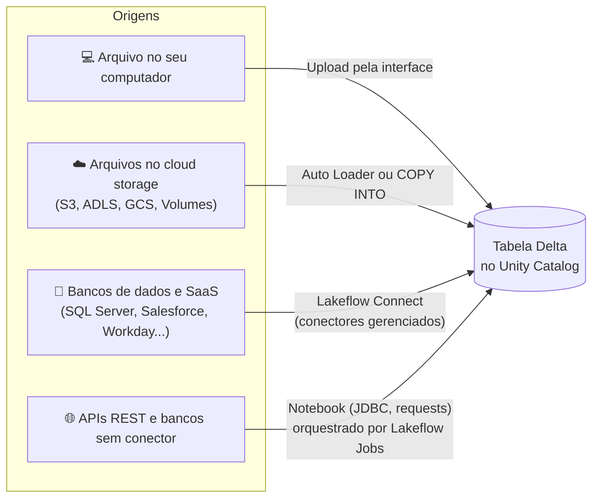
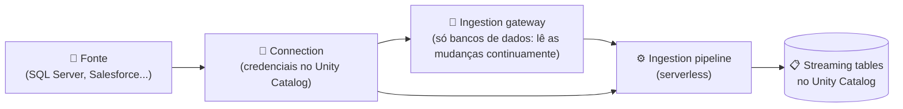
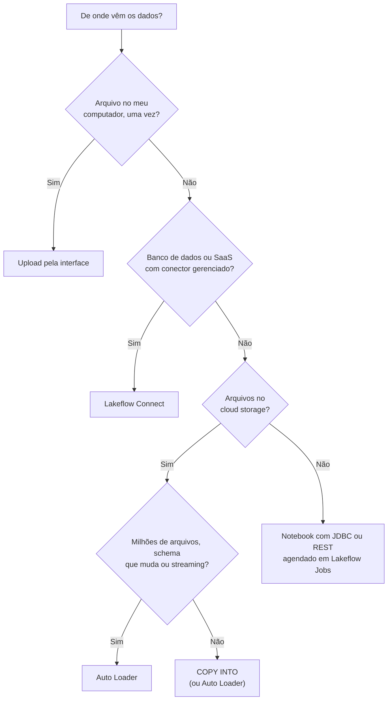

# 📥 Data Ingestion and Loading — Data Engineer Associate

> **Exame:** Databricks Certified Data Engineer Associate
> **Domínio:** 2 — Data Ingestion and Loading (~20% da prova, estimativa da comunidade)
> **No plano de estudos:** janeiro e fevereiro de 2027 · aula de segunda-feira
>
> **Objetivo:** dominar **todas as formas de colocar dados no Lakehouse** e saber **quando usar cada uma**.

---

## 📑 Índice
1. [O mapa da ingestão](#1-o-mapa-da-ingestão)
2. [Tipos de ingestão: batch, streaming e incremental](#2-tipos-de-ingestão-batch-streaming-e-incremental)
3. [Importar arquivos locais](#3-importar-arquivos-locais)
4. [COPY INTO](#4-copy-into)
5. [Auto Loader (`cloudFiles`)](#5-auto-loader-cloudfiles)
6. [COPY INTO × Auto Loader](#6-copy-into--auto-loader)
7. [Lakeflow Connect: conectores gerenciados](#7-lakeflow-connect-conectores-gerenciados)
8. [Ingestão por notebook: JDBC e APIs REST](#8-ingestão-por-notebook-jdbc-e-apis-rest)
9. [Dados semiestruturados e não estruturados](#9-dados-semiestruturados-e-não-estruturados)
10. [Como escolher o método certo](#10-como-escolher-o-método-certo)
11. [Estudos de caso](#11-estudos-de-caso)
12. [Resumo mental para a prova](#12-resumo-mental-para-a-prova)
13. [Possíveis pegadinhas da prova](#13-possíveis-pegadinhas-da-prova)
14. [Questões no estilo da prova](#14-questões-no-estilo-da-prova)
15. [Fontes](#15-fontes)

---

## 1. O mapa da ingestão

Os dados chegam de **quatro tipos de lugar**, e cada um tem uma ferramenta preferida:



| Origem | Ferramenta preferida |
| :--- | :--- |
| Arquivo no seu computador (uma vez) | **Upload pela interface** |
| Arquivos chegando no cloud storage | **Auto Loader** (ou **COPY INTO** para casos simples) |
| Banco de dados ou SaaS com conector disponível | **Lakeflow Connect** (conector gerenciado) |
| Fonte sem conector (API própria, banco legado) | **Notebook** com JDBC ou `requests`, agendado num **Lakeflow Job** |

---

## 2. Tipos de ingestão: batch, streaming e incremental

| Tipo | Como funciona | Latência | Exemplo |
| :--- | :--- | :--- | :--- |
| **Batch (lote)** | Lê um conjunto de dados de uma vez, em horários definidos | Horas | Carga noturna do ERP |
| **Streaming** | Processa os dados continuamente, à medida que chegam | Segundos | Eventos de cliques no app |
| **Incremental** | Em cada execução, processa **só o que é novo** desde a última | Depende da frequência | Arquivos novos de vendas a cada hora |

> 🎯 **Incremental não é o oposto de batch.** Uma carga pode ser **batch e incremental ao mesmo tempo**: um job que roda de hora em hora e processa só os arquivos novos. O Auto Loader com `trigger(availableNow=True)` é exatamente isso: usa a tecnologia de streaming para fazer uma **carga incremental em lote**.

### Batch completo × incremental

| | Batch completo (full load) | Incremental |
| :--- | :--- | :--- |
| **O que lê** | Tudo, toda vez | Só o que mudou ou chegou |
| **Custo** | Cresce com o tamanho da origem | Proporcional ao volume novo |
| **Quando faz sentido** | Tabelas pequenas, cargas iniciais | Quase sempre em produção |
| **Como saber o que é novo** | Não precisa | Checkpoint (Auto Loader), histórico de arquivos (COPY INTO), coluna de data (marca d'água) ou CDC |

---

## 3. Importar arquivos locais

Para um arquivo que está **no seu computador**, como uma planilha de metas ou um CSV de cadastro, a forma mais simples é a **interface**:

| Caminho | O que faz |
| :--- | :--- |
| **Upload para criar uma tabela** (*Create or modify table*) | Você envia o arquivo, confere a pré-visualização e os tipos, e o Databricks cria uma **tabela Delta** no catálogo e schema escolhidos |
| **Upload para um Volume** | O arquivo fica guardado num **Volume** do Unity Catalog e pode ser lido depois por código |

```python
# Depois de enviar o arquivo para um Volume
df = spark.read.csv("/Volumes/main/bronze/arquivos/metas_2027.csv", header=True, sep=";")
```

> ⚠️ Upload manual serve para **cargas pontuais**. Se o arquivo chega **todo dia**, é um sinal de que o processo precisa ser automatizado (Auto Loader, COPY INTO ou Lakeflow Connect).

---

## 4. COPY INTO

Comando **SQL** que carrega arquivos de uma pasta do cloud storage para uma tabela Delta, **pulando os arquivos que já foram carregados**.

### Sintaxe

```sql
-- A tabela pode ser criada vazia, sem colunas: o COPY INTO define o schema
CREATE TABLE IF NOT EXISTS bronze.vendas_lojas;

COPY INTO bronze.vendas_lojas
FROM '/Volumes/main/bronze/landing/vendas/'
FILEFORMAT = CSV
FORMAT_OPTIONS ('header' = 'true', 'sep' = ';', 'inferSchema' = 'true')
COPY_OPTIONS ('mergeSchema' = 'true');
```

| Parte | Para quê |
| :--- | :--- |
| `FROM` | Pasta (ou arquivo) de origem |
| `FILEFORMAT` | `CSV`, `JSON`, `PARQUET`, `AVRO`, `ORC`, `TEXT`, `BINARYFILE` |
| `FORMAT_OPTIONS` | Opções de leitura do formato (cabeçalho, separador...) |
| `COPY_OPTIONS ('mergeSchema' = 'true')` | Permite que colunas novas sejam adicionadas à tabela |
| `COPY_OPTIONS ('force' = 'true')` | **Recarrega** arquivos já carregados (desliga a idempotência) |
| `PATTERN = '*.csv'` | Filtra arquivos por nome |

### Por que é idempotente

O COPY INTO **registra quais arquivos já carregou**, nos metadados da tabela de destino. Se você rodar o mesmo comando de novo:

```
1ª execução: carrega vendas_01.csv, vendas_02.csv
2ª execução (chegou vendas_03.csv): carrega SÓ vendas_03.csv
3ª execução (nada novo): carrega nada
```

Rodar várias vezes **não duplica dados**, o que o torna seguro para retries de um Job.

### Quando usar

- **Milhares** de arquivos (não milhões).
- Equipe que prefere **SQL**.
- Cargas em lote **periódicas** e simples.

---

## 5. Auto Loader (`cloudFiles`)

O Auto Loader lê arquivos **de forma incremental** usando o **Structured Streaming**. O estado (quais arquivos já foram lidos) fica guardado no **checkpoint**.

### Estrutura básica

```python
(spark.readStream
    .format("cloudFiles")
    .option("cloudFiles.format", "json")
    .option("cloudFiles.schemaLocation", "/Volumes/main/bronze/checkpoints/vendas/schema")
    .load("/Volumes/main/bronze/landing/vendas/")
    .writeStream
    .option("checkpointLocation", "/Volumes/main/bronze/checkpoints/vendas")
    .trigger(availableNow=True)         # processa o que está pendente e encerra
    .toTable("main.bronze.vendas"))
```

| Opção | Para quê |
| :--- | :--- |
| `cloudFiles.format` | Formato dos arquivos: `json`, `csv`, `parquet`, `avro`, `text`, `binaryFile`... |
| `cloudFiles.schemaLocation` | Onde o Auto Loader guarda o **schema inferido** e suas versões |
| `checkpointLocation` | Onde o stream guarda **quais arquivos já processou** |
| `trigger(availableNow=True)` | Modo lote: processa tudo o que está pendente e encerra |

### 5.1 Como o Auto Loader descobre arquivos novos

| Modo | Como funciona | Prós | Contras |
| :--- | :--- | :--- | :--- |
| **Directory listing** (padrão) | **Lista a pasta** a cada execução para achar arquivos novos | Nada para configurar | Fica mais lento quando a pasta tem muitos arquivos |
| **File notification (clássico)** | A nuvem **avisa** o Auto Loader a cada arquivo novo, por uma fila de mensagens criada para **cada stream** | Menor latência; não precisa listar | Cada stream precisa da sua fila; há limite de notificações por bucket |
| **File events** (`cloudFiles.useManagedFileEvents = true`) | Um **serviço de eventos** ligado à **external location** do Unity Catalog guarda os metadados dos arquivos, e **vários streams compartilham a mesma fila** | Evita o limite de filas; após a 1ª execução, não precisa listar | A 1ª execução lista tudo; o stream precisa rodar pelo menos a cada 7 dias, senão volta a listar; a camada extra pode aumentar a latência |

```python
# File events: exige a external location com file events habilitados
spark.readStream.format("cloudFiles") \
    .option("cloudFiles.format", "json") \
    .option("cloudFiles.useManagedFileEvents", "true") \
    ...
```

> 💡 **Para a prova:** pasta pequena e simples → **directory listing**. Pasta enorme, com milhões de arquivos, e necessidade de descobrir arquivos sem listar tudo → **notificações**: file events, ou o file notification clássico se a latência for crítica.

### 5.2 Inferência de schema

| Formato | Tipos inferidos por padrão |
| :--- | :--- |
| **JSON, CSV, XML** | **Tudo vira texto** (`string`), inclusive campos aninhados do JSON. Para inferir tipos, use `cloudFiles.inferColumnTypes = true` |
| **Parquet, Avro** | Os tipos vêm do **schema embutido** no arquivo |

Para **forçar o tipo** de algumas colunas sem escrever o schema inteiro, use **schema hints**:

```python
.option("cloudFiles.schemaHints", "valor DECIMAL(12,2), data_venda DATE")
```

### 5.3 Schema enforcement e schema evolution

O que acontece quando chega um arquivo com uma **coluna nova** depende do `cloudFiles.schemaEvolutionMode`:

| Modo | Comportamento | Quando usar |
| :--- | :--- | :--- |
| **`addNewColumns`** (padrão sem schema informado) | O stream **para de propósito** (`UnknownFieldException`) e registra a coluna nova; ao **reiniciar**, segue com o schema atualizado | Quando colunas novas são bem-vindas |
| **`addNewColumnsWithTypeWidening`** (preview) | Igual ao anterior e também **amplia tipos** compatíveis (ex.: `int` → `long`) | Quando os tipos podem crescer |
| **`rescue`** | **Nunca muda o schema e nunca falha**; os dados novos vão para a coluna `_rescued_data` | Quando a tabela não pode mudar, mas nada pode ser perdido |
| **`failOnNewColumns`** | O stream **falha** e só volta quando alguém atualizar o schema ou remover o arquivo | Quando qualquer mudança precisa de revisão humana |
| **`none`** (padrão com schema informado) | **Ignora** colunas novas e não falha | Quando só as colunas conhecidas interessam |

> 🎯 **Por que o `addNewColumns` "falha"?** É de propósito: o stream para para registrar o novo schema. Por isso, em produção, configure o Job com **retries**. Na nova tentativa, a carga continua normalmente.

### 5.4 A coluna `_rescued_data`

Quando o schema é inferido, o Auto Loader cria a coluna **`_rescued_data`**. Ela guarda, num JSON, os dados que **não couberam** no schema: colunas novas (no modo `rescue`), valores com tipo incompatível ou nomes de coluna com maiúsculas e minúsculas diferentes. Junto vem o caminho do arquivo de origem.

```sql
-- Monitorar dados resgatados (sinal de mudança na fonte)
SELECT _rescued_data, COUNT(*)
FROM main.bronze.vendas
WHERE _rescued_data IS NOT NULL
GROUP BY ALL;
```

---

## 6. COPY INTO × Auto Loader

> 💡 **A pegadinha clássica do domínio.**

| Critério | COPY INTO | Auto Loader |
| :--- | :--- | :--- |
| **Linguagem** | SQL | Python/Scala (e SQL com streaming tables) |
| **Volume de arquivos** | **Milhares** | **Milhões** ou mais |
| **Como lembra o que leu** | Metadados da tabela de destino | Checkpoint do stream |
| **Descoberta de arquivos** | Lista a pasta | Directory listing, file notification ou file events |
| **Streaming contínuo** | ❌ Não | ✅ Sim |
| **Evolução de schema** | Básica (`mergeSchema`) | Completa (5 modos, `_rescued_data`, schema hints) |
| **Idempotente** | ✅ Sim | ✅ Sim |
| **Melhor para** | Cargas simples e periódicas, equipes de SQL | Volumes grandes e crescentes, schema que muda, streaming |

**Regra de bolso:**
- "**Milhões de arquivos**", "**schema que muda com frequência**", "**perto de tempo real**" → **Auto Loader**.
- "**Poucos milhares de arquivos**", "**SQL simples**", "**carga periódica**" → **COPY INTO**.

---

## 7. Lakeflow Connect: conectores gerenciados

O **Lakeflow Connect** reúne os conectores do Databricks. Os **conectores gerenciados** trazem dados de **bancos de dados e aplicações SaaS** sem você escrever código de extração.

### Tipos de conector

| Tipo | Exemplos |
| :--- | :--- |
| **SaaS** | Salesforce, Workday, HubSpot, Jira e outros |
| **Bancos de dados (CDC)** | SQL Server, MySQL, PostgreSQL |
| **Arquivos** | Google Drive, SharePoint |
| **Streaming** | RabbitMQ |

Também existem conectores baseados em consulta e conectores da comunidade. A lista cresce com frequência; confira a documentação.

### Componentes



| Componente | Função |
| :--- | :--- |
| **Connection** | Objeto do Unity Catalog que guarda **as credenciais** da fonte, com permissões controladas |
| **Ingestion gateway** | Usado só por **bancos de dados**: roda continuamente, captura as mudanças e as guarda numa área de staging |
| **Ingestion pipeline** | Lê os dados (ou as mudanças) e grava no destino; roda em **serverless** |
| **Destino** | **Streaming tables** no Unity Catalog |

### Incremental e CDC

- A **primeira execução** traz todos os dados selecionados.
- As **seguintes** trazem **só o que mudou**, quando a fonte permite.
  - **Bancos de dados:** usam **CDC** (*Change Data Capture*). No SQL Server, por exemplo, usam change tracking e CDC.
  - **SaaS:** usam uma **coluna de controle**, como a data de alteração do registro.

### Quando usar

- A fonte **tem conector gerenciado**.
- Você quer **governança** (credenciais no Unity Catalog), **incremental automático** e **menos código para manter**.

> 💡 **Conectores de parceiros:** pelo **Partner Connect**, o Databricks também se integra a ferramentas de ingestão como Fivetran, para fontes que o Lakeflow Connect ainda não cobre.

---

## 8. Ingestão por notebook: JDBC e APIs REST

Quando a fonte **não tem conector**, você escreve a ingestão num notebook e a agenda num **Lakeflow Job**.

### 8.1 Banco de dados via JDBC

```python
senha = dbutils.secrets.get(scope="erp", key="senha-banco")   # nunca escreva a senha no código

df = (spark.read.format("jdbc")
    .option("url", "jdbc:postgresql://erp.empresa.com:5432/vendas")
    .option("query", "SELECT * FROM pedidos WHERE atualizado_em >= '2026-11-01'")  # incremental
    .option("user", "usuario_leitura")
    .option("password", senha)
    .option("fetchsize", "10000")             # linhas por ida ao banco
    .load())

df.write.mode("append").saveAsTable("main.bronze.pedidos_erp")
```

Para **tabelas grandes**, leia em paralelo, dividindo por uma coluna numérica:

```python
(spark.read.format("jdbc")
    .option("url", url)
    .option("dbtable", "pedidos")
    .option("partitionColumn", "id_pedido")   # coluna numérica, de data ou de timestamp
    .option("lowerBound", "1")
    .option("upperBound", "50000000")
    .option("numPartitions", "16")            # 16 conexões simultâneas: cuidado com o banco de origem
    ...)
```

> ⚠️ Cada partição abre **uma conexão** no banco de origem. `numPartitions` alto demais pode sobrecarregar o sistema da empresa.

> 💡 **Lakehouse Federation** é uma alternativa para **consultar** o banco direto pelo Unity Catalog, por um *foreign catalog*, sem copiar os dados. Serve para consultas eventuais. Para cargas recorrentes e volumosas, ingerir costuma ser melhor.

### 8.2 API REST

```python
import requests
import pandas as pd

token = dbutils.secrets.get(scope="apis", key="token-crm")
widget_data = dbutils.widgets.get("data_ref")      # parâmetro vindo do Job

registros, pagina = [], 1
while True:
    r = requests.get(
        "https://api.crm.exemplo.com/v1/clientes",
        params={"atualizado_desde": widget_data, "pagina": pagina},
        headers={"Authorization": f"Bearer {token}"},
        timeout=30,
    )
    r.raise_for_status()
    lote = r.json()["resultados"]
    if not lote:
        break
    registros.extend(lote)
    pagina += 1

# Guardar o JSON bruto na Bronze (e tipar na Silver)
df = spark.createDataFrame(pd.DataFrame({"payload": [str(x) for x in registros]}))
df.write.mode("append").saveAsTable("main.bronze.crm_clientes_raw")
```

> 💡 **Boa prática:** para volumes maiores, grave as respostas da API como **arquivos JSON num Volume** e deixe o **Auto Loader** carregá-los. Assim você ganha idempotência, linhagem por arquivo e evolução de schema sem escrever esse controle à mão.

### 8.3 Orquestração com Lakeflow Jobs

- **Agendamento** (cron) na frequência que a fonte permite.
- **Parâmetros** (`data_ref`) para definir o período incremental.
- **Retries** para falhas temporárias de rede.
- **Notificações** em caso de falha.

---

## 9. Dados semiestruturados e não estruturados

### 9.1 JSON aninhado: as três abordagens

Imagine este evento de pedido:

```json
{"pedido_id": "P1", "cliente": {"id": "C1", "uf": "SP"},
 "itens": [{"sku": "A1", "qtd": 2}, {"sku": "B7", "qtd": 1}]}
```

**Abordagem 1 · Estrutura tipada (struct e array) + `explode`**

```python
from pyspark.sql import functions as F

df = spark.read.json("/Volumes/main/bronze/landing/pedidos/")

itens = df.select(
    "pedido_id",
    F.col("cliente.uf").alias("uf"),                 # acessar campo de struct
    F.explode("itens").alias("item"),                # uma linha por item
).select("pedido_id", "uf", "item.sku", "item.qtd")
```

| pedido_id | uf | sku | qtd |
| :--- | :--- | :--- | :--- |
| P1 | SP | A1 | 2 |
| P1 | SP | B7 | 1 |

**Abordagem 2 · JSON guardado como texto, interpretado depois**

```python
from pyspark.sql import functions as F

schema = "pedido_id STRING, cliente STRUCT<id: STRING, uf: STRING>, itens ARRAY<STRUCT<sku: STRING, qtd: INT>>"
df_tipado = df_texto.select(F.from_json("payload", schema).alias("p")).select("p.*")
```

```sql
-- Em SQL, a notação de dois-pontos lê caminhos dentro de um texto JSON
SELECT payload:pedido_id, payload:cliente.uf, payload:itens[0].sku
FROM main.bronze.pedidos_raw;
```

**Abordagem 3 · Tipo `VARIANT`**

O `VARIANT` guarda JSON de **forma flexível e eficiente**, sem precisar definir o schema antes. É ótimo para dados cujo formato muda muito.

```sql
CREATE TABLE main.bronze.eventos_app (evento VARIANT);

INSERT INTO main.bronze.eventos_app
SELECT parse_json(payload) FROM main.bronze.eventos_raw;

-- Ler campos e converter tipos com ::
SELECT evento:pedido_id::string AS pedido_id,
       evento:cliente.uf::string AS uf
FROM main.bronze.eventos_app;
```

| Abordagem | Quando usar |
| :--- | :--- |
| **Struct/array tipado** | Schema conhecido e estável; melhor desempenho nas consultas |
| **Texto + `from_json` ou `:`** | Bronze guardando o dado bruto; tipagem feita na Silver |
| **`VARIANT`** | Schema muito variável; quer flexibilidade sem perder desempenho |

### 9.2 Ler arquivos direto com SQL: `read_files`

```sql
SELECT * FROM read_files(
  '/Volumes/main/bronze/landing/pedidos/',
  format => 'json'
);
```

### 9.3 Não estruturados (imagens, PDFs, áudio)

O formato **`binaryFile`** lê cada arquivo como uma linha, com caminho, data de modificação, tamanho e o **conteúdo em bytes**:

```python
pdfs = (spark.readStream.format("cloudFiles")
    .option("cloudFiles.format", "binaryFile")
    .option("pathGlobFilter", "*.pdf")
    .load("/Volumes/main/bronze/documentos/"))
```

> 💡 Arquivos não estruturados normalmente **ficam num Volume**, e a tabela guarda os **metadados e o caminho**. O conteúdo é processado depois, por exemplo com funções de IA para extrair texto.

---

## 10. Como escolher o método certo



| Critério | Pergunta | Aponta para |
| :--- | :--- | :--- |
| **Volume** | Milhares ou milhões de arquivos? | COPY INTO (milhares) × Auto Loader (milhões) |
| **Frequência e latência** | Uma vez, periódico ou contínuo? | Upload × Job em lote × streaming |
| **Tipo de fonte** | Arquivo, banco, SaaS ou API? | Auto Loader/COPY INTO × Lakeflow Connect × notebook |
| **Tipo de dado** | Tabular, JSON aninhado ou binário? | Formato e abordagem de schema |
| **Governança** | Credenciais centralizadas? Linhagem? Menos código? | Lakeflow Connect (connection no UC) e Auto Loader (linhagem por arquivo) |

---

## 11. Estudos de caso

### Caso A · Os arquivos do PDV
> 30 lojas enviam um CSV por dia para um bucket. Às vezes o fornecedor do PDV acrescenta colunas sem avisar.

**Resposta:** **Auto Loader** com `addNewColumns` e **retries** no Job. A coluna nova é adicionada automaticamente. Se a empresa preferir revisar antes, use `rescue` e monitore a `_rescued_data`.

### Caso B · O CRM na nuvem
> O time de marketing quer os dados do Salesforce atualizados todo dia na Bronze, sem ninguém mantendo scripts.

**Resposta:** **Lakeflow Connect**, com o conector gerenciado do Salesforce. As credenciais ficam numa *connection* do Unity Catalog, a carga é incremental, e o destino são streaming tables.

### Caso C · A planilha de metas
> A diretoria envia uma planilha de metas de vendas uma vez por ano.

**Resposta:** **upload pela interface**, criando a tabela direto. Automatizar algo que acontece uma vez por ano não compensa.

### Caso D · O sistema legado
> Um sistema interno antigo só tem uma API REST paginada, sem conector disponível.

**Resposta:** **notebook** com `requests`, buscando as páginas pela data de atualização (parâmetro do Job), com o token num **secret scope**, agendado num **Lakeflow Job** com retries. Melhor ainda: gravar as respostas como JSON num Volume e carregá-las com **Auto Loader**.

---

## 12. Resumo mental para a prova

- **Incremental** = processar só o que é novo. Pode ser em lote (`availableNow`) ou contínuo.
- **COPY INTO:** SQL, idempotente, **milhares** de arquivos; `force` recarrega; `mergeSchema` aceita colunas novas.
- **Auto Loader:** `cloudFiles`, checkpoint, **milhões** de arquivos, streaming, 5 modos de evolução de schema e `_rescued_data`.
- **Descoberta de arquivos:** directory listing (padrão), file notification (clássico, por stream) e **file events** (fila compartilhada pela external location).
- **JSON e CSV** chegam como **texto** no Auto Loader, a menos que `inferColumnTypes = true` ou que haja schema hints.
- **Lakeflow Connect:** conectores gerenciados para bancos (CDC, com ingestion gateway) e SaaS; credenciais numa **connection** do UC; destino em streaming tables; serverless.
- **Sem conector:** notebook com **JDBC** ou **REST**, com segredos em `dbutils.secrets`, orquestrado por **Lakeflow Jobs**.
- **JSON aninhado:** struct + `explode`, `from_json` e `:` em texto, ou **`VARIANT`**. Binários: `binaryFile`.

---

## 13. Possíveis pegadinhas da prova

| ❌ Afirmação falsa (armadilha) | ✅ O correto |
| :--- | :--- |
| "COPY INTO recarrega todos os arquivos a cada execução." | É **idempotente**: pula os arquivos já carregados (a menos que `force = true`). |
| "COPY INTO é a melhor opção para milhões de arquivos." | Para milhões de arquivos, use **Auto Loader**. |
| "Quando o Auto Loader para por causa de coluna nova, é um bug." | No `addNewColumns`, parar é **proposital**; o retry continua com o schema novo. |
| "O modo `rescue` adiciona as colunas novas à tabela." | `rescue` **nunca muda o schema**; os dados vão para `_rescued_data`. |
| "O Auto Loader infere os tipos do JSON por padrão." | Em JSON e CSV, tudo vira **string**, a menos que `inferColumnTypes = true`. |
| "Directory listing é sempre a melhor opção." | Com milhões de arquivos, **notificações** (file events) evitam listar a pasta inteira. |
| "Batch e incremental são opostos." | Uma carga pode ser **batch e incremental** ao mesmo tempo. |
| "Para trazer dados do Salesforce é preciso escrever um script." | Use o **conector gerenciado** do Lakeflow Connect. |
| "Pode colocar a senha do banco direto na URL do JDBC." | Use **`dbutils.secrets`** (ou uma *connection* do Unity Catalog). |
| "`numPartitions` alto no JDBC é sempre melhor." | Cada partição é **uma conexão** no banco de origem; exagerar sobrecarrega o sistema. |

> 💡 **Dica de leitura:** sublinhe no enunciado **onde estão os dados** (arquivo local, storage, banco, SaaS, API), **quantos arquivos** (milhares ou milhões), **se o schema muda** e **a latência pedida**. Esses quatro detalhes decidem a resposta.

---

## 14. Questões no estilo da prova

**1. Um job roda `COPY INTO` a cada hora sobre a mesma pasta. Na segunda execução, chegaram 3 arquivos novos e os 50 antigos continuam lá. O que é carregado?**
- a) Os 53 arquivos
- b) Só os 3 arquivos novos
- c) Nenhum, porque a pasta já foi processada
- d) Os 50 antigos, para garantir consistência

**2. Uma pasta recebe cerca de 2 milhões de arquivos JSON por dia, e o schema muda com frequência. Qual é a melhor opção?**
- a) COPY INTO com `force = true`
- b) Upload pela interface
- c) Auto Loader com evolução de schema
- d) Leitura com `spark.read.json` a cada hora

**3. Um stream com Auto Loader, sem schema informado, falhou com `UnknownFieldException` depois que um arquivo trouxe uma coluna nova. O que acontece ao reiniciar?**
- a) Falha de novo, até alguém editar o schema
- b) Continua, já com a coluna nova no schema
- c) Ignora a coluna nova para sempre
- d) Apaga o checkpoint e recarrega tudo

**4. Uma empresa quer que a tabela Bronze nunca mude de schema, mas não aceita perder nenhum dado novo que a fonte enviar. Qual `schemaEvolutionMode` usar?**
- a) `addNewColumns`
- b) `failOnNewColumns`
- c) `rescue`
- d) `none`

**5. Um Auto Loader lê arquivos JSON sem nenhuma opção de tipo. Como os campos numéricos aparecem na tabela?**
- a) Como `double`
- b) Como `string`
- c) Como `decimal(12,2)`
- d) Como `int`

**6. Uma equipe precisa trazer diariamente tabelas do SQL Server corporativo para o Databricks, de forma incremental, sem manter código de extração. Qual opção usar?**
- a) Notebook com JDBC lendo a tabela inteira todo dia
- b) Lakeflow Connect com o conector gerenciado de SQL Server
- c) Upload manual de arquivos CSV exportados
- d) COPY INTO apontando para o banco

**7. Vários streams de Auto Loader leem o mesmo bucket, e a empresa atingiu o limite de notificações por bucket no modo clássico. O que ajuda?**
- a) Usar file events (`cloudFiles.useManagedFileEvents`) com a external location habilitada
- b) Trocar para COPY INTO
- c) Desativar o checkpoint
- d) Aumentar o número de workers

**8. Uma tabela Bronze guarda eventos do app como JSON em texto. Como ler o campo `uf` de dentro de `cliente` em SQL?**
- a) `SELECT payload.cliente.uf FROM eventos`
- b) `SELECT payload:cliente.uf FROM eventos`
- c) `SELECT explode(payload) FROM eventos`
- d) `SELECT cliente_uf FROM eventos`

**9. Uma API REST interna sem conector precisa ser ingerida todo dia. Qual abordagem segue as boas práticas?**
- a) Notebook com a senha escrita no código, rodado manualmente
- b) Notebook com o token em `dbutils.secrets`, parâmetro de data e agendamento num Lakeflow Job com retries
- c) Lakeflow Connect com conector gerenciado
- d) Upload diário do JSON pela interface

**10. Uma tabela de pedidos tem uma coluna `itens` do tipo array de structs. Qual função gera uma linha por item?**
- a) `F.split()`
- b) `F.explode()`
- c) `F.from_json()`
- d) `F.flatten()`

**11. Qual afirmação sobre COPY INTO e Auto Loader está correta?**
- a) Só o Auto Loader é idempotente
- b) Os dois são idempotentes; o Auto Loader escala melhor e suporta streaming
- c) Só o COPY INTO suporta evolução de schema
- d) O COPY INTO usa checkpoint, e o Auto Loader não

**12. A diretoria envia uma planilha de metas uma vez por ano. Qual é a forma mais adequada de carregá-la?**
- a) Auto Loader com file events
- b) Lakeflow Connect
- c) Upload pela interface, criando a tabela
- d) Notebook com JDBC

<details>
<summary><b>📝 Gabarito (clique para abrir)</b></summary>

| Questão | Resposta | Por quê |
| :--- | :--- | :--- |
| 1 | b | COPY INTO registra os arquivos já carregados e só traz os novos. |
| 2 | c | Milhões de arquivos e schema que muda: Auto Loader. |
| 3 | b | No `addNewColumns`, o stream para de propósito e, ao reiniciar, segue com o schema novo. |
| 4 | c | `rescue` nunca muda o schema e guarda os dados novos em `_rescued_data`. |
| 5 | b | Em JSON e CSV, o Auto Loader infere tudo como string, a menos que `inferColumnTypes = true`. |
| 6 | b | Banco com conector gerenciado, incremental (CDC) e sem código para manter: Lakeflow Connect. |
| 7 | a | File events usam uma fila compartilhada pela external location e evitam o limite por bucket. |
| 8 | b | A notação `:` lê caminhos dentro de um JSON guardado como texto. |
| 9 | b | Sem conector: notebook com segredos, parâmetros e Job agendado com retries. |
| 10 | b | `explode` transforma cada elemento do array numa linha. |
| 11 | b | Ambos são idempotentes; o Auto Loader escala para milhões de arquivos e faz streaming. |
| 12 | c | Carga pontual e anual: upload pela interface. |

</details>

---

## 15. Fontes

- [Guia oficial do exame — Databricks Certified Data Engineer Associate (maio de 2026)](https://www.databricks.com/sites/default/files/2026-03/databricks-certified-data-engineer-associate-exam-guide-may-4-2026.pdf)
- [Managed connectors in Lakeflow Connect — Databricks](https://docs.databricks.com/aws/ingestion/lakeflow-connect)
- [Auto Loader with file events overview — Databricks](https://docs.databricks.com/aws/en/ingestion/cloud-object-storage/auto-loader/file-events-explained)
- [Configure schema inference and evolution in Auto Loader — Databricks](https://docs.databricks.com/gcp/en/ingestion/cloud-object-storage/auto-loader/schema)
- [Auto Loader best practices — Databricks](https://docs.databricks.com/aws/en/ingestion/cloud-object-storage/auto-loader/best-practices)

*Consultado em novembro de 2026.*
