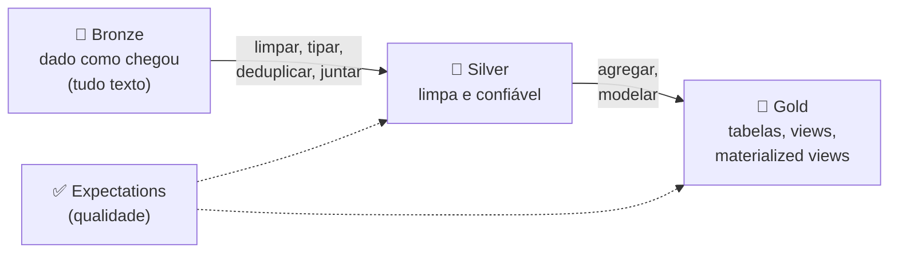
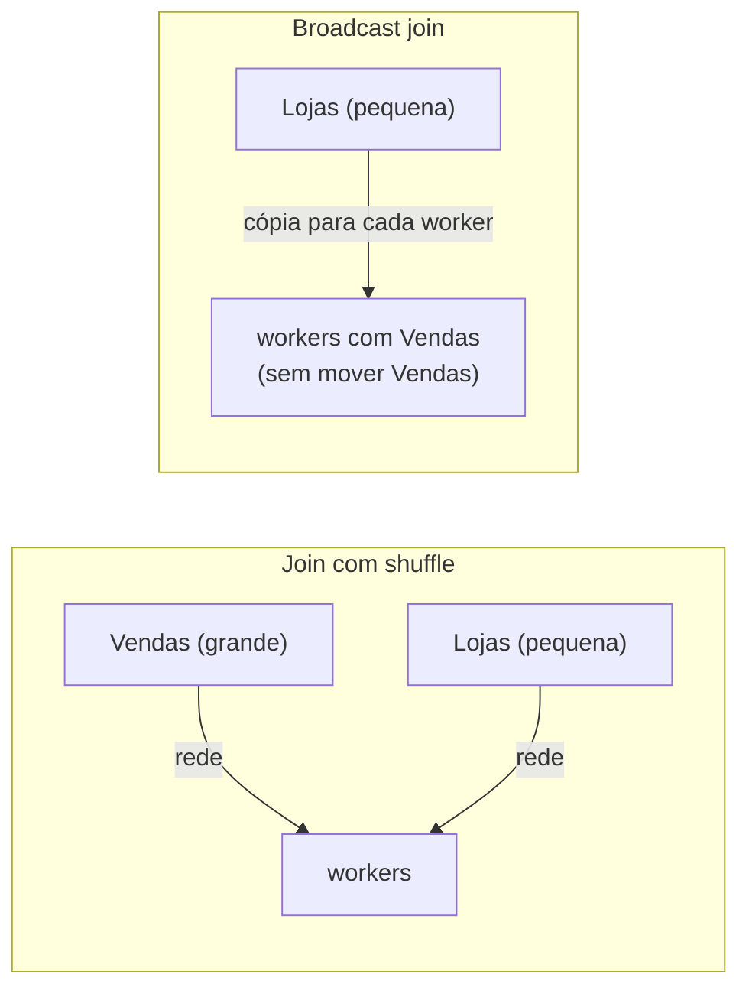
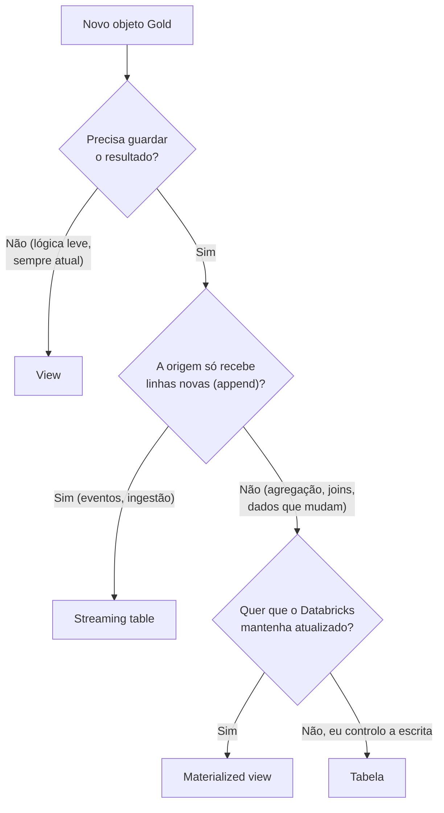
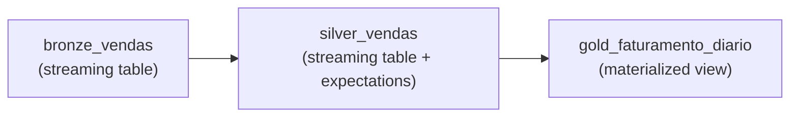

# 🔄 Data Transformation and Modeling — Data Engineer Associate

> **Exame:** Databricks Certified Data Engineer Associate
> **Domínio:** 3 — Data Transformation and Modeling (**~25%** da prova, estimativa da comunidade)

>
> **Objetivo:** limpar e transformar dados da **Bronze** para a **Silver**, construir objetos **Gold**, aplicar **regras de qualidade** e montar **pipelines declarativos**.
>
> 💡 **O domínio de maior peso.** Exige prática real: muitas questões mostram um trecho de PySpark ou SQL e perguntam o resultado, o erro ou a melhor opção.
>
> 📎 **Relacionados:** Fundamentals Módulo 3 (Spark e DataFrames), Módulo 1.1 (MERGE) e as colinhas `Comandos no Databricks.md` e `Comandos Python para Dados.md`.

---

## 📑 Índice
1. [Onde este domínio se encaixa](#1-onde-este-domínio-se-encaixa)
2. [Limpar dados da Bronze e gravar a Silver](#2-limpar-dados-da-bronze-e-gravar-a-silver)
3. [Joins e uniões](#3-joins-e-uniões)
4. [Manipular colunas e linhas](#4-manipular-colunas-e-linhas)
5. [Deduplicação e agregações](#5-deduplicação-e-agregações)
6. [Ajuste básico do Spark](#6-ajuste-básico-do-spark)
7. [Objetos Gold: tabelas, views, materialized views e streaming tables](#7-objetos-gold-tabelas-views-materialized-views-e-streaming-tables)
8. [Qualidade de dados: expectations](#8-qualidade-de-dados-expectations)
9. [Lakeflow Spark Declarative Pipelines](#9-lakeflow-spark-declarative-pipelines)
10. [Resumo mental para a prova](#10-resumo-mental-para-a-prova)
11. [Possíveis pegadinhas da prova](#11-possíveis-pegadinhas-da-prova)
12. [Questões no estilo da prova](#12-questões-no-estilo-da-prova)
13. [Fontes](#13-fontes)

---

## 1. Onde este domínio se encaixa



| Etapa | Pergunta | Ferramentas |
| :--- | :--- | :--- |
| Bronze → Silver | O dado está **correto**? | Tipagem, nulos, deduplicação, joins, `explode`, MERGE |
| Silver → Gold | O dado está **pronto para o negócio**? | Agregações, modelo estrela, views, materialized views |
| Em todas | Posso **confiar**? | Expectations e quarentena |

Os exemplos usam o projeto **Trama Store** (varejo de moda omnichannel fictício):

```python
from pyspark.sql import functions as F
```

---

## 2. Limpar dados da Bronze e gravar a Silver

Na Bronze, o dado chega **como veio**: tudo texto, com espaços, nulos, formatos misturados e duplicatas. A Silver corrige isso.

### 2.1 Checklist de limpeza

| Problema | Exemplo | Tratamento |
| :--- | :--- | :--- |
| Tipos errados | `"59,90"` como texto | `cast`, `try_cast`, `to_date`, `to_timestamp` |
| Espaços e caixa | `"  ana SILVA "` | `trim`, `lower`, `upper`, `initcap` |
| Vazio no lugar de nulo | `""` | `when(col == "", None)` / `nullif` |
| Nulos | `valor = null` | `fillna`, `coalesce`, `dropna` |
| Duplicatas | Mesma venda enviada duas vezes | `dropDuplicates` ou `row_number` |
| Formatos de data | `"22/10/2026"` | `to_date(col, "dd/MM/yyyy")` |

### 2.2 Em PySpark

```python
bronze = spark.read.table("bronze.pdv_vendas")

silver = (bronze
    .withColumn("id_venda", F.trim("id_venda"))
    .withColumn("cliente", F.initcap(F.trim("cliente")))
    .withColumn("uf", F.upper(F.trim("uf")))
    # "1.234,56" → 1234.56
    .withColumn("valor", F.regexp_replace(F.regexp_replace("valor", r"\.", ""), ",", ".").cast("decimal(12,2)"))
    .withColumn("data_venda", F.to_date("data_venda", "dd/MM/yyyy"))
    .withColumn("id_cliente", F.when(F.trim("id_cliente") == "", None).otherwise(F.trim("id_cliente")))
    .fillna({"canal": "loja_fisica"})
    .dropna(subset=["id_venda"])                         # sem chave, não entra
    .dropDuplicates(["id_venda", "id_item"])
)

silver.write.mode("overwrite").saveAsTable("silver.vendas")
```

### 2.3 Em SQL

```sql
CREATE OR REPLACE TABLE silver.vendas AS
SELECT
  trim(id_venda)                                                    AS id_venda,
  CAST(id_item AS INT)                                              AS id_item,
  initcap(trim(cliente))                                            AS cliente,
  upper(trim(uf))                                                   AS uf,
  try_cast(replace(replace(valor, '.', ''), ',', '.') AS DECIMAL(12,2)) AS valor,
  to_date(data_venda, 'dd/MM/yyyy')                                 AS data_venda,
  nullif(trim(id_cliente), '')                                      AS id_cliente,
  coalesce(canal, 'loja_fisica')                                    AS canal
FROM bronze.pdv_vendas
WHERE id_venda IS NOT NULL
QUALIFY ROW_NUMBER() OVER (PARTITION BY id_venda, id_item ORDER BY _ingerido_em DESC) = 1;
```

| Função | Comportamento com valor inválido |
| :--- | :--- |
| `CAST('abc' AS INT)` | Com o modo ANSI (padrão no Databricks atual), **gera erro** |
| `try_cast('abc' AS INT)` | Devolve **NULL**, sem quebrar a carga |

> 💡 Em produção, a Silver costuma ser **incremental** (`MERGE` ou streaming), e não `overwrite`. Veja o **Módulo 1.1**.

---

## 3. Joins e uniões

### 3.1 Tipos de join

| Tipo | Retorna | Uso típico |
| :--- | :--- | :--- |
| **inner** (padrão) | Só o que existe **nos dois** lados | Vendas com produto cadastrado |
| **left** | **Tudo da esquerda** + o que casar da direita | Vendas com dados do cliente, quando houver |
| **right** | Tudo da direita + o que casar da esquerda | Raro (prefira inverter e usar left) |
| **full / outer** | Tudo dos dois lados | Conciliação entre sistemas |
| **left_semi** | Linhas da esquerda **que têm** par (sem trazer colunas da direita) | "Clientes que compraram" |
| **left_anti** | Linhas da esquerda **sem** par | "Clientes que nunca compraram" |
| **cross** | **Todas as combinações** (produto cartesiano) | Calendário × lojas |

```python
vendas = spark.read.table("silver.vendas")
clientes = spark.read.table("silver.clientes")
lojas = spark.read.table("silver.lojas")

# inner e left
vendas.join(clientes, on="id_cliente", how="inner")
vendas.join(clientes, on="id_cliente", how="left")

# Múltiplas chaves
estoque = spark.read.table("silver.estoque")
vendas.join(estoque, on=["sku", "id_loja"], how="left")

# Chaves com nomes diferentes
vendas.join(lojas, vendas.id_loja_venda == lojas.id_loja, "left")

# Anti-join: clientes sem compra
clientes.join(vendas, on="id_cliente", how="left_anti")

# Cross join: uma linha por loja e por dia
datas = spark.sql("SELECT explode(sequence(DATE'2026-11-01', DATE'2026-11-30')) AS data")
lojas.crossJoin(datas)
```

```sql
SELECT v.*, c.nome
FROM silver.vendas v
LEFT JOIN silver.clientes c ON v.id_cliente = c.id_cliente;

-- Anti-join em SQL
SELECT * FROM silver.clientes c
WHERE NOT EXISTS (SELECT 1 FROM silver.vendas v WHERE v.id_cliente = c.id_cliente);
```

### 3.2 Broadcast join

Num join comum, os dois lados são **redistribuídos pela rede** (*shuffle*) para que as chaves iguais fiquem no mesmo worker. No **broadcast**, a tabela **pequena** é **copiada inteira para cada worker**, e a grande **não se move**.



```python
vendas.join(F.broadcast(lojas), vendas.id_loja_venda == lojas.id_loja, "left")
```

```sql
SELECT /*+ BROADCAST(l) */ v.*, l.regiao
FROM silver.vendas v
JOIN silver.lojas l ON v.id_loja_venda = l.id_loja;
```

| Quando usar | Quando **não** usar |
| :--- | :--- |
| Um lado é **pequeno** (dimensões: lojas, produtos, calendário) | Os dois lados são grandes: a cópia estoura a memória dos workers e do driver |

> 💡 O Spark já faz broadcast **automático** quando uma tabela é menor que `spark.sql.autoBroadcastJoinThreshold` (seção 6).

### 3.3 UNION e UNION ALL

| | SQL | PySpark |
| :--- | :--- | :--- |
| **Mantém duplicatas** | `UNION ALL` | `union()` / `unionByName()` |
| **Remove duplicatas** | `UNION` (= `UNION DISTINCT`) | `union(...).distinct()` |

```python
# union: junta pela POSIÇÃO das colunas (perigoso se a ordem for diferente)
# unionByName: junta pelo NOME (mais seguro)
vendas_total = vendas_pdv.unionByName(vendas_ecommerce)

# Colunas que só existem de um lado viram nulo
vendas_total = vendas_pdv.unionByName(vendas_ecommerce, allowMissingColumns=True)
```

> ⚠️ Em PySpark, `union()` **não remove duplicatas** (é o `UNION ALL` do SQL) e casa colunas **pela posição**. Prefira `unionByName()`.

### 3.4 Armadilhas de join

- **Chave duplicada na direita multiplica linhas** (o faturamento "infla"). Confira `count()` antes e depois.
- **Chave nula não casa** com nada (`NULL = NULL` não é verdadeiro). Para casar nulos, use o operador null-safe `<=>` (SQL) ou `eqNullSafe` (PySpark).
- **Colunas com o mesmo nome** dos dois lados ficam ambíguas: use `on="coluna"` (que gera uma só) ou renomeie antes.

---

## 4. Manipular colunas e linhas

### 4.1 Colunas

```python
df = (vendas
    # Adicionar
    .withColumn("ano", F.year("data_venda"))
    .withColumn("valor_com_frete", F.col("valor") + 15)
    .withColumn("origem", F.lit("pdv"))                        # valor fixo
    .withColumn("faixa", F.when(F.col("valor") >= 200, "alto")
                          .when(F.col("valor") >= 100, "medio")
                          .otherwise("baixo"))
    # Renomear
    .withColumnRenamed("id_loja_venda", "id_loja")
    # Remover
    .drop("origem")
)

# Várias colunas de uma vez
df = df.withColumns({"mes": F.month("data_venda"), "dia": F.dayofmonth("data_venda")})
df = df.withColumnsRenamed({"cliente": "nome_cliente", "uf": "estado"})

# Selecionar com expressões SQL
df.selectExpr("id_venda", "valor * 0.9 AS valor_desconto", "upper(estado) AS estado")
```

### 4.2 Dividir colunas (`split`)

```python
# "SP-L001-2026" → uf, loja, ano
codigos = spark.createDataFrame([("SP-L001-2026",)], ["codigo"])
partes = F.split("codigo", "-")
codigos.select(
    partes.getItem(0).alias("uf"),
    partes.getItem(1).alias("loja"),
    partes.getItem(2).cast("int").alias("ano"),
)
```

```sql
SELECT split(codigo, '-')[0] AS uf, split(codigo, '-')[1] AS loja FROM codigos;
-- Ou, para partes contadas a partir de 1:
SELECT split_part(codigo, '-', 1) AS uf FROM codigos;
```

### 4.3 Filtrar linhas

```python
vendas.filter((F.col("canal") == "app") & (F.col("valor") > 100))   # & e |, com parênteses
vendas.where("canal = 'app' AND valor > 100")                         # string SQL
vendas.filter(F.col("uf").isin("SP", "RJ"))
vendas.filter(F.col("id_cliente").isNotNull())
vendas.filter(F.col("cliente").like("Ana%"))
```

### 4.4 Explodir arrays (`explode`)

```python
# pedidos: pedido_id | itens = [{sku, qtd}, {sku, qtd}]
pedidos = spark.read.table("bronze.ecommerce_pedidos_tipado")

itens = (pedidos
    .select("pedido_id", F.explode("itens").alias("item"))
    .select("pedido_id", "item.sku", "item.qtd"))
```

| Função | O que faz |
| :--- | :--- |
| `explode` | Uma linha por elemento; **descarta** linhas com array vazio ou nulo |
| `explode_outer` | Igual, mas **mantém** a linha (com nulo) quando o array é vazio ou nulo |
| `posexplode` | Também devolve a **posição** do elemento (útil como `id_item`) |

```sql
SELECT pedido_id, item.sku, item.qtd
FROM bronze.ecommerce_pedidos_tipado
LATERAL VIEW explode(itens) t AS item;
```

---

## 5. Deduplicação e agregações

### 5.1 Deduplicação

| Método | Quando usar |
| :--- | :--- |
| `distinct()` | Remove linhas **totalmente iguais** |
| `dropDuplicates(["chave"])` | Mantém **uma linha por chave**, mas **qual** linha fica não é garantido |
| `row_number()` sobre uma janela | Mantém **a linha certa** (ex.: a mais recente) por chave |

```python
from pyspark.sql import Window

janela = Window.partitionBy("id_cliente").orderBy(F.col("atualizado_em").desc())

clientes_unicos = (clientes
    .withColumn("ordem", F.row_number().over(janela))
    .filter("ordem = 1")
    .drop("ordem"))
```

> 🎯 **Para a prova:** se a questão diz "manter o registro **mais recente**", a resposta é `row_number()` com `orderBy(... desc)`, e não `dropDuplicates`.

### 5.2 Agregações

```python
resumo = (vendas
    .groupBy("canal", "uf")
    .agg(
        F.count("*").alias("linhas"),                           # conta linhas (inclui nulos)
        F.count("id_cliente").alias("linhas_com_cliente"),      # ignora nulos
        F.countDistinct("id_cliente").alias("clientes"),        # exato
        F.approx_count_distinct("id_cliente").alias("clientes_aprox"),  # aproximado e rápido
        F.sum("valor").alias("faturamento"),
        F.avg("valor").alias("ticket_medio"),
        F.min("data_venda").alias("primeira_venda"),
        F.max("data_venda").alias("ultima_venda"),
    ))
```

| Função | Detalhe de prova |
| :--- | :--- |
| `count("*")` | Conta **todas** as linhas |
| `count("coluna")` | Ignora **nulos** naquela coluna |
| `countDistinct` | Distintos **exatos**; pode ser caro em grandes volumes |
| `approx_count_distinct` | Distintos **aproximados** (algoritmo HyperLogLog++); muito mais rápido; erro padrão de ~5% por padrão, ajustável pelo parâmetro `rsd` |
| `avg` | Ignora nulos no cálculo |

```sql
SELECT canal, COUNT(*), COUNT(DISTINCT id_cliente), approx_count_distinct(id_cliente), AVG(valor)
FROM silver.vendas
GROUP BY canal;
```

### 5.3 Estatísticas rápidas: `describe` e `summary`

```python
vendas.describe("valor").show()   # count, mean, stddev, min, max
vendas.summary().show()           # + percentis 25%, 50% e 75%
vendas.summary("count", "min", "50%", "max").show()  # só as escolhidas
```

| | `describe()` | `summary()` |
| :--- | :--- | :--- |
| Estatísticas | count, mean, stddev, min, max | As mesmas **+ percentis** (25%, 50%, 75%) |
| Personalizável | Escolhe colunas | Escolhe colunas **e** estatísticas |

> 💡 No notebook, `display(df)` + **Data Profile** mostra isso de forma visual.

---

## 6. Ajuste básico do Spark

### 6.1 As configurações que a prova cobra

| Configuração | O que controla | Padrão | Quando mexer |
| :--- | :--- | :--- | :--- |
| `spark.sql.shuffle.partitions` | Nº de partições depois de **shuffle** (joins, `groupBy`, `distinct`, `orderBy`) | 200 | Poucos dados → menos partições; muitos dados → mais |
| `spark.default.parallelism` | Paralelismo padrão das operações com **RDD** | Nº total de núcleos do cluster | Raramente (código com DataFrame usa a opção acima) |
| `spark.executor.memory` / `spark.driver.memory` | Memória de cada executor / do driver | Definida pelo tipo de VM | Erros de falta de memória (OOM); definida no cluster, não no notebook |
| `spark.sql.autoBroadcastJoinThreshold` | Tamanho máximo para **broadcast automático** | 10 MB | Aumentar se uma dimensão um pouco maior deveria ser broadcast; `-1` desliga |

```python
spark.conf.set("spark.sql.shuffle.partitions", "64")
spark.conf.set("spark.sql.autoBroadcastJoinThreshold", 50 * 1024 * 1024)   # 50 MB

spark.conf.get("spark.sql.shuffle.partitions")
```

> ⚠️ **Memória do executor e do driver** é configurada **no cluster** (em *Spark config*), antes de ele iniciar. Mudar com `spark.conf.set` no meio do notebook não tem efeito. No **serverless**, nenhuma dessas configurações de cluster é permitida.

### 6.2 AQE: o Spark se ajustando sozinho

O **AQE** (*Adaptive Query Execution*), ativo por padrão no Databricks, ajusta o plano **durante** a execução:

- **junta partições pequenas** depois de um shuffle (reduz o efeito de `shuffle.partitions` alto demais);
- **troca para broadcast** quando descobre que um lado ficou pequeno;
- **divide partições desbalanceadas** (*skew*).

### 6.3 Medir antes e depois

O ajuste só vale se for **medido**:

```python
import time

def medir(df, descricao):
    inicio = time.time()
    df.write.mode("overwrite").format("noop").save()   # executa tudo, sem gravar
    print(f"{descricao}: {time.time() - inicio:.1f}s")

consulta = vendas.join(lojas, vendas.id_loja_venda == lojas.id_loja).groupBy("regiao").agg(F.sum("valor"))
medir(consulta, "antes")

spark.conf.set("spark.sql.shuffle.partitions", "32")
medir(vendas.join(F.broadcast(lojas), vendas.id_loja_venda == lojas.id_loja)
           .groupBy("regiao").agg(F.sum("valor")), "depois")
```

Onde olhar:

| Ferramenta | O que mostra |
| :--- | :--- |
| `df.explain()` / `explain("formatted")` | O **plano**: aparece `BroadcastHashJoin` ou `SortMergeJoin`? Quantos `Exchange` (shuffles)? |
| **Spark UI** (compute clássico) | Duração por *stage*, tamanho do shuffle, *spill* para disco |
| **Query profile** (serverless e SQL Warehouse) | Tempo e linhas por operador |

---

## 7. Objetos Gold: tabelas, views, materialized views e streaming tables

| Objeto | Guarda dados? | Como atualiza | Melhor para |
| :--- | :--- | :--- | :--- |
| **Tabela** (Delta) | ✅ Sim | Quando **você** grava (`INSERT`, `MERGE`, `CREATE OR REPLACE`) | Controle total sobre a escrita |
| **View** | ❌ Não | Recalcula **a cada consulta** | Lógica leve, sempre atual, sem custo de armazenamento |
| **Temp view** | ❌ Não | Vive só na **sessão** | Etapas intermediárias num notebook |
| **Materialized view** | ✅ Sim (resultado pré-calculado) | **Refresh** (agendado ou manual), **incremental** quando possível | Agregações pesadas consultadas muitas vezes (Gold, dashboards) |
| **Streaming table** | ✅ Sim | Processa **só os dados novos** da origem (append) | Ingestão incremental e Silver em pipelines |

```sql
-- View: sempre atual, sem dados gravados
CREATE OR REPLACE VIEW gold.vw_vendas_app AS
SELECT * FROM silver.vendas WHERE canal = 'app';

-- Materialized view: resultado guardado e atualizado por refresh
CREATE OR REPLACE MATERIALIZED VIEW gold.mv_faturamento_diario AS
SELECT data_venda, canal, SUM(valor) AS faturamento, COUNT(DISTINCT id_venda) AS vendas
FROM silver.vendas
GROUP BY ALL;

REFRESH MATERIALIZED VIEW gold.mv_faturamento_diario;

-- Streaming table: lê só o que é novo
CREATE OR REFRESH STREAMING TABLE bronze.eventos_app
AS SELECT * FROM STREAM read_files('/Volumes/main/bronze/landing/eventos/', format => 'json');
```

### Como escolher



> 🎯 **Para a prova:** "agregação consultada por um dashboard várias vezes ao dia, atualizada de hora em hora" → **materialized view**. "Lógica simples que precisa refletir sempre o dado mais recente" → **view**. "Ingestão de arquivos novos" → **streaming table**.

---

## 8. Qualidade de dados: expectations

**Expectations** são **regras de qualidade declaradas** num pipeline. Cada uma tem um **nome**, uma **condição** e uma **ação** para quando a regra é violada.

| Ação | SQL | Python | O que acontece com a linha inválida | O pipeline |
| :--- | :--- | :--- | :--- | :--- |
| **Avisar** (padrão) | `EXPECT (cond)` | `@dp.expect` | É **mantida** na tabela | Continua; a violação é registrada nas métricas |
| **Descartar** | `... ON VIOLATION DROP ROW` | `@dp.expect_or_drop` | É **removida** | Continua |
| **Falhar** | `... ON VIOLATION FAIL UPDATE` | `@dp.expect_or_fail` | — | **Para** a atualização |

```sql
CREATE OR REFRESH STREAMING TABLE silver.vendas (
  CONSTRAINT sku_presente     EXPECT (sku IS NOT NULL)        ON VIOLATION DROP ROW,
  CONSTRAINT quantidade_valida EXPECT (quantidade > 0)        ON VIOLATION DROP ROW,
  CONSTRAINT valor_razoavel    EXPECT (valor < 100000),       -- só avisa
  CONSTRAINT id_venda_presente EXPECT (id_venda IS NOT NULL)  ON VIOLATION FAIL UPDATE
)
AS SELECT * FROM STREAM(bronze.pdv_vendas);
```

```python
from pyspark import pipelines as dp

regras = {"sku_presente": "sku IS NOT NULL", "quantidade_valida": "quantidade > 0"}

@dp.table(name="silver_vendas")
@dp.expect_all_or_drop(regras)                       # várias regras de uma vez
@dp.expect("valor_razoavel", "valor < 100000")       # só avisa
def silver_vendas():
    return spark.readStream.table("bronze.pdv_vendas")
```

### Quarentena: não perder o que foi rejeitado

O `DROP ROW` **descarta**. Se a área precisa **investigar** os registros ruins, crie uma tabela com a condição **invertida**:

```python
@dp.table(name="silver_vendas_quarentena")
def silver_vendas_quarentena():
    return spark.readStream.table("bronze.pdv_vendas").filter("sku IS NULL OR quantidade <= 0")
```

> 💡 As métricas de cada expectation (linhas aprovadas e reprovadas) aparecem na **interface do pipeline** e no **event log**. Fora de um pipeline declarativo, regras parecidas são feitas com **CHECK constraints** do Delta (`ALTER TABLE ... ADD CONSTRAINT ... CHECK (...)`), que **rejeitam a gravação inteira** se alguma linha violar a regra.

---

## 9. Lakeflow Spark Declarative Pipelines

### 9.1 O conceito: declarativo × imperativo

| Imperativo (notebooks + Jobs) | Declarativo (Lakeflow SDP) |
| :--- | :--- |
| Você diz **como** fazer: ler, transformar, gravar, controlar checkpoint, ordenar as etapas | Você diz **o que** cada tabela deve conter; o Databricks descobre **a ordem**, a infraestrutura e o incremental |
| Dependências definidas à mão no Job | **Dependências inferidas** pelas tabelas que cada consulta lê |
| Qualidade feita com código próprio | **Expectations** embutidas |
| Retries, checkpoints e schemas por sua conta | Gerenciados pelo pipeline |

> 📛 **Nomes:** antes se chamava **Delta Live Tables (DLT)**; depois **Lakeflow Declarative Pipelines**; hoje **Lakeflow Spark Declarative Pipelines (SDP)**. O Apache Spark 4.1 incorporou a base aberta (**Spark Declarative Pipelines**), e o Databricks acrescenta recursos como expectations e AUTO CDC.

### 9.2 Os três tipos de dataset

| Tipo | Python | SQL | Lê |
| :--- | :--- | :--- | :--- |
| **Streaming table** | `@dp.table` com `spark.readStream` | `CREATE OR REFRESH STREAMING TABLE` | `STREAM(...)` / leitura em streaming |
| **Materialized view** | `@dp.materialized_view` com `spark.read` | `CREATE OR REFRESH MATERIALIZED VIEW` | Leitura em lote |
| **Temporary view** | `@dp.temporary_view` | `CREATE TEMPORARY VIEW` | Etapa intermediária, sem gravar |

### 9.3 Exemplo completo (Medallion do Trama Store)

**Em SQL:**

```sql
-- Bronze: ingestão incremental de arquivos
CREATE OR REFRESH STREAMING TABLE bronze_vendas
AS SELECT *, _metadata.file_path AS arquivo_origem
FROM STREAM read_files('/Volumes/main/bronze/landing/vendas/', format => 'json');

-- Silver: limpeza + qualidade
CREATE OR REFRESH STREAMING TABLE silver_vendas (
  CONSTRAINT sku_presente EXPECT (sku IS NOT NULL) ON VIOLATION DROP ROW,
  CONSTRAINT quantidade_valida EXPECT (quantidade > 0) ON VIOLATION DROP ROW
)
AS SELECT
  id_venda,
  upper(trim(sku))                      AS sku,
  CAST(quantidade AS INT)               AS quantidade,
  CAST(valor AS DECIMAL(12,2))          AS valor,
  to_date(data_venda)                   AS data_venda,
  canal
FROM STREAM(bronze_vendas);

-- Gold: agregação para o dashboard
CREATE OR REFRESH MATERIALIZED VIEW gold_faturamento_diario
AS SELECT data_venda, canal, SUM(valor) AS faturamento, COUNT(DISTINCT id_venda) AS vendas
FROM silver_vendas
GROUP BY data_venda, canal;
```

**Em Python:**

```python
from pyspark import pipelines as dp
from pyspark.sql import functions as F

@dp.table(name="bronze_vendas")
def bronze_vendas():
    return (spark.readStream.format("cloudFiles")
            .option("cloudFiles.format", "json")
            .load("/Volumes/main/bronze/landing/vendas/")
            .withColumn("arquivo_origem", F.col("_metadata.file_path")))

@dp.table(name="silver_vendas")
@dp.expect_or_drop("sku_presente", "sku IS NOT NULL")
@dp.expect_or_drop("quantidade_valida", "quantidade > 0")
def silver_vendas():
    return (spark.readStream.table("bronze_vendas")
            .select("id_venda",
                    F.upper(F.trim("sku")).alias("sku"),
                    F.col("quantidade").cast("int").alias("quantidade"),
                    F.col("valor").cast("decimal(12,2)").alias("valor"),
                    F.to_date("data_venda").alias("data_venda"),
                    "canal"))

@dp.materialized_view(name="gold_faturamento_diario")
def gold_faturamento_diario():
    return (spark.read.table("silver_vendas")
            .groupBy("data_venda", "canal")
            .agg(F.sum("valor").alias("faturamento"),
                 F.countDistinct("id_venda").alias("vendas")))
```

O Databricks monta sozinho o grafo de dependências:



| Python antigo (`import dlt`) | Python atual (`from pyspark import pipelines as dp`) |
| :--- | :--- |
| `@dlt.table` (streaming ou lote) | `@dp.table` (streaming) / `@dp.materialized_view` (lote) |
| `@dlt.view` | `@dp.temporary_view` |
| `@dlt.expect_or_drop` | `@dp.expect_or_drop` |
| `dlt.apply_changes(...)` | `dp.create_auto_cdc_flow(...)` |

### 9.4 Execução

| Conceito | Significado |
| :--- | :--- |
| **Triggered** (acionado) | Processa o que está pendente e **para**; ideal para agendar num Job |
| **Continuous** (contínuo) | Fica **sempre rodando**, com baixa latência |
| **Development** | Reaproveita o compute e não faz retries automáticos, para iterar rápido |
| **Production** | Reinicia em caso de falha e faz retries |
| **Event log** | Registro de execuções, métricas de qualidade e linhagem |

### 9.5 CDC declarativo: AUTO CDC

Para aplicar mudanças (inserções, atualizações e exclusões) vindas de um sistema de origem, o SDP oferece o **AUTO CDC** (antes `APPLY CHANGES`). Ele trata **ordem**, **duplicatas** e **eventos fora de ordem** sem você escrever o MERGE, e suporta **SCD tipo 1 e tipo 2**.

```sql
CREATE OR REFRESH STREAMING TABLE silver_clientes;

CREATE FLOW clientes_cdc AS AUTO CDC INTO silver_clientes
FROM STREAM(bronze_clientes_cdc)
KEYS (id_cliente)
APPLY AS DELETE WHEN operacao = 'DELETE'
SEQUENCE BY atualizado_em
STORED AS SCD TYPE 1;
```

> 💡 A documentação de boas práticas recomenda **CDC declarativo em vez de MERGE imperativo** dentro de pipelines.

---

## 10. Resumo mental para a prova

- **Silver:** tipar (`cast`/`try_cast`), padronizar texto, tratar vazios e nulos, deduplicar.
- **Joins:** inner, left, `left_anti` (sem par), `left_semi` (com par), cross (todas as combinações). **Broadcast** para tabela **pequena**.
- **UNION** remove duplicatas; **UNION ALL** mantém. Em PySpark, `union`/`unionByName` = UNION ALL; prefira `unionByName`.
- **`explode`** descarta arrays vazios; `explode_outer` mantém; `posexplode` dá a posição.
- **Deduplicar "o mais recente"** → `row_number()` numa janela, não `dropDuplicates`.
- **`approx_count_distinct`** é rápido e aproximado; `countDistinct` é exato e caro. **`summary`** = `describe` + percentis.
- **Tuning:** `shuffle.partitions` (padrão 200) para shuffles; `autoBroadcastJoinThreshold` (padrão 10 MB) para broadcast automático; memória de executor/driver se define **no cluster**. **Meça antes e depois.**
- **Gold:** view (não guarda), materialized view (guarda e faz refresh), streaming table (só o novo), tabela (você controla).
- **Expectations:** avisar (padrão), `DROP ROW`, `FAIL UPDATE`.
- **Lakeflow SDP:** declarativo; `@dp.table`, `@dp.materialized_view`, `@dp.temporary_view`; dependências inferidas; AUTO CDC para mudanças.

---

## 11. Possíveis pegadinhas da prova

| ❌ Afirmação falsa (armadilha) | ✅ O correto |
| :--- | :--- |
| "`union()` no PySpark remove duplicatas." | É o **UNION ALL**; para remover, use `.distinct()`. |
| "`union()` casa as colunas pelo nome." | Casa pela **posição**; `unionByName()` casa pelo nome. |
| "Broadcast é sempre mais rápido." | Só quando um lado é **pequeno**; com dois lados grandes, estoura a memória. |
| "`dropDuplicates` mantém o registro mais recente." | Mantém **qualquer um**; para o mais recente, use `row_number()` ordenado. |
| "`explode` mantém linhas com array vazio." | **Descarta**; use `explode_outer`. |
| "`count('coluna')` conta todas as linhas." | Ignora **nulos**; `count('*')` conta todas. |
| "`approx_count_distinct` é exato." | É **aproximado** (erro padrão de ~5%), em troca de velocidade. |
| "`spark.conf.set('spark.executor.memory', ...)` no notebook aumenta a memória." | Memória do executor é definida **no cluster**, antes de iniciar. |
| "Uma view guarda o resultado da consulta." | View **recalcula** a cada leitura; quem guarda é a **materialized view**. |
| "Expectation sem `ON VIOLATION` descarta a linha." | O padrão só **avisa** e mantém a linha. |
| "`ON VIOLATION DROP ROW` para o pipeline." | Só descarta a linha; quem para é o `FAIL UPDATE`. |
| "Em pipelines declarativos, é preciso definir a ordem das tabelas no Job." | As dependências são **inferidas** automaticamente. |

> 💡 **Dica de leitura:** em questões de código, leia **o nome exato da função** (`explode` × `explode_outer`, `union` × `unionByName`, `count('*')` × `count(col)`). A diferença costuma estar num detalhe.

---

## 12. Questões no estilo da prova

**1. Uma coluna `valor` chega como texto e algumas linhas têm valores inválidos, como `"abc"`. Com o modo ANSI ativo, qual opção converte para número sem interromper a carga?**
- a) `CAST(valor AS DECIMAL(12,2))`
- b) `try_cast(valor AS DECIMAL(12,2))`
- c) `to_date(valor)`
- d) `explode(valor)`

**2. Uma tabela de vendas tem 2 bilhões de linhas e precisa ser unida a uma tabela de 30 lojas. Qual técnica reduz o shuffle?**
- a) Cross join
- b) Broadcast da tabela de lojas
- c) Broadcast da tabela de vendas
- d) Aumentar `spark.sql.shuffle.partitions` para 10.000

**3. Qual join retorna os clientes que nunca fizeram uma compra?**
- a) `clientes.join(vendas, "id_cliente", "inner")`
- b) `clientes.join(vendas, "id_cliente", "left_semi")`
- c) `clientes.join(vendas, "id_cliente", "left_anti")`
- d) `clientes.crossJoin(vendas)`

**4. Dois DataFrames têm as mesmas colunas, mas em ordens diferentes. Qual comando os empilha corretamente?**
- a) `df1.union(df2)`
- b) `df1.unionByName(df2)`
- c) `df1.join(df2)`
- d) `df1.crossJoin(df2)`

**5. Uma coluna `itens` é um array. Alguns pedidos têm o array vazio e precisam continuar aparecendo no resultado. Qual função usar?**
- a) `explode`
- b) `explode_outer`
- c) `split`
- d) `flatten`

**6. A tabela de clientes tem várias versões do mesmo cliente. É preciso manter apenas a mais recente pela coluna `atualizado_em`. Qual abordagem garante isso?**
- a) `dropDuplicates(["id_cliente"])`
- b) `distinct()`
- c) `row_number()` sobre uma janela particionada por `id_cliente` e ordenada por `atualizado_em` desc, filtrando `= 1`
- d) `groupBy("id_cliente").count()`

**7. Um dashboard mostra o número de clientes distintos por dia em uma tabela com bilhões de linhas, e uma pequena margem de erro é aceitável. Qual função é a mais eficiente?**
- a) `countDistinct`
- b) `approx_count_distinct`
- c) `count("*")`
- d) `sum`

**8. Um job processa poucos megabytes, mas o `groupBy` gera 200 tarefas muito pequenas. Qual configuração ajustar?**
- a) `spark.sql.autoBroadcastJoinThreshold`
- b) `spark.sql.shuffle.partitions`
- c) `spark.executor.memory` com `spark.conf.set` no notebook
- d) `spark.default.parallelism` para 10.000

**9. Uma agregação pesada é consultada dezenas de vezes por hora por um dashboard, e os dados de origem mudam algumas vezes por dia. Qual objeto Gold é o mais adequado?**
- a) View
- b) Temp view
- c) Materialized view
- d) Streaming table

**10. Em um pipeline declarativo, a regra `CONSTRAINT valor_valido EXPECT (valor > 0)` foi declarada sem `ON VIOLATION`. O que acontece com uma linha com `valor = -5`?**
- a) A linha é descartada
- b) O pipeline falha
- c) A linha é mantida e a violação é registrada nas métricas
- d) O valor é convertido para zero

**11. Qual expectation interrompe a atualização do pipeline quando um `id_venda` nulo aparece?**
- a) `EXPECT (id_venda IS NOT NULL)`
- b) `EXPECT (id_venda IS NOT NULL) ON VIOLATION DROP ROW`
- c) `EXPECT (id_venda IS NOT NULL) ON VIOLATION FAIL UPDATE`
- d) `CHECK (id_venda IS NOT NULL) ON VIOLATION WARN`

**12. Em Lakeflow Spark Declarative Pipelines (Python), qual decorador cria uma materialized view a partir de uma leitura em lote?**
- a) `@dp.table`
- b) `@dp.materialized_view`
- c) `@dp.temporary_view`
- d) `@dp.expect_or_drop`

**13. Qual é a principal vantagem de um pipeline declarativo em relação a notebooks orquestrados manualmente?**
- a) Permite escrever código em R
- b) O Databricks infere as dependências entre tabelas e gerencia incremental, retries e qualidade
- c) Não precisa de compute
- d) Substitui o Unity Catalog

**14. O que `df.summary()` mostra que `df.describe()` não mostra?**
- a) A contagem de linhas
- b) A média
- c) Os percentis (25%, 50%, 75%)
- d) O valor máximo

<details>
<summary><b>📝 Gabarito (clique para abrir)</b></summary>

| Questão | Resposta | Por quê |
| :--- | :--- | :--- |
| 1 | b | `try_cast` devolve NULL para valores inválidos; `CAST` gera erro no modo ANSI. |
| 2 | b | Broadcast da tabela pequena evita o shuffle da grande. |
| 3 | c | `left_anti` traz as linhas da esquerda sem par na direita. |
| 4 | b | `unionByName` casa as colunas pelo nome; `union` casa pela posição. |
| 5 | b | `explode_outer` mantém linhas com array vazio ou nulo. |
| 6 | c | `row_number` ordenado garante a versão mais recente; `dropDuplicates` não garante qual linha fica. |
| 7 | b | `approx_count_distinct` é muito mais rápido e aceita uma pequena margem de erro. |
| 8 | b | `shuffle.partitions` define o nº de partições após o shuffle (padrão 200). |
| 9 | c | Materialized view guarda o resultado pré-calculado e é atualizada por refresh. |
| 10 | c | Sem `ON VIOLATION`, a expectation só avisa e mantém a linha. |
| 11 | c | `FAIL UPDATE` interrompe a atualização. |
| 12 | b | `@dp.materialized_view` cria materialized views; `@dp.table` cria streaming tables. |
| 13 | b | O pipeline declarativo infere dependências e gerencia incremental, retries e expectations. |
| 14 | c | `summary` acrescenta os percentis às estatísticas do `describe`. |

</details>

---

## 13. Fontes

- [Guia oficial do exame — Databricks Certified Data Engineer Associate (maio de 2026)](https://www.databricks.com/sites/default/files/2026-03/databricks-certified-data-engineer-associate-exam-guide-may-4-2026.pdf)
- [Best practices for Lakeflow Spark Declarative Pipelines — Databricks](https://docs.databricks.com/aws/en/ldp/best-practices)
- [Develop pipeline code with Python — Databricks](https://docs.databricks.com/aws/en/dlt/python-dev)
- [Lakeflow Spark Declarative Pipelines Python language reference — Databricks](https://docs.databricks.com/aws/en/dlt/python-ref)
- [Migração de DLT para Lakeflow Declarative Pipelines — DZone](https://dzone.com/articles/dlt-to-lakeflow-migration-playbook)

*Consultado em novembro de 2026.*
