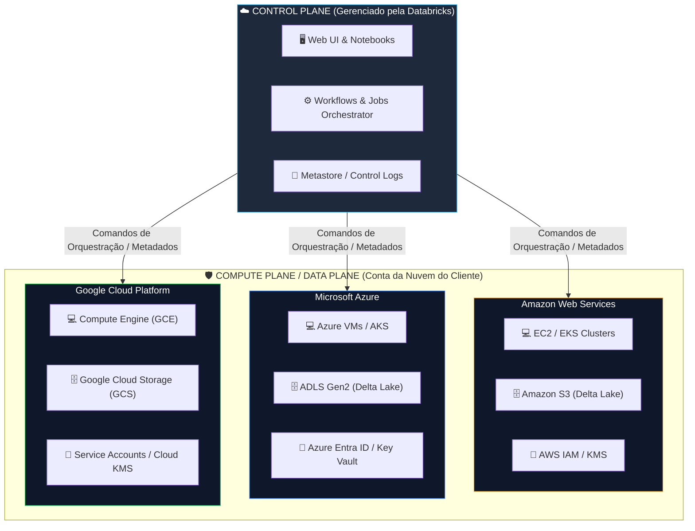

# ☁️ Arquitetura da Plataforma Databricks: Visão Geral Multi-Cloud (AWS, Azure e GCP)

A plataforma **Databricks** opera nativamente nas três principais nuvens públicas (**AWS**, **Azure** e **GCP**), mantendo a mesma experiência de desenvolvimento e o mesmo motor de processamento (**Apache Spark / Photon**), mas integrando-se aos serviços nativos de armazenamento, segurança e rede de cada provedor.

---

## 📐 1. Fluxograma da Arquitetura Multi-Cloud

O diagrama abaixo ilustra a relação de desacoplamento entre o **Control Plane** (gerenciado pela Databricks) e o **Compute Plane** (hospedado dentro da conta do cliente em qualquer nuvem):



## 🔄 2. Mapeamento de Serviços por Provedor de Nuvem
Apesar de a interface e o código PySpark/SQL serem idênticos em qualquer nuvem, a infraestrutura subjacente utiliza os recursos nativos de cada Cloud Service Provider (CSP):

| Camada de Arquitetura | 🟧 AWS (Amazon Web Services) | 🟦 Azure (Microsoft Azure) | 🟩 GCP (Google Cloud) |
| :--- | :--- | :--- | :--- |
| **Nome da Oferta** | Databricks on AWS | Azure Databricks | Databricks on Google Cloud |
| **Armazenamento de Dados (Lakehouse)** | Amazon S3 | Azure Data Lake Storage Gen2 (ADLS Gen2) | Google Cloud Storage (GCS) |
| **Processamento (Compute)** | Instâncias Amazon EC2 | Máquinas Virtuais (Azure VMs) | Instâncias Google Compute Engine (GCE) |
| **Gestão de Identidade e Acesso** | AWS IAM (Roles & Policies) | Azure Entra ID (antigo Azure AD) | Google Cloud IAM (Service Accounts) |
| **Cofre de Segredos (Secrets)** | AWS Secrets Manager | Azure Key Vault | Google Cloud Secret Manager |
| **Redes Privadas** | AWS VPC / PrivateLink | Azure VNet / VNet Peering | GCP VPC / Private Service Connect |
| **Orquestração Nativa Externa** | AWS Step Functions / MWAA | Azure Data Factory (ADF) | Cloud Composer (Airflow) |
| **Governança Global** | Unity Catalog + AWS Lake Formation | Unity Catalog + Azure Purview | Unity Catalog + Dataplex |


## 🛡️ 3. Integração de Segredos e Armazenamento
A. Acesso ao Data Lake Sem Credenciais Expostas
Em nenhuma das três nuvens é boa prática hardcodear chaves de acesso (Access Keys ou Connection Strings) nos notebooks. A autenticação com o armazenamento é feita via identidades nativas da nuvem:

AWS: Utiliza-se IAM Roles for Service Accounts (IRSA) ou Instance Profiles atribuídos ao cluster.

Azure: Utiliza-se Managed Identities (Identidade Gerenciada) ou Service Principals configurados no Unity Catalog.

GCP: Utiliza-se Service Accounts do Google vinculadas aos nós do cluster.

B. Montagem e Leitura de Armazenamento (dbutils.fs)

``` Python
# Exemplo genérico de leitura do Data Lake independente da nuvem
# O Unity Catalog abstrai a URI do storage via Volumes ou External Locations

# AWS S3
df_aws = spark.read.format("delta").load("s3://meu-bucket-bronze/vendas/")

# Azure ADLS Gen2
df_azure = spark.read.format("delta").load(
    "abfss://bronze@meustorage.dfs.core.windows.net/vendas/"
)

# GCP GCS
df_gcp = spark.read.format("delta").load("gs://meu-bucket-bronze/vendas/")
```
---

## 📊 Tabela Comparativa: Particularidades de Implantação por Nuvem

| Critério | AWS | Azure | GCP |
| :--- | :--- | :--- | :--- |
| **Faturamento / Billing** | Unificado via AWS Marketplace ou Contrato Databricks Direct. | Faturado diretamente na fatura da Azure *(First-party Service)*. | Unificado via Google Cloud Marketplace. |
| **Integração com Ferramentas de BI** | Amazon QuickSight, Power BI, Tableau. | **Power BI (Conector Nativo com suporte DirectQuery/Delta Sharing)**. | Looker, Power BI, Tableau. |
| **Nível de Integração de Plataforma** | Alta (Padrão de mercado para infraestrutura flexível). | **Máxima** (Tratado como um serviço nativo da Microsoft dentro do Portal Azure). | Alta (Integrado nativamente com a infraestrutura do Google Kubernetes Engine). |


---

## 💡 5. Dicas para a Certificação Databricks Fundamentals
🎯 O que a prova cobra sobre Multi-Cloud:

Consistência de Código: O código de pipeline (PySpark, Delta Lake, SQL) é 100% portátil entre AWS, Azure e GCP. Mudam apenas os URIs do storage e as regras de rede.

Arquitetura de Segurança: Os dados sempre permanecem na conta de nuvem do cliente (Compute/Data Plane), independente de ser AWS S3, Azure ADLS Gen2 ou GCP GCS.

Unity Catalog: É o único catálogo de governança capaz de gerenciar permissões e linhagem de dados de forma unificada entre diferentes provedores de nuvem simultaneamente.

<FollowUp label="Quer revisar o próximo tópico do exame: 'Delta Lake & Arquitetura Medalhão' com tabelas de controle e exemplos de código?" query="Vamos para o próximo tópico: Delta Lake e Arquitetura Medalhão (Bronze, Silver, Gold), com foco no que é cobrado no exame Databricks Fundamentals."/>


