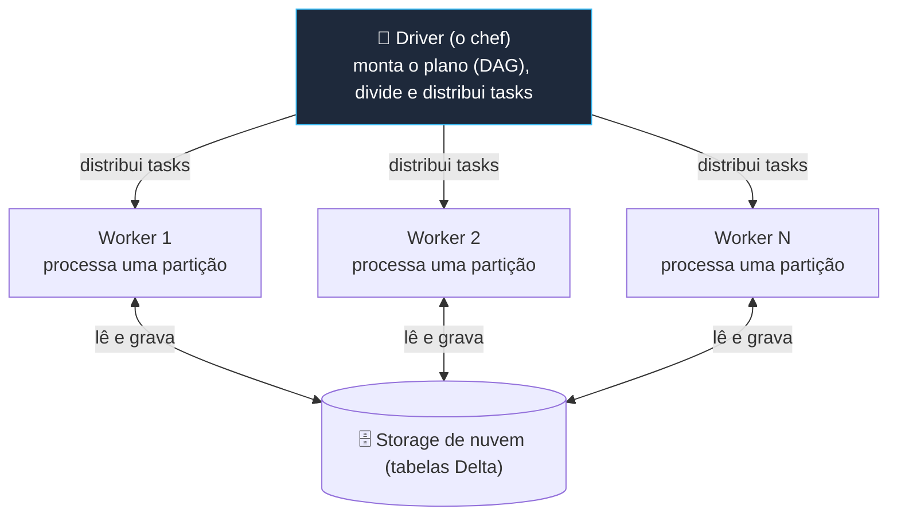

# 🖥️ Gestão de Clusters — Databricks Fundamentals

> **Exame:** Databricks Fundamentals
> **Tópico:** Módulo 1 — Gestão de Clusters: Driver e Workers, tipos de compute, auto-scaling e auto-termination.

---

## 📑 Índice
1. [O que é um cluster (compute)](#1-o-que-é-um-cluster-compute)
2. [Driver e Workers](#2-driver-e-workers)
3. [Tipos de compute](#3-tipos-de-compute)
4. [Configurações que caem na prova](#4-configurações-que-caem-na-prova)
5. [Resumo mental para a prova](#5-resumo-mental-para-a-prova)
6. [Possíveis pegadinhas da prova](#6-possíveis-pegadinhas-da-prova)

---

## 1. O que é um cluster (compute)

No Databricks, **compute** é o conjunto de máquinas que executa o seu código. A interface hoje usa o nome *Compute*, mas "cluster" continua sendo o termo mais usado. Notebooks, jobs e queries SQL **não processam nada sozinhos**: precisam estar ligados a um compute.

A ideia central é a **escalabilidade horizontal**: em vez de uma máquina gigante, várias máquinas comuns dividem o trabalho em paralelo.

---

## 2. Driver e Workers

Todo cluster tem **um driver**, que coordena, e **de 0 a N workers**, que executam. Pense numa cozinha de restaurante:

O driver não guarda dados: os workers leem e gravam direto no storage de nuvem.

- **Driver (o chef):** recebe o seu código, monta o plano de execução (DAG), divide o trabalho em *tasks*, distribui essas tasks e junta os resultados.
- **Workers (os cozinheiros):** cada um processa uma parte dos dados (uma partição) em paralelo, com CPU e memória próprias. Dentro de cada worker roda um *executor* do Spark.

**⚠️ Pegadinhas:**

- Um `collect()` ou `toPandas()` num DataFrame enorme traz tudo para o **driver**, que pode ficar sem memória. Os workers não ajudam aqui.
- Um cluster **Single Node** tem **só o driver**, que também faz o papel de worker. Serve para cargas pequenas, Pandas e testes, mas não tem paralelismo entre máquinas.

---

## 3. Tipos de compute

Regra de ouro: **all-purpose** para desenvolver, **job compute** ou **serverless** para produção, **SQL Warehouse** para SQL e BI.

| Tipo | Para quê | Ciclo de vida | Ideia para a prova |
| :--- | :--- | :--- | :--- |
| **All-purpose** (interativo) | Desenvolvimento em notebooks, exploração, depuração | Você liga e desliga, ou ele desliga sozinho por inatividade | Pode ser compartilhado por vários usuários; é mais caro por DBU |
| **Job compute** | Executar Jobs agendados (produção) | Criado no início do job e encerrado ao final | Mais barato por DBU; não serve para uso interativo |
| **SQL Warehouse** | Queries SQL, dashboards, ferramentas de BI (Power BI, Tableau) | Liga sob demanda e para por inatividade | Compute otimizado para SQL; tipos Serverless, Pro e Classic |
| **Serverless** (notebooks, jobs, pipelines) | Uso geral sem gerenciar infraestrutura | Inicia em segundos, gerenciado pela Databricks | Roda no Serverless Compute Plane, na conta da Databricks |

---

## 4. Configurações que caem na prova

### 1. Auto-scaling (dimensionamento automático)
Você define um mínimo e um máximo de workers. O Databricks adiciona workers quando a carga sobe e remove quando cai: performance nos picos, economia nos vales. A alternativa é o tamanho fixo (por exemplo, sempre 4 workers), previsível mas sujeito a desperdício.

### 2. Auto-termination (término por inatividade)
Se um cluster all-purpose fica um tempo sem executar nada (por exemplo, 30 minutos), ele desliga sozinho para parar a cobrança.

- Vale para all-purpose. O job compute já termina quando o job acaba.
- **Terminar não é excluir:** a configuração fica salva e o cluster pode ser religado.

### 3. Databricks Runtime (DBR)
É a "imagem" instalada nas máquinas: versão do Spark, do Delta Lake, bibliotecas e otimizações.

- **LTS:** suporte estendido, recomendado para produção.
- **ML Runtime:** já vem com bibliotecas de Machine Learning (scikit-learn, PyTorch, MLflow).

### 4. Photon
Motor de execução vetorizado, escrito em C++, da Databricks. Acelera SQL e operações com DataFrames e Delta sem mudar o código. Basta ativar no compute; nos SQL Warehouses já vem ligado.

### 5. Access mode
Define quem pode usar o cluster e liga o cluster ao Unity Catalog.

- **Standard** (antigo *Shared*): vários usuários compartilham o cluster, com isolamento entre eles.
- **Dedicated** (antigo *Single user*): o cluster é atribuído a um único usuário ou grupo.

### 6. Cluster policies e instance pools (controle de custo)

- **Policies:** regras do administrador que limitam o que pode ser criado (tamanho máximo, tipos de máquina, auto-termination obrigatória).
- **Instance pools:** mantêm máquinas pré-aquecidas e reduzem o tempo de inicialização de clusters clássicos.

---

## 5. Resumo mental para a prova

- **Driver** coordena, **workers** executam: um driver, N workers.
- **All-purpose** para desenvolver; **job compute** (mais barato) ou **serverless** para produção agendada; **SQL Warehouse** para SQL e BI.
- **Auto-scaling** ajusta a quantidade de workers; **auto-termination** desliga o cluster ocioso.
- **Photon** acelera sem mudar código; o **Runtime** é a versão do software; o **access mode** define o compartilhamento e a compatibilidade com Unity Catalog.

---

## 6. Possíveis pegadinhas da prova

Cada linha traz a afirmação falsa que costuma aparecer como alternativa e a versão correta.

| Tema | ❌ Afirmação falsa (armadilha) | ✅ O correto |
| :--- | :--- | :--- |
| Auto-termination | "O cluster é excluído ao atingir o tempo de inatividade." | Ele é desligado; a configuração fica salva e pode ser religado. |
| Auto-termination vs. auto-scaling | "Auto-termination reduz o número de workers quando a carga cai." | Quem ajusta workers é o auto-scaling; auto-termination desliga o cluster inteiro. |
| Job compute | "Use um cluster all-purpose ligado para rodar o ETL diário." | Produção agendada usa job compute (ou serverless): sobe, roda, termina e custa menos por DBU. |
| Job compute | "Job compute pode ser compartilhado para análises interativas." | Job compute existe só durante o job; uso interativo é no all-purpose. |
| Driver | "O driver processa os dados em paralelo." | O driver coordena; o processamento paralelo é feito pelos workers. |
| Driver | "`collect()` em um DataFrame enorme é seguro porque roda nos workers." | `collect()` e `toPandas()` trazem tudo para o driver, que pode ficar sem memória. |
| Onde ficam os dados | "As tabelas ficam armazenadas no cluster." | O cluster só processa; as tabelas Delta ficam no storage de nuvem e sobrevivem ao desligamento. |
| Single Node | "Single Node tem um worker e nenhum driver." | Tem só o driver, que acumula o papel de worker; não há paralelismo entre máquinas. |
| Photon | "Para usar o Photon é preciso reescrever o código." | Photon é transparente: basta habilitar no compute; nos SQL Warehouses já vem ligado. |
| SQL Warehouse | "SQL Warehouse é o melhor compute para treinar modelos de ML." | SQL Warehouse é para SQL e BI; ML usa clusters com ML Runtime. |
| Serverless | "O compute serverless roda na conta de nuvem do cliente." | Roda no Serverless Compute Plane, na conta da Databricks; os dados continuam no storage do cliente. |
| Serverless | "No serverless você configura tipo de instância e número de workers." | A Databricks gerencia e dimensiona; você não escolhe VMs. |
| Runtime | "O Databricks Runtime é o hardware do cluster." | Runtime é o software (versão do Spark, Delta e bibliotecas); hardware é o tipo de instância. |
| Access mode | "Access mode define o tamanho do cluster." | Define quem pode usar o cluster (Standard ou Dedicated) e a compatibilidade com Unity Catalog. |
| Instance pools | "Pools reduzem o custo por DBU." | Pools reduzem o tempo de inicialização com máquinas pré-aquecidas. |

> 💡 **Dica de leitura:** desconfie de alternativas com "sempre", "nunca" ou "100%". Em perguntas de custo, a resposta quase sempre envolve job compute, auto-termination ou serverless.
