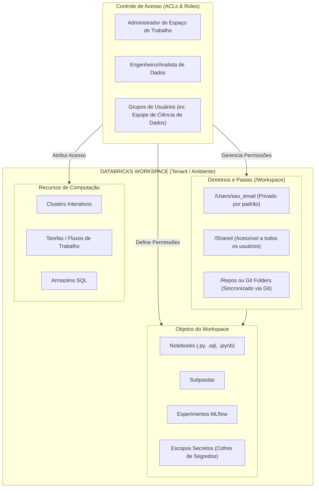

# 🗂️ Databricks Workspace: Navegação, Organização e Controle de Acesso (ACLs)

> **Exame:** Databricks Lakehouse Fundamentals  
> **Tópico:** Módulo 1 — Navegação pela Interface, Gerenciamento de Pastas, Workspaces e ACLs Básicos.

---

## 📐 1. Hierarquia de Objetos do Workspace e Governança (Mermaid.js)

O diagrama abaixo ilustra como a estrutura organizacional do **Databricks Workspace** separa os ativos de código/arquivos dos recursos de computação e como as permissões de acesso (**ACLs**) são aplicadas:

---
## 🧭 2. Navegação na Interface (Databricks UI Personas)

A barra lateral esquerda (*Left Navigation Bar*) permite alternar a experiência do usuário de acordo com o seu perfil de trabalho (**Personas**):

| Módulo / Persona | Ícone / Seção | Funcionalidade e Ativos Principais |
| :--- | :--- | :--- |
| **Workspace (Geral)** | 📂 **Workspace** | Navegação na árvore de arquivos, notebooks, pastas e repositórios Git. |
| **Data Engineering** | ⚙️ **Workflows / Compute** | Criação e monitoramento de Clusters Spark, agendamento de Jobs e Pipelines de DLT (Delta Live Tables). |
| **Databricks SQL** | 🧱 **SQL Warehouses / Queries** | Criação de dashboards visuais, editor de consultas SQL ad-hoc, alertas e gestão de SQL Warehouses. |
| **Machine Learning** | 🧪 **Experiments / Models** | Rastreamento de experimentos com MLflow, Feature Store e registro de modelos para deploy. |
| **Data Governance** | 🗄️ **Catalog (Unity Catalog)** | Exploração de Schemas, Tabelas Delta, Volumes, Linhagem de Dados e Permissões globais. |

## 📁 3. Estrutura e Gerenciamento de Pastas

| Caminho do Diretório | Escopo de Acesso Padrão | Uso Indicado no Dia a Dia |
| :--- | :--- | :--- |
| `/Workspace/Users/<email>/` | **Privado** ao usuário proprietário. | Prototipagem, rascunhos de código e análises exploratórias individuais. |
| `/Workspace/Shared/` | **Público** para todos os usuários do Workspace. | Templates de notebooks corporativos, documentações gerais e pipelines compartilhados. |
| `/Workspace/Users/<email>/<git-repo>` *(Git Folders)* | **Isolado por Usuário** com sincronização remota. | Desenvolvimento oficial com branches Git (GitHub/Azure Repos) voltado a CI/CD. |
   

