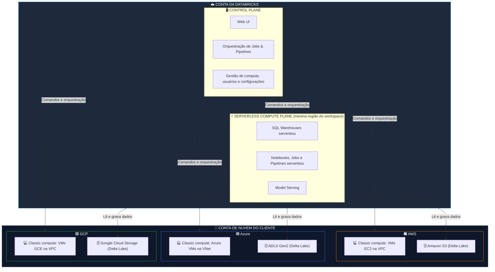

# ☁️ Arquitetura da Plataforma Databricks: Visão Geral Multi-Cloud (AWS, Azure e GCP)

A plataforma **Databricks** opera nativamente nas três principais nuvens públicas (**AWS**, **Azure** e **GCP**). Em todas elas, a experiência de desenvolvimento e o motor de processamento (**Apache Spark / Photon**) são os mesmos. O que muda é a integração com os serviços nativos de armazenamento, segurança e rede de cada provedor.

---

## 📐 1. Fluxograma da Arquitetura Multi-Cloud

A arquitetura tem **três planos**. A pergunta-chave é: **em qual conta cada um fica?**

* **Control Plane:** conta da Databricks.
* **Serverless Compute Plane:** conta da Databricks, na mesma região do workspace.
* **Classic Compute Plane:** conta de nuvem do cliente, dentro da rede virtual (VPC/VNet) do workspace.

Nos dois modelos de compute, as **tabelas e arquivos do cliente** ficam no **storage de nuvem do cliente**.



> ℹ️ O compute clássico usa **VMs comuns** de cada nuvem (EC2, Azure VMs, GCE). Ele **não** roda em Kubernetes gerenciado (EKS/AKS).

### Clássico vs. Serverless em uma tabela

| Critério | Compute Clássico | Compute Serverless |
| :--- | :--- | :--- |
| **Onde ficam as VMs?** | Na conta de nuvem do **cliente** | Na conta da **Databricks** |
| **Quem configura?** | Você (tipo de instância, workers, auto-scaling, auto-termination) | A Databricks gerencia e dimensiona |
| **Tempo de início** | Minutos | Segundos |
| **Cobrança** | DBUs + VMs na fatura da sua nuvem | Apenas DBUs (infraestrutura embutida) |
| **Onde ficam as tabelas?** | Storage do cliente | Storage do cliente |

---

## 🔄 2. Mapeamento de Serviços por Provedor de Nuvem

A interface e o código PySpark/SQL são idênticos em qualquer nuvem. A infraestrutura por baixo usa os recursos nativos de cada provedor (CSP):

| Camada de Arquitetura | 🟧 AWS | 🟦 Azure | 🟩 GCP |
| :--- | :--- | :--- | :--- |
| **Nome da Oferta** | Databricks on AWS | Azure Databricks | Databricks on Google Cloud |
| **Armazenamento de Dados (Lakehouse)** | Amazon S3 | Azure Data Lake Storage Gen2 (ADLS Gen2) | Google Cloud Storage (GCS) |
| **Compute Clássico** | Instâncias Amazon EC2 | Azure Virtual Machines | Instâncias Google Compute Engine (GCE) |
| **Identidade dos usuários** | IdP corporativo sincronizado com a conta Databricks (SSO/SCIM) | Microsoft Entra ID (antigo Azure AD) | IdP corporativo / Google Identity |
| **Acesso ao storage (Unity Catalog)** | *Storage credential* com **IAM Role** | *Storage credential* com **Access Connector** (Managed Identity) | *Storage credential* com **Google Service Account** |
| **Segredos** | *Secret scopes* do Databricks | *Secret scopes* do Databricks ou apoiados no **Azure Key Vault** | *Secret scopes* do Databricks |
| **Redes Privadas** | VPC / AWS PrivateLink | VNet injection / Private Link | VPC / Private Service Connect |
| **Orquestração externa (opcional)** | AWS Step Functions / MWAA | Azure Data Factory (ADF) | Cloud Composer (Airflow) |
| **Governança de dados** | **Unity Catalog** | **Unity Catalog** | **Unity Catalog** |

> 📌 A governança é a mesma nas três nuvens: **Unity Catalog**. Serviços como Lake Formation, Microsoft Purview ou Dataplex são ferramentas das nuvens que podem se integrar, mas **não fazem parte** da governança do Databricks.

---

## 🛡️ 3. Integração de Segredos e Armazenamento

### A. Acesso ao Data Lake sem credenciais expostas

Em nenhuma nuvem é boa prática colocar chaves de acesso (*Access Keys* ou *Connection Strings*) direto no código dos notebooks.

**Padrão atual com Unity Catalog:**
1. Um administrador cria uma **Storage Credential**, que guarda a identidade de nuvem com acesso ao storage:
   * **AWS:** IAM Role.
   * **Azure:** Access Connector for Azure Databricks (Managed Identity).
   * **GCP:** Google Service Account.
2. Ele cria uma **External Location**, que associa um caminho do storage a essa credencial.
3. Os usuários recebem permissões (`GRANT`) no Unity Catalog. Ninguém manipula chave de nuvem.

**Padrões legados (podem aparecer em ambientes antigos):** *instance profiles* na AWS e *mounts* com `dbutils.fs.mount`. Com Unity Catalog, prefira **Volumes** e **External Locations**.

**Segredos (senhas de bancos, tokens de API):** guarde-os em **secret scopes** e leia com `dbutils.secrets.get(scope="meu-scope", key="minha-chave")`.

### B. Leitura de dados

```python
# ✅ Recomendado: acessar pelo nome no Unity Catalog (catálogo.schema.tabela)
# O mesmo código funciona em AWS, Azure e GCP
df = spark.read.table("bronze.vendas.pedidos")

# ✅ Arquivos em um Volume do Unity Catalog
df_csv = spark.read.format("csv").option("header", True).load(
    "/Volumes/bronze/vendas/arquivos_brutos/"
)

# ⚙️ Acesso por caminho direto na nuvem (exige External Location configurada)
df_aws   = spark.read.format("delta").load("s3://meu-bucket-bronze/vendas/")
df_azure = spark.read.format("delta").load("abfss://bronze@meustorage.dfs.core.windows.net/vendas/")
df_gcp   = spark.read.format("delta").load("gs://meu-bucket-bronze/vendas/")
```

---

## 📊 4. Particularidades de Implantação por Nuvem

| Critério | AWS | Azure | GCP |
| :--- | :--- | :--- | :--- |
| **Faturamento** | Contrato direto com a Databricks ou AWS Marketplace | Na própria fatura da Azure *(serviço first-party da Microsoft)* | Contrato direto ou Google Cloud Marketplace |
| **Ferramentas de BI comuns** | Amazon QuickSight, Power BI, Tableau | **Power BI** (conector nativo) | Looker, Power BI, Tableau |
| **Nível de integração** | Alto | **Máximo** (serviço nativo dentro do Portal Azure) | Alto |

---

## 💡 5. Dicas para a Certificação Databricks Fundamentals

🎯 **O que a prova cobra sobre arquitetura e multi-cloud:**

* **Três planos:** o **Control Plane** (UI, jobs, configurações) fica na conta da Databricks. O **Classic Compute Plane** fica na conta de nuvem do cliente. O **Serverless Compute Plane** fica na conta da Databricks, na mesma região do workspace.
* **Onde ficam os dados:** as tabelas Delta e os Volumes ficam no **storage de nuvem do cliente** (S3, ADLS Gen2, GCS), seja o compute clássico ou serverless.
* **Cuidado com o "nunca":** o Control Plane não guarda suas tabelas, mas guarda código, configurações e metadados do workspace.
* **Serverless:** início em segundos e sem gestão de VMs. Exemplos: SQL Warehouses serverless, notebooks, jobs e pipelines serverless.
* **Portabilidade de código:** PySpark, SQL e Delta Lake funcionam igual nas três nuvens. Com Unity Catalog, você acessa dados pelo nome (`catálogo.schema.tabela`), sem depender do caminho da nuvem.
* **Unity Catalog:** é a governança unificada de dados e IA em todas as nuvens. Existe **um metastore por região**, e vários workspaces da mesma região podem compartilhar esse metastore. Para compartilhar dados entre regiões, nuvens ou empresas, use **Delta Sharing**.
* **Azure Databricks é first-party:** é cobrado na fatura da Azure e integrado ao Microsoft Entra ID.
