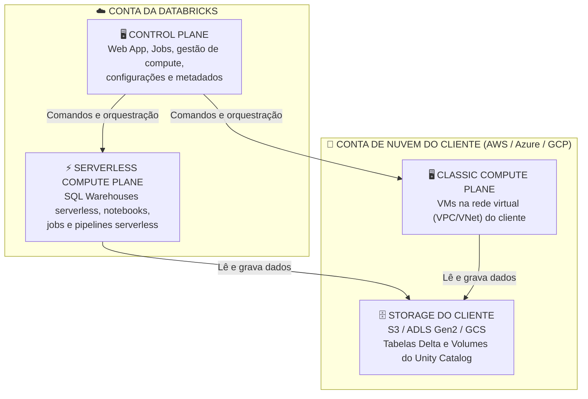

# Databricks Fundamentals — Módulo 1

> **Exame:** Databricks Lakehouse Fundamentals  
> **Tópico:** Módulo 1 — Introdução à Plataforma Lakehouse e Databricks  
> **Foco:** Conceitos-chave, definições de arquitetura e pegadinhas do exame oficial.

---

## 📑 Índice
1. [Evolução das Arquiteturas de Dados](#1-evolução-das-arquiteturas-de-dados)
2. [Pilares do Ecossistema Databricks](#2-pilares-do-ecossistema-databricks)
3. [Arquitetura da Plataforma: Control Plane, Compute Plane Clássico e Serverless](#3-️-arquitetura-da-plataforma-control-plane-compute-plane-clássico-e-serverless)
4. [Padrões de Questões e Pegadinhas do Exame](#4-padrões-de-questões-e-pegadinhas-do-exame)
5. [Cheat Sheet de Mnemônicos para a Prova](#5-cheat-sheet-de-mnemônicos-para-a-prova)

---

## 1. 🏛️ Evolução das Arquiteturas de Dados

O exame avalia constantemente a capacidade de comparar as limitações das arquiteturas legadas com a proposta de valor do **Data Lakehouse**.

## 📊 Comparativo de Arquiteturas: Data Warehouse vs. Data Lake vs. Data Lakehouse

| Arquitetura | Tipos de Dados | Casos de Uso Principais | Recursos Chave |
| :--- | :--- | :--- | :--- |
| **Data Warehouse** | Apenas Estruturado | BI, Dashboards e Relatórios | Alta performance SQL, schema rígido, formato proprietário. |
| **Data Lake** | Todos os Formatos (Estruturado, Semi e Não Estruturado) | Machine Learning, Ciência de Dados e Storage Bruto | Baixo custo, escala massiva, sem transações ACID nativas. |
| **Data Lakehouse** | Todos os Formatos (Estruturado, Semi e Não Estruturado) | BI + Machine Learning + Engenharia + IA | **Transações ACID + Performance de BI + Flexibilidade de ML + Padrão Aberto (Delta Lake)** |

### 🔹 Data Warehouse (DW)
* **Conceito:** Banco de dados relacional otimizado para consultas analíticas em dados estruturados (*Star Schema* / Snowflake Schema).
* **Pontos de Atenção na Prova:**
  * Não suporta dados não estruturados ou semi-estruturados (JSON complexo, imagens, áudio, logs brutos) para uso em IA e Machine Learning.
  * Armazenamento e computação acoplados (alto custo de escalabilidade).
  * Lock-in de fornecedor devido a formatos de arquivo e motores proprietários.

### 🔹 Data Lake
* **Conceito:** Repositório centralizado em nuvem (S3, ADLS Gen2, GCS) contendo dados em formatos abertos (CSV, Parquet, JSON).
* **Pontos de Atenção na Prova:**
  * **Ausência de Transações ACID:** Risco de leituras inconsistentes durante processos de escrita simultâneos.
  * **Problema do Data Swamp (Pântano de Dados):** Falta de governança e validação de esquema (*Schema Enforcement*), resultando em arquivos corrompidos ou mal formatados.
  * **Baixo Desempenho em BI:** Falta de mecanismos de indexação e compactação avançada.

### 🚀 Data Lakehouse
* **Conceito-Chave:** Arquitetura aberta que unifica o **gerenciamento e desempenho do Data Warehouse** (transações ACID, governança, consultas SQL rápidas) com a **flexibilidade e baixo custo do Data Lake** (formatos abertos, suporte a todos os tipos de dados).
* **Camada Base:** Sustentado pela camada de armazenamento em formato aberto **Delta Lake**.

---

## 2. 🧱 Pilares do Ecossistema Databricks

O exame exige associar cada tecnologia aberta ao seu papel específico na plataforma:

| Tecnologia Aberta | Função no Lakehouse | Ponto Focado no Exame |
| :--- | :--- | :--- |
| **Apache Spark** | Motor de processamento distribuído. | Processamento em lote (*Batch*) e fluxo (*Streaming*) unificados. |
| **Delta Lake** | Camada de armazenamento estruturado. | Traz **Transações ACID**, *Time Travel* e *Schema Enforcement* para o Lake. |
| **MLflow** | Gestão do ciclo de vida de Machine Learning. | Rastreamento de experimentos, métricas, parâmetros e registro de modelos. |
| **Unity Catalog** | Governança unificada de Dados e IA. | Controle de acesso centralizado (*Fine-grained ACLs*), linhagem de dados (*lineage*) multi-cloud. |

---

## 3. 🛡️ Arquitetura da Plataforma: Control Plane, Compute Plane Clássico e Serverless

A arquitetura do Databricks é dividida em **planos**. O ponto que mais cai na prova é saber **onde cada coisa roda** e **quem é dono da infraestrutura**.

> ⚠️ **Atualização importante:** a regra antiga "o processamento sempre acontece na conta do cliente" **só vale para o compute clássico**. Com o **serverless**, as máquinas rodam na conta da **Databricks**. O que não muda: suas tabelas e arquivos continuam no seu storage de nuvem.

### 📐 Visão geral

### 🧩 Os três planos

| Plano | Onde reside? | O que roda / fica ali | Isolamento |
| :--- | :--- | :--- | :--- |
| **Control Plane** | Conta da **Databricks** | Aplicação web (UI), orquestração de Jobs, gestão de compute, usuários e configurações do workspace | Serviço gerenciado pela Databricks |
| **Classic Compute Plane** | Conta de nuvem do **cliente**, dentro da rede virtual (VPC/VNet) de cada workspace | Clusters *all-purpose* e *job clusters* clássicos (VMs que o cliente vê e paga na sua nuvem) | Isolamento "natural": roda na conta do próprio cliente |
| **Serverless Compute Plane** | Conta da **Databricks**, na **mesma região** do workspace | SQL Warehouses serverless, notebooks, jobs e pipelines serverless, Model Serving | Fronteira de rede por workspace, camadas que separam clientes e controles de rede entre clusters do mesmo cliente |

### 🔍 Clássico vs. Serverless: o que muda na prática

| Critério | Compute Clássico | Compute Serverless |
| :--- | :--- | :--- |
| **Quem provisiona as VMs?** | O Databricks cria as VMs **na sua conta de nuvem** | O Databricks usa um pool de máquinas **na conta dele** |
| **Tempo de início** | Minutos (as VMs precisam subir) | Segundos (capacidade já está pronta) |
| **Gestão de infraestrutura** | Você escolhe tipo de instância, nº de workers, auto-scaling e auto-termination | O Databricks dimensiona e gerencia tudo |
| **Cobrança** | DBUs para a Databricks **+** VMs na fatura da sua nuvem | Tudo em DBUs (a infraestrutura já está embutida) |
| **Onde ficam suas tabelas?** | No storage da sua nuvem | **Também** no storage da sua nuvem |

### 🗄️ E os dados? Separe três categorias

1. **Seus dados (tabelas Delta, Volumes do Unity Catalog):** ficam no **storage de nuvem do cliente**. Isso vale para clássico e serverless.
2. **Ativos do workspace:** notebooks, queries SQL, dashboards, alertas, bibliotecas e pequenos arquivos que você cria na interface.
3. **Dados de sistema do workspace:** resultados de queries e jobs, revisões de notebooks, planos de consulta e logs de cluster.

As categorias 2 e 3 ficam no **workspace storage**, separado dos seus dados de negócio. Nos workspaces clássicos, isso é um bucket/container **na conta do cliente**, que também guarda o DBFS root legado.

> 📌 **Nuance (workspaces serverless):** existem workspaces totalmente serverless que usam o **default storage**, um armazenamento **gerenciado pela Databricks** para dados de sistema e ativos do Unity Catalog. Mesmo nesse caso, você pode conectar o storage da sua própria nuvem para seus catálogos e tabelas.

### ✅ Como responder na prova

* **"Onde ficam a interface web e a orquestração de jobs?"** → Control Plane, na conta da Databricks.
* **"Onde rodam os clusters clássicos?"** → Classic Compute Plane, na conta de nuvem do cliente.
* **"Onde roda o compute serverless?"** → Serverless Compute Plane, na conta da Databricks, na mesma região do workspace.
* **"Onde ficam as tabelas Delta do cliente?"** → No storage de nuvem do cliente (S3, ADLS Gen2, GCS), em ambos os modelos.
* **Cuidado com o "NUNCA":** o Control Plane não guarda suas tabelas, mas guarda código, configurações e metadados. Prefira respostas como *"os dados de negócio ficam no storage do cliente"*.

---

## 4. 🎯 Padrões de Questões e Pegadinhas do Exame

### ❓ Questão Padrão 1: Problemas do Data Lake
* **Pergunta:** "Qual é a principal limitação de um Data Lake tradicional que o Data Lakehouse resolve utilizando o Delta Lake?"
* ❌ **Incorreto:** "A incapacidade de armazenar grandes volumes de arquivos não estruturados."
* ✅ **Correto:** "A ausência de suporte a transações ACID e a falta de mecanismos para garantir a qualidade dos dados (Schema Enforcement)."

### ❓ Questão Padrão 2: Privacidade e Governança de Dados
* **Pergunta:** "Em qual componente da arquitetura do Databricks os dados brutos e as tabelas do cliente são processados e armazenados?"
* ❌ **Incorreto:** "No Control Plane gerenciado pela Databricks."
* ✅ **Correto:** "As tabelas ficam no storage de nuvem do cliente. São processadas no Compute Plane: o clássico fica na conta do cliente e o serverless na conta da Databricks, na mesma região do workspace."

### ❓ Questão Padrão 2b: Serverless
* **Pergunta:** "Uma equipe usa SQL Warehouses serverless. Onde ficam as máquinas que executam as consultas?"
* ❌ **Incorreto:** "Na rede virtual (VPC/VNet) da conta de nuvem do cliente."
* ✅ **Correto:** "No Serverless Compute Plane, na conta da Databricks. Os dados lidos continuam no storage do cliente."

### ❓ Questão Padrão 3: Formatos Abertos vs. Vendor Lock-in
* **Pergunta:** "Como a plataforma Databricks evita o vendor lock-in ao armazenar dados?"
* ❌ **Incorreto:** "Convertendo automaticamente todos os dados para tabelas relacionais proprietárias em disco."
* ✅ **Correto:** "Utilizando o Delta Lake, um formato de armazenamento de código aberto baseado em arquivos Parquet e logs de transação JSON."

---

## 5. 📌 Cheat Sheet de Mnemônicos para a Prova

* **Data Lakehouse =** Data Lake (Baixo custo/Formatos abertos) + Data Warehouse (ACID/Performance/Governança).
* **Control Plane =** Interface, Jobs, configurações e metadados (conta da Databricks).
* **Classic Compute Plane =** VMs na conta de nuvem do cliente.
* **Serverless Compute Plane =** Compute na conta da Databricks, mesma região do workspace.
* **Seus dados =** Storage de nuvem do cliente (S3 / ADLS Gen2 / GCS), nos dois modelos.
* **Delta Lake =** Parquet + Transaction Log (`_delta_log`).
* **Unificação =** Uma única plataforma para Data Engineering, SQL Analytics, Data Science e IA.
