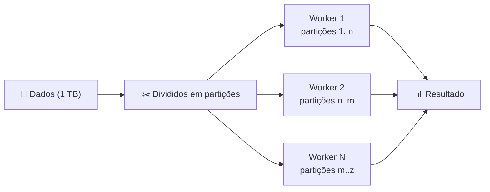
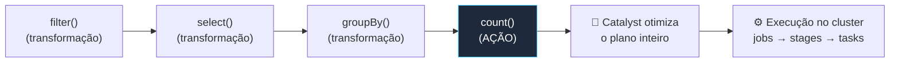

# ⚡ Apache Spark & DataFrames — Databricks Fundamentals

> **Exame:** Databricks Fundamentals
> **Tópico:** Módulo 3 — Processamento distribuído, Spark DataFrames, Spark SQL e Transformações vs. Ações.

---

## 📑 Índice
1. [O que é o Apache Spark](#1-o-que-é-o-apache-spark)
2. [Spark DataFrames](#2-spark-dataframes)
3. [Spark SQL](#3-spark-sql)
4. [Transformações vs. Ações](#4-transformações-vs-ações)
5. [Resumo mental para a prova](#5-resumo-mental-para-a-prova)
6. [Possíveis pegadinhas da prova](#6-possíveis-pegadinhas-da-prova)
7. [Questões no estilo da prova](#7-questões-no-estilo-da-prova)

---

## 1. O que é o Apache Spark

O Spark é um **motor de processamento distribuído de código aberto**. Ele foi criado pelos fundadores da Databricks na Universidade de Berkeley, e o Databricks é construído em cima dele.

O Spark se apoia em três pilares:

| Pilar | Como funciona | Por que importa |
| :--- | :--- | :--- |
| **Processamento distribuído** | Os dados são divididos em **partições**, e cada worker processa as suas em paralelo | Escala para terabytes e petabytes (escalabilidade horizontal) |
| **Computação em memória** | Mantém os dados intermediários **na RAM** sempre que possível, em vez de gravar em disco entre etapas como o Hadoop MapReduce | Muito mais rápido, sobretudo em processos com várias etapas e em Machine Learning |
| **Tolerância a falhas** | Guarda a **lineage** (sequência de transformações) de cada partição; se um worker cai, **recalcula só as partições perdidas** | Recupera falhas sem replicar os dados |

**Um motor, várias cargas:** o mesmo Spark faz processamento em lote (*batch*), *streaming* (Structured Streaming), SQL (Spark SQL) e Machine Learning (MLlib). As APIs existem em Python (**PySpark**), SQL, Scala, R e Java.



---

## 2. Spark DataFrames

Um **DataFrame** é uma tabela distribuída. Tem linhas e **colunas com nome e tipo**, ou seja, um *schema*.

### Pandas vs. Spark DataFrame

| | Pandas | Spark DataFrame |
| :--- | :--- | :--- |
| **Onde roda** | Uma máquina só | Distribuído entre os workers |
| **Volume** | Limitado à RAM de um computador | Escala para terabytes e petabytes |
| **Execução** | Imediata (*eager*) | Preguiçosa (*lazy*), veja a seção 4 |
| **Mutabilidade** | Pode alterar no lugar | **Imutável**: cada operação gera um **novo** DataFrame |

### Criando DataFrames

O objeto `spark` (a *SparkSession*) já vem pronto em todo notebook do Databricks. Ele é a porta de entrada para o Spark.

```python
# A partir de uma tabela (o mais comum no Databricks)
df = spark.read.table("bronze.vendas.pedidos")

# A partir de arquivos
df_csv  = spark.read.format("csv").option("header", True).load("/Volumes/bronze/vendas/brutos/")
df_json = spark.read.json("/Volumes/bronze/vendas/eventos/")

# A partir de dados em memória (testes)
df_teste = spark.createDataFrame([(1, "Ana"), (2, "Bia")], ["id", "nome"])
```

### Operações básicas

```python
from pyspark.sql import functions as F

resultado = (df
    .select("pedido_id", "cliente", "valor", "status")      # escolher colunas
    .filter(F.col("status") == "pago")                      # filtrar linhas
    .withColumn("valor_com_frete", F.col("valor") + 15)     # criar/alterar coluna
    .groupBy("cliente")                                     # agrupar
    .agg(F.sum("valor").alias("total_gasto"))               # agregar
    .orderBy(F.desc("total_gasto"))                         # ordenar
)

display(resultado)
```

A cada `.filter()` ou `.withColumn()`, o `df` original **não muda**. O que nasce é um DataFrame novo, por causa da **imutabilidade**.

### Gravando resultados

```python
resultado.write.mode("overwrite").saveAsTable("gold.vendas.top_clientes")
```

No Databricks, o formato padrão de tabela é o **Delta** (veja o Módulo 4).

---

## 3. Spark SQL

O Spark SQL permite consultar dados com **SQL tradicional**.

> 🎯 **Ponto-chave da prova:** SQL e DataFrames usam o **mesmo motor** e o **mesmo otimizador (Catalyst)**, então a performance é equivalente. Você escolhe a sintaxe pela preferência.

### Três formas de usar

```sql
%sql
-- 1. Consultar uma tabela do catálogo (catálogo.schema.tabela)
SELECT cliente, SUM(valor) AS total
FROM bronze.vendas.pedidos
WHERE status = 'pago'
GROUP BY cliente
```

```python
# 2. Rodar SQL de dentro do Python e receber um DataFrame
df_sql = spark.sql("SELECT * FROM bronze.vendas.pedidos WHERE valor > 100")

# 3. Expor um DataFrame para o SQL com uma temp view
df.createOrReplaceTempView("pedidos_tmp")
```

### Consultar arquivos diretamente

Não é preciso criar uma tabela antes. O formato vai antes do ponto e o caminho fica entre **crases**:

```sql
%sql
SELECT * FROM json.`/Volumes/bronze/vendas/eventos/`;
SELECT * FROM delta.`s3://meu-bucket/silver/clientes/`;
```

### Tabela vs. Temp View

| | Tabela | Temp View |
| :--- | :--- | :--- |
| **Persistência** | Persistida, registrada no catálogo | Existe **só durante a sessão** do notebook |
| **Dados** | Grava dados no storage | Não grava dados; é só um "apelido" para uma consulta |
| **Visibilidade** | Todos com permissão | Apenas a sessão que a criou |

---

## 4. Transformações vs. Ações

> 🎯 **Este é o tópico mais cobrado do módulo.**

O Spark trabalha com **avaliação preguiçosa** (*lazy evaluation*). "Preguiçosa" aqui significa **adiada**, e não lenta.

| | Transformações | Ações |
| :--- | :--- | :--- |
| **O que fazem** | Descrevem o que fazer e devolvem um novo DataFrame | **Disparam a execução** no cluster e devolvem um resultado ou gravam dados |
| **Executam na hora?** | ❌ Não, só anotam a receita | ✅ Sim |
| **Exemplos** | `select`, `filter`/`where`, `withColumn`, `groupBy`, `join`, `orderBy`, `distinct`, `union` | `count()`, `show()`, `display()`, `collect()`, `take()`, `first()`, `write`/`saveAsTable` |

```python
df2 = df.filter(F.col("valor") > 100)      # nada roda ainda
df3 = df2.select("cliente", "valor")        # nada roda ainda
df3.count()                                 # AGORA o cluster trabalha
```



### Por que ser preguiçoso é bom?

Como o Spark espera até a ação, ele enxerga **o plano inteiro** antes de executar. Então o otimizador **Catalyst** consegue reorganizar o trabalho. Por exemplo, ele aplica filtros o mais cedo possível e lê só as colunas necessárias. Só depois disso a execução acontece, dividida em *jobs*, *stages* e *tasks* distribuídas aos workers.

### Transformações Narrow vs. Wide

| Tipo | Exemplos | O que acontece | Custo |
| :--- | :--- | :--- | :--- |
| **Narrow** | `filter`, `select`, `withColumn` | Cada partição é processada sozinha, sem trocar dados entre workers | Baixo |
| **Wide** | `groupBy`, `join`, `orderBy`, `distinct` | Exigem **shuffle**: redistribuição de dados entre os workers pela rede | Alto (a parte mais cara) |

---

## 5. Resumo mental para a prova

- Spark = **distribuído** (partições em paralelo) + **em memória** (rápido) + **tolerante a falhas** (recalcula pela lineage).
- DataFrame = tabela distribuída, com schema, **imutável**, parecida com Pandas mas escalável.
- SQL e DataFrames usam o **mesmo motor e o mesmo otimizador**, sem diferença de performance.
- **Transformações são lazy** (só montam o plano); **ações disparam** a execução.
- Wide transformations causam **shuffle**, que é a parte cara.
- Temp view existe só na sessão; tabela é persistida no catálogo.

---

## 6. Possíveis pegadinhas da prova

| ❌ Afirmação falsa (armadilha) | ✅ O correto |
| :--- | :--- |
| "Lazy evaluation significa que o Spark é lento." | Significa execução **adiada** até uma ação, o que permite otimizar o plano. |
| "`filter()` executa imediatamente no cluster." | É transformação: só registra o passo. Nada roda até uma ação. |
| "Spark SQL é mais lento que DataFrames (ou vice-versa)." | Os dois usam o mesmo motor e o otimizador Catalyst. |
| "O Spark garante tolerância a falhas replicando os dados na memória." | Ele usa a **lineage** para recalcular só as partições perdidas. |
| "`withColumn` altera o DataFrame original." | DataFrames são imutáveis; retorna um novo DataFrame. |
| "Uma temp view grava os dados permanentemente." | Temp view existe só na sessão e não grava dados. Para persistir, use tabela. |
| "Spark serve só para processamento em lote." | O mesmo motor faz batch, streaming, SQL e ML. |
| "`count()` é uma transformação." | `count()`, `show()`, `collect()` e `write` são **ações**. |
| "Spark DataFrame e Pandas funcionam igual, só muda o nome." | Spark é distribuído, lazy e imutável; Pandas roda numa máquina e executa na hora. |

> 💡 **Dica de leitura:** se a pergunta perguntar "quando o processamento acontece", procure a **ação**. Se falar em "operação cara" ou "troca de dados entre workers", pense em **shuffle** e **wide transformations**.

---

## 7. Questões no estilo da prova

**1. Qual característica explica por que o Spark é muito mais rápido que o Hadoop MapReduce em processos com várias etapas?**
- a) Ele grava os dados em disco após cada etapa
- b) Ele mantém os dados intermediários em memória sempre que possível
- c) Ele roda em uma única máquina mais potente
- d) Ele só aceita dados estruturados

**2. Um worker falha no meio do processamento. Como o Spark recupera as partições perdidas?**
- a) Reinicia o job inteiro do zero, sempre
- b) Restaura uma cópia replicada de cada partição guardada no driver
- c) Usa a lineage para recalcular apenas as partições perdidas
- d) Descarta as partições perdidas e continua

**3. Qual das operações abaixo é uma AÇÃO, ou seja, dispara a execução no cluster?**
- a) `filter()`
- b) `withColumn()`
- c) `groupBy()`
- d) `count()`

**4. Qual é a principal vantagem da avaliação preguiçosa (lazy evaluation) no Spark?**
- a) Reduzir o uso de memória do notebook
- b) Permitir que o otimizador enxergue o plano inteiro e o otimize antes de executar
- c) Executar cada transformação assim que ela é escrita
- d) Evitar o uso de workers

**5. Sobre a performance de Spark SQL versus a API de DataFrames, qual afirmação está correta?**
- a) Spark SQL é sempre mais rápido
- b) DataFrames em Python são sempre mais rápidos
- c) Ambos usam o mesmo motor e o mesmo otimizador, com performance equivalente
- d) Spark SQL só funciona em SQL Warehouses

**6. O que acontece com o DataFrame `df` após executar `df2 = df.withColumn("novo", F.lit(1))`?**
- a) `df` passa a ter a coluna "novo"
- b) `df` permanece igual; `df2` é um novo DataFrame com a coluna "novo"
- c) `df` é apagado da memória
- d) A coluna é gravada imediatamente na tabela de origem

**7. Qual das operações abaixo provoca shuffle (troca de dados entre workers)?**
- a) `select()`
- b) `filter()`
- c) `groupBy()`
- d) `withColumn()`

<details>
<summary><b>📝 Gabarito (clique para abrir)</b></summary>

| Questão | Resposta | Por quê |
| :--- | :--- | :--- |
| 1 | b | A computação em memória evita gravar e reler o disco entre etapas. |
| 2 | c | O Spark guarda a receita (lineage) e recalcula só o que foi perdido. |
| 3 | d | `count()` é ação; as outras são transformações lazy. |
| 4 | b | O Catalyst vê todas as etapas e reorganiza o plano antes de executar. |
| 5 | c | SQL e DataFrames são duas interfaces para o mesmo motor e otimizador. |
| 6 | b | DataFrames são imutáveis; e, sendo lazy, nada é gravado. |
| 7 | c | `groupBy` é wide: precisa juntar linhas de mesma chave vindas de vários workers. |

</details>
