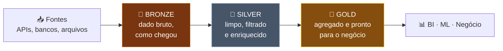

# 🏛️ Delta Lake & Arquitetura Medallion — Databricks Fundamentals

> **Exame:** Databricks Fundamentals
> **Tópico:** Módulo 4 — Delta Lake, Transações ACID, Time Travel e Arquitetura Medallion (Bronze, Silver e Gold).

---

## 📑 Índice
1. [O que é o Delta Lake](#1-o-que-é-o-delta-lake)
2. [Transações ACID](#2-transações-acid)
3. [Time Travel (viagem no tempo)](#3-time-travel-viagem-no-tempo)
4. [Outros recursos do Delta Lake](#4-outros-recursos-do-delta-lake)
5. [Arquitetura Medallion](#5-arquitetura-medallion)
6. [Resumo mental para a prova](#6-resumo-mental-para-a-prova)
7. [Possíveis pegadinhas da prova](#7-possíveis-pegadinhas-da-prova)
8. [Questões no estilo da prova](#8-questões-no-estilo-da-prova)

---

## 1. O que é o Delta Lake

O **Delta Lake** é uma **camada de armazenamento de código aberto** (mantida pela Linux Foundation) que roda sobre o storage de nuvem que você já tem: S3, ADLS Gen2 ou GCS. Ela traz para o Data Lake recursos que antes só os Data Warehouses tinham:

- transações ACID;
- validação de schema;
- histórico de versões (time travel);
- comandos como `UPDATE`, `DELETE` e `MERGE`.

### Como funciona por dentro

Uma tabela Delta é só uma pasta com duas coisas:

```
minha_tabela/
├── part-0000.parquet        ← os dados, em arquivos Parquet (formato aberto, colunar)
├── part-0001.parquet
└── _delta_log/              ← o transaction log (log de transações)
    ├── 00000000000000000000.json   ← versão 0: tabela criada
    ├── 00000000000000000001.json   ← versão 1: INSERT
    └── 00000000000000000002.json   ← versão 2: UPDATE
```

> 🎯 **Delta Lake = arquivos Parquet + transaction log (`_delta_log`)**

O **`_delta_log`** é o coração de tudo. Cada operação vira um arquivo JSON numerado, que registra quais arquivos Parquet entraram e saíram da tabela. Quem lê a tabela consulta o log primeiro para saber **quais arquivos formam a versão atual**.

### Por que isso importa para a prova

- **Formato aberto:** sem *vendor lock-in*. Os dados são Parquet comum no **seu** storage.
- **Padrão do Databricks:** toda tabela criada no Databricks é Delta, a menos que você diga o contrário.

---

## 2. Transações ACID

O problema do Data Lake tradicional era a ausência de transações. Se um job caía no meio da gravação, ficavam arquivos pela metade. Quem lia ao mesmo tempo via dados inconsistentes. O Delta resolve isso com as quatro garantias ACID:

| Letra | Garantia | Na prática, no Delta |
| :--- | :--- | :--- |
| **A**tomicidade | A operação acontece **por inteiro ou não acontece** | Um job que falha no meio não deixa dados pela metade, porque a versão só "existe" quando o commit entra no `_delta_log` |
| **C**onsistência | A tabela sempre vai de um estado válido para outro | O **schema enforcement** rejeita dados com colunas ou tipos errados |
| **I**solamento | Operações simultâneas não interferem entre si | Quem lê vê uma versão (*snapshot*) completa, mesmo enquanto outro job grava |
| **D**urabilidade | O que foi confirmado não se perde | Dados e log ficam gravados no storage de nuvem, que é durável |

### Schema enforcement vs. Schema evolution

| | Schema enforcement (validação) | Schema evolution (evolução) |
| :--- | :--- | :--- |
| **Comportamento** | **Padrão.** Rejeita gravações com colunas a mais ou tipos diferentes | Permite que o schema mude quando a mudança é intencional |
| **Como ativar** | Já vem ligado | Explicitamente, por exemplo com `mergeSchema` |
| **Objetivo** | Evitar o *data swamp* | Acompanhar mudanças legítimas na fonte |

```python
(df_novo.write
    .format("delta")
    .mode("append")
    .option("mergeSchema", "true")   # permite adicionar a coluna nova
    .saveAsTable("silver.vendas.pedidos"))
```

---

## 3. Time Travel (viagem no tempo)

Como o `_delta_log` guarda todas as versões, você pode **consultar a tabela como ela era antes**.

```sql
-- Ver o histórico: versão, data, operação, usuário
DESCRIBE HISTORY silver.vendas.pedidos;

-- Consultar por número de versão
SELECT * FROM silver.vendas.pedidos VERSION AS OF 3;

-- Consultar por data/hora
SELECT * FROM silver.vendas.pedidos TIMESTAMP AS OF '2026-10-31';

-- Desfazer um erro: voltar a tabela para uma versão anterior
RESTORE TABLE silver.vendas.pedidos TO VERSION AS OF 3;
```

```python
# Equivalente em PySpark
df_v3 = spark.read.option("versionAsOf", 3).table("silver.vendas.pedidos")
```

### Para que serve

- **Desfazer erros:** alguém rodou um `DELETE` errado e você usa `RESTORE`.
- **Auditoria:** quem mudou o quê e quando.
- **Reprodutibilidade:** reproduzir um relatório ou treinar um modelo de ML com os dados exatos de uma data.

### O limite do time travel: `VACUUM`

Versões antigas dependem de arquivos Parquet antigos. O `VACUUM` apaga os arquivos que **não fazem mais parte da versão atual** e são mais velhos que o período de retenção, que por padrão é **7 dias**.

> ⚠️ Depois do `VACUUM`, você **não consegue mais voltar** para versões que usavam os arquivos apagados. O `VACUUM` economiza storage, mas encurta o time travel.

---

## 4. Outros recursos do Delta Lake

| Recurso | O que faz |
| :--- | :--- |
| **`UPDATE` / `DELETE`** | Alteram e removem linhas no Data Lake, o que era muito difícil antes do Delta |
| **`MERGE`** | Faz **upsert**: atualiza o que já existe e insere o que é novo. É o comando mais usado na camada Silver |
| **`OPTIMIZE`** | Junta muitos arquivos pequenos em arquivos maiores, o que acelera as leituras |
| **Liquid clustering / Z-order** | Organizam os dados pelas colunas mais filtradas, para o Spark pular arquivos que não interessam |
| **Batch + streaming** | A mesma tabela Delta pode ser lida e escrita tanto em lote quanto em streaming |

```sql
MERGE INTO silver.vendas.clientes AS destino
USING novos_clientes AS origem
ON destino.cliente_id = origem.cliente_id
WHEN MATCHED THEN UPDATE SET *
WHEN NOT MATCHED THEN INSERT *;
```

> 💡 **Não confunda:** `OPTIMIZE` **junta** arquivos pequenos (performance). `VACUUM` **apaga** arquivos antigos (storage).

---

## 5. Arquitetura Medallion

A Arquitetura Medallion é um **padrão de organização** dos dados em camadas. A qualidade aumenta a cada camada, e todas elas são **tabelas Delta**.



| Camada | O que contém | Transformações típicas | Quem usa |
| :--- | :--- | :--- | :--- |
| **🥉 Bronze** | Dados **brutos**, do jeito que chegaram da fonte, com metadados como data de carga e arquivo de origem | Quase nenhuma: só ingestão. Não se apaga nada | Engenheiros de dados; serve de **histórico e reprocessamento** |
| **🥈 Silver** | Dados **limpos, filtrados e enriquecidos** | Remover duplicatas, tratar nulos, padronizar tipos e formatos, `MERGE`, `JOIN`s entre fontes | Engenheiros, cientistas de dados e analistas |
| **🥇 Gold** | Dados **agregados e modelados para o negócio** | `GROUP BY`, métricas, KPIs, tabelas por área (vendas, finanças) | Analistas de BI, dashboards, executivos e modelos de ML |

### Por que separar em camadas

- **Rastreabilidade:** dá para seguir um número do dashboard até o dado bruto.
- **Reprocessamento:** se uma regra da Silver estiver errada, você corrige e reprocessa a partir da Bronze, sem buscar os dados de novo na fonte.
- **Qualidade crescente:** cada camada tem um papel claro e um público claro.

> 📎 Veja também a nota [`Log na Arquitetura Medalhão.md`](../Nuvens%20/Databricks/Log%20na%20Arquitetura%20Medalh%C3%A3o.md).

---

## 6. Resumo mental para a prova

- **Delta Lake = Parquet + `_delta_log`**, open source e formato padrão do Databricks.
- **ACID** acaba com gravações pela metade e leituras inconsistentes do Data Lake.
- **Schema enforcement** rejeita dados fora do schema; **schema evolution** (`mergeSchema`) permite mudanças intencionais.
- **Time travel:** `VERSION AS OF`, `TIMESTAMP AS OF`, `DESCRIBE HISTORY`, `RESTORE`. Fica limitado pelo `VACUUM` (retenção padrão de 7 dias).
- **`OPTIMIZE`** junta arquivos; **`VACUUM`** apaga arquivos antigos.
- **Medallion:** Bronze (bruto), Silver (limpo), Gold (agregado), todas em Delta.

---

## 7. Possíveis pegadinhas da prova

| ❌ Afirmação falsa (armadilha) | ✅ O correto |
| :--- | :--- |
| "Delta Lake é um formato proprietário da Databricks." | É **open source** (Linux Foundation), baseado em Parquet. |
| "Delta Lake é um banco de dados separado do Data Lake." | É uma **camada** sobre o storage existente (S3, ADLS, GCS). |
| "O `_delta_log` guarda os dados da tabela." | O log guarda o **histórico de transações**; os dados ficam nos Parquet. |
| "O Delta aceita qualquer schema na gravação." | Por padrão faz **schema enforcement** e rejeita. Mudar exige `mergeSchema`. |
| "Time travel funciona para sempre." | É limitado pela retenção: depois do `VACUUM`, as versões antigas se perdem. |
| "`VACUUM` cria uma versão nova ou faz backup." | `VACUUM` **apaga** arquivos antigos não usados; economiza storage e reduz o time travel. |
| "`VACUUM` e `OPTIMIZE` fazem a mesma coisa." | `OPTIMIZE` junta arquivos pequenos (performance); `VACUUM` apaga arquivos antigos (storage). |
| "A camada Bronze já tem dados limpos e sem duplicatas." | Bronze é **bruta**; a limpeza é papel da Silver. |
| "A Gold guarda o dado mais detalhado possível." | Gold é **agregada** para o negócio; o detalhe fica em Silver e Bronze. |
| "Medallion é um recurso que se ativa no Databricks." | É um **padrão de design**, uma forma de organizar tabelas. |
| "Atomicidade significa que duas pessoas podem gravar ao mesmo tempo." | Isso é **isolamento**. Atomicidade é "tudo ou nada". |

> 💡 **Dica de leitura:** "job falhou no meio" → **Atomicidade**. "Leitura enquanto outro grava" → **Isolamento**. "Coluna inesperada" → **Schema enforcement**. "Voltar ao estado anterior" → **Time travel / RESTORE**.

---

## 8. Questões no estilo da prova

**1. Do que é composta uma tabela Delta no storage?**
- a) Um banco de dados relacional proprietário da Databricks
- b) Arquivos Parquet com os dados e um transaction log (`_delta_log`)
- c) Arquivos CSV com um índice em memória
- d) Apenas arquivos JSON

**2. Um job de gravação falha no meio. Graças a qual garantia ACID a tabela Delta não fica com dados pela metade?**
- a) Atomicidade
- b) Isolamento
- c) Durabilidade
- d) Escalabilidade

**3. Um engenheiro tenta gravar em uma tabela Delta um DataFrame com uma coluna que não existe na tabela, sem nenhuma opção extra. O que acontece?**
- a) A coluna é adicionada automaticamente
- b) A coluna extra é ignorada silenciosamente
- c) A gravação é rejeitada por schema enforcement
- d) A tabela é recriada com o novo schema

**4. Alguém executou um `DELETE` errado em uma tabela Delta. Qual recurso permite voltar a tabela ao estado anterior?**
- a) `VACUUM`
- b) `OPTIMIZE`
- c) Time travel com `RESTORE TABLE ... TO VERSION AS OF`
- d) Schema evolution

**5. Qual o efeito de executar `VACUUM` em uma tabela Delta?**
- a) Cria um backup completo da tabela
- b) Apaga arquivos antigos não usados pela versão atual, limitando o time travel
- c) Junta arquivos pequenos para acelerar leituras
- d) Valida o schema da tabela

**6. Na Arquitetura Medallion, em qual camada ficam os dados limpos, sem duplicatas, com tipos padronizados e enriquecidos com outras fontes?**
- a) Bronze
- b) Silver
- c) Gold
- d) Landing

**7. Uma diretora quer um dashboard com o faturamento mensal por região. De qual camada o dashboard deve ler?**
- a) Bronze
- b) Silver
- c) Gold
- d) Direto da fonte original

**8. Qual comando atualiza registros existentes e insere os novos em uma única operação (upsert)?**
- a) `INSERT INTO`
- b) `MERGE INTO`
- c) `OPTIMIZE`
- d) `RESTORE`

<details>
<summary><b>📝 Gabarito (clique para abrir)</b></summary>

| Questão | Resposta | Por quê |
| :--- | :--- | :--- |
| 1 | b | Delta Lake = Parquet (dados) + `_delta_log` (histórico de transações), em formato aberto. |
| 2 | a | Atomicidade = tudo ou nada; a versão só existe quando o commit entra no log. |
| 3 | c | Schema enforcement é o padrão; aceitar a mudança exige schema evolution (`mergeSchema`). |
| 4 | c | `DESCRIBE HISTORY` mostra as versões e `RESTORE` volta a tabela para uma delas. |
| 5 | b | `VACUUM` apaga arquivos antigos (retenção padrão de 7 dias); juntar arquivos é o `OPTIMIZE`. |
| 6 | b | Silver = limpo, filtrado e enriquecido. |
| 7 | c | Gold = agregado e modelado para o negócio, pronto para BI. |
| 8 | b | `MERGE` faz upsert: `WHEN MATCHED THEN UPDATE` e `WHEN NOT MATCHED THEN INSERT`. |

</details>
