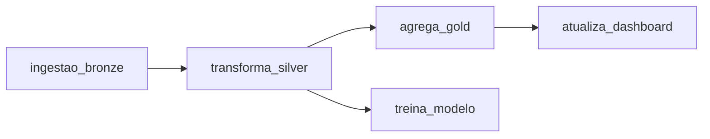
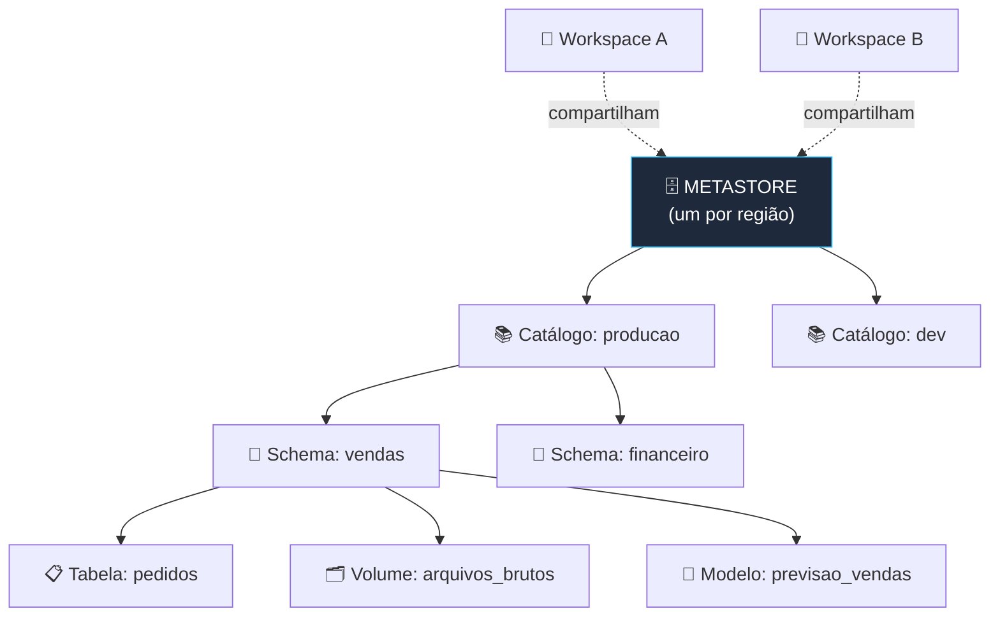
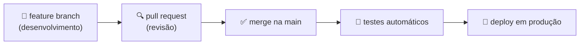

# 🔄 Jobs, Unity Catalog e Git — Databricks Fundamentals

> **Exame:** Databricks Fundamentals
> **Tópico:** Módulo 5 — Orquestração com Jobs, governança com Unity Catalog e versionamento com Git folders.

---

## 📑 Índice
1. [Databricks Jobs (Lakeflow Jobs)](#1-databricks-jobs-lakeflow-jobs)
2. [Unity Catalog](#2-unity-catalog)
3. [Integração com Git (Git folders)](#3-integração-com-git-git-folders)
4. [Resumo mental para a prova](#4-resumo-mental-para-a-prova)
5. [Possíveis pegadinhas da prova](#5-possíveis-pegadinhas-da-prova)
6. [Questões no estilo da prova](#6-questões-no-estilo-da-prova)

---

## 1. Databricks Jobs (Lakeflow Jobs)

Um **Job** é a forma de rodar código **automaticamente**, sem alguém apertar "Run" no notebook. É o orquestrador nativo do Databricks. Na interface, fica em **Jobs & Pipelines** (antes se chamava *Workflows*).

### A estrutura: Job → Tasks

Um job tem uma ou mais **tarefas (tasks)**. Cada task pode ser de vários tipos:

- notebook;
- script Python;
- query SQL;
- pipeline;
- dbt;
- outro job, entre outros.

As tasks podem ter **dependências**, formando um fluxo (DAG):



No exemplo, a task `transforma_silver` só começa quando `ingestao_bronze` termina com sucesso. Depois dela, `agrega_gold` e `treina_modelo` rodam **em paralelo**.

### Gatilhos (triggers): quando o job roda

| Gatilho | Exemplo de uso |
| :--- | :--- |
| **Agendado** (*scheduled*, com expressão cron) | Todo dia às 2h da manhã |
| **Chegada de arquivo** (*file arrival*) | Quando um novo arquivo cai num Volume ou External Location |
| **Atualização de tabela** (*table update*) | Quando uma tabela de origem recebe dados novos |
| **Contínuo** (*continuous*) | Roda sem parar, reiniciando logo após terminar |
| **Manual** ou via API | Disparado por uma pessoa ou por outro sistema |

### Configurações importantes

| Configuração | O que faz |
| :--- | :--- |
| **Compute** | Use **job compute** ou **serverless** (Módulo 1), mais barato do que deixar um all-purpose ligado |
| **Parâmetros** | Passam valores para as tasks, como os widgets do Módulo 2 |
| **Retries** | Quantas vezes repetir uma task que falhou |
| **Notificações** | E-mail, Slack e outros canais em caso de sucesso, falha ou atraso |
| **Histórico de execuções** | Cada execução (*run*) fica registrada com logs e duração |
| **Repair run** | Após uma falha, reexecuta **só as tasks que falharam** e as que dependem delas |

> 💡 Existem também os **Lakeflow Declarative Pipelines** (antigo *Delta Live Tables*, DLT). Neles você **declara** as tabelas e as regras de qualidade, e o Databricks cuida da orquestração e da infraestrutura. Para a Fundamentals, basta saber que existem e que são *declarativos*.

---

## 2. Unity Catalog

O **Unity Catalog (UC)** é a **solução de governança unificada** do Databricks **para dados e IA**. Unificada significa que **um único lugar** controla acesso, auditoria, linhagem e descoberta. Esse controle vale para:

- tabelas e views;
- arquivos (Volumes);
- modelos de ML;
- funções.

E vale para **todos os workspaces** ligados a ele.

### O namespace de três níveis

Todo objeto no UC é endereçado assim:

```
catálogo.schema.tabela
   │        │       │
   │        │       └── tabela, view, volume, função ou modelo
   │        └── schema (também chamado de database)
   └── catálogo (o nível mais alto, por exemplo um por área ou ambiente)
```

Exemplos: `producao.vendas.pedidos` ou `dev.financeiro.notas_fiscais`.



Acima dos catálogos fica o **metastore**, o "contêiner" de topo do Unity Catalog. Existe **um metastore por região**, e vários workspaces dessa região podem compartilhar o mesmo metastore. É por isso que a governança é **centralizada**: você define uma permissão uma vez e ela vale em todos os workspaces ligados ao metastore.

### Controle de acesso com SQL

As permissões são dadas com `GRANT` e retiradas com `REVOKE`, de preferência para **grupos**, e não para pessoas:

```sql
-- Para ler uma tabela, o grupo precisa de permissão nos três níveis
GRANT USE CATALOG ON CATALOG producao TO `analistas`;
GRANT USE SCHEMA  ON SCHEMA  producao.vendas TO `analistas`;
GRANT SELECT      ON TABLE   producao.vendas.pedidos TO `analistas`;

-- Retirar acesso
REVOKE SELECT ON TABLE producao.vendas.pedidos FROM `analistas`;
```

> 🎯 **Dois pontos que caem bastante:**
> - **`SELECT` sozinho não basta.** Para ler uma tabela é preciso `USE CATALOG` no catálogo, `USE SCHEMA` no schema **e** `SELECT` na tabela.
> - **Herança:** uma permissão dada num catálogo ou schema **vale para tudo que está dentro dele**. Por exemplo, `SELECT` no schema dá leitura em todas as tabelas daquele schema.

O UC também permite controle **fino**: filtros de linha (cada região vê só as suas vendas) e máscaras de coluna (esconder CPF ou salário).

### Recursos além do controle de acesso

| Recurso | O que faz |
| :--- | :--- |
| **Linhagem de dados** (*lineage*) | Mostra automaticamente de onde cada tabela e **coluna** veio e para onde vai: notebooks, jobs e dashboards |
| **Auditoria** | Registra quem acessou o quê e quando |
| **Descoberta** (*Catalog Explorer*) | Busca e documentação de tabelas, com comentários e tags |
| **Volumes** | Governam **arquivos** (CSV, imagens, PDFs) com as mesmas permissões das tabelas |
| **Modelos de ML** | Modelos registrados no UC, com versões e permissões |
| **Delta Sharing** | Compartilha dados com outras empresas, regiões ou nuvens, de forma aberta e sem copiar |

### Tabelas gerenciadas vs. externas

| | Gerenciada (*managed*) | Externa (*external*) |
| :--- | :--- | :--- |
| **Quem controla os arquivos** | O Unity Catalog decide onde e como guardar | Você aponta um caminho seu (External Location) |
| **`DROP TABLE`** | Remove a tabela **e os dados** | Remove só o registro no catálogo; **os arquivos continuam** |
| **Recomendação** | Padrão recomendado | Quando os dados já existem ou outros sistemas também leem |

### E o `hive_metastore`?

É o catálogo **legado**, por workspace, de antes do Unity Catalog, com namespace de **dois níveis** (`database.tabela`). Ele aparece em ambientes antigos. A direção atual é migrar para o UC.

---

## 3. Integração com Git (Git folders)

As **Git folders** (antigo *Repos*) ligam uma pasta do workspace a um repositório remoto.

> 📎 Veja também a nota [`Git Folders.md`](../Nuvens%20/Databricks/Git%20Folders.md).

| Aspecto | Detalhe |
| :--- | :--- |
| **Provedores suportados** | GitHub, GitLab, Azure DevOps (Azure Repos), Bitbucket e outros |
| **Autenticação** | Cada usuário conecta sua conta Git, com token pessoal (PAT) ou OAuth |
| **Operações pela interface** | Clonar, criar e trocar de **branch**, ver o *diff*, fazer **commit**, **push** e **pull** |
| **Arquivos suportados** | Notebooks e também `.py`, `.sql`, `.yaml`, `.md` e outros; funções de módulos Python da própria pasta podem ser importadas |

### Fluxo típico de CI/CD



Ferramentas como os **Databricks Asset Bundles** empacotam jobs, pipelines e código para esse deploy.

> 🎯 **Diferença-chave (também do Módulo 2):** o *histórico de versões* do notebook é automático e simples. As **Git folders** dão o versionamento completo, com branches, pull requests e CI/CD.

---

## 4. Resumo mental para a prova

- **Job = tasks + dependências + gatilho + compute.** Para produção, use job compute ou serverless.
- **Repair run** reexecuta só o que falhou.
- **Unity Catalog = governança unificada de dados e IA**, centralizada para vários workspaces.
- **`catálogo.schema.tabela`**, com o **metastore** acima (um por região).
- **Para ler uma tabela, são necessárias três permissões:** `USE CATALOG`, `USE SCHEMA` e `SELECT`. Permissões são **herdadas** para baixo.
- **UC entrega linhagem automática** (até o nível de coluna), auditoria, Volumes, modelos e Delta Sharing.
- **Tabela gerenciada:** o `DROP` apaga os dados. **Tabela externa:** o `DROP` apaga só os metadados.
- **Git folders** trazem branches, commits, pull requests e CI/CD dentro do Databricks.

---

## 5. Possíveis pegadinhas da prova

| ❌ Afirmação falsa (armadilha) | ✅ O correto |
| :--- | :--- |
| "Para rodar um ETL diário, deixe um notebook aberto num cluster all-purpose." | Crie um **Job** agendado com job compute ou serverless. |
| "Se uma task falha, é preciso rodar o job inteiro de novo." | O **repair run** reexecuta só as tasks que falharam e as dependentes. |
| "Um job só pode ter uma task." | Um job tem **várias tasks**, com dependências entre elas. |
| "O Unity Catalog governa apenas tabelas." | Governa tabelas, views, **Volumes (arquivos)**, **modelos de ML** e funções. |
| "Cada workspace tem seu próprio Unity Catalog isolado." | Vários workspaces da mesma região compartilham **um metastore**, com governança centralizada. |
| "`GRANT SELECT` na tabela basta para o usuário ler." | Também precisa de `USE CATALOG` e `USE SCHEMA`. |
| "Permissão dada no schema não vale para as tabelas dentro dele." | Permissões são **herdadas** pelos objetos de dentro. |
| "`DROP TABLE` numa tabela externa apaga os arquivos." | Apaga só os metadados; os arquivos continuam. Na **gerenciada**, os dados são apagados. |
| "A linhagem precisa ser documentada manualmente." | O Unity Catalog captura a linhagem **automaticamente**, até o nível de coluna. |
| "O namespace do UC tem dois níveis: database.tabela." | São **três níveis**: catálogo.schema.tabela. Dois níveis era o `hive_metastore` legado. |
| "Git folders só aceitam notebooks." | Aceitam `.py`, `.sql`, `.yaml`, `.md` e outros arquivos. |

> 💡 **Dica de leitura:** "automatizar" ou "agendar" → **Jobs**. "Quem pode acessar", "auditoria" ou "linhagem" → **Unity Catalog**. "Branches", "pull request" ou "CI/CD" → **Git folders**.

---

## 6. Questões no estilo da prova

**1. Uma equipe precisa rodar, toda noite, um pipeline com três etapas em sequência: ingestão, limpeza e agregação. Qual é a solução nativa do Databricks?**
- a) Deixar os três notebooks abertos em um cluster all-purpose
- b) Um Job com três tasks dependentes e um gatilho agendado
- c) Usar o histórico de versões do notebook
- d) Criar três SQL Warehouses

**2. Em um job com cinco tasks, apenas a quarta falhou. Qual recurso permite reexecutar só o necessário?**
- a) Repair run
- b) `RESTORE TABLE`
- c) Auto-termination
- d) Criar um novo job do zero

**3. Qual é o formato do namespace usado pelo Unity Catalog para identificar uma tabela?**
- a) `database.tabela`
- b) `workspace.tabela`
- c) `catálogo.schema.tabela`
- d) `metastore.cluster.tabela`

**4. Um analista recebeu `GRANT SELECT` na tabela `producao.vendas.pedidos`, mas ainda não consegue ler. O que provavelmente falta?**
- a) Permissão CAN MANAGE no notebook
- b) `USE CATALOG` no catálogo `producao` e `USE SCHEMA` no schema `vendas`
- c) Rodar `VACUUM` na tabela
- d) Converter a tabela para externa

**5. Qual afirmação sobre o Unity Catalog está correta?**
- a) Governa apenas tabelas Delta
- b) Cada workspace tem um catálogo isolado, sem governança compartilhada
- c) Oferece governança centralizada de dados e IA, com linhagem automática e auditoria, para vários workspaces
- d) Exige documentar a linhagem manualmente

**6. O que acontece ao executar `DROP TABLE` em uma tabela EXTERNA no Unity Catalog?**
- a) A tabela e todos os arquivos de dados são apagados
- b) Apenas o registro (metadados) é removido; os arquivos continuam no storage
- c) A tabela vira gerenciada
- d) O comando é bloqueado

**7. Uma equipe quer desenvolver em branches, revisar código por pull request e fazer deploy automático. Qual recurso do Databricks usar?**
- a) Git folders conectados a um provedor como GitHub
- b) Histórico de versões do notebook
- c) Unity Catalog lineage
- d) Comentários no notebook

**8. Um job deve começar assim que um novo arquivo CSV chegar a um Volume. Qual gatilho usar?**
- a) Agendado (cron)
- b) Chegada de arquivo (*file arrival*)
- c) Contínuo
- d) Auto-scaling

<details>
<summary><b>📝 Gabarito (clique para abrir)</b></summary>

| Questão | Resposta | Por quê |
| :--- | :--- | :--- |
| 1 | b | Jobs orquestram tasks com dependências e gatilhos, em job compute ou serverless. |
| 2 | a | O repair run reexecuta só as tasks que falharam e as dependentes. |
| 3 | c | O UC usa três níveis; dois níveis era o `hive_metastore` legado. |
| 4 | b | Ler uma tabela exige `USE CATALOG`, `USE SCHEMA` e `SELECT`. |
| 5 | c | Governança centralizada (um metastore por região), com linhagem automática e auditoria. |
| 6 | b | Em tabela externa, o `DROP` remove só os metadados; na gerenciada, apaga os dados. |
| 7 | a | Git folders trazem branches, commits, push/pull, PRs e CI/CD. |
| 8 | b | O gatilho *file arrival* dispara o job quando um novo arquivo chega. |

</details>
