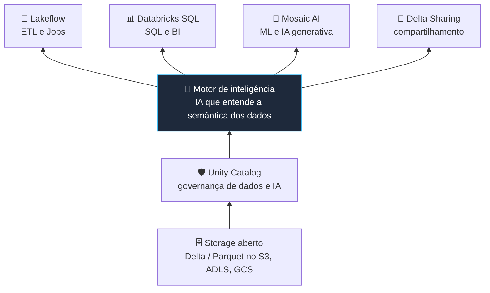
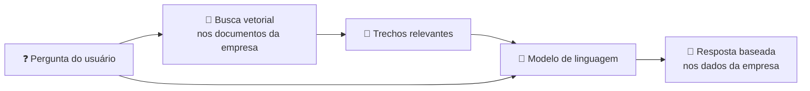
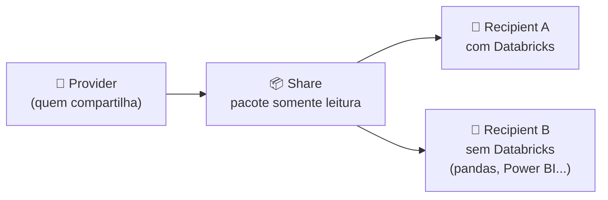

# 🧠 Data Intelligence Platform, Databricks SQL, Mosaic AI e Delta Sharing — Databricks Fundamentals

> **Exame:** Databricks Fundamentals
> **Tópico:** Módulo 6 (complementar) — Temas que a prova atual cobra além do roteiro original: Data Intelligence Platform, Databricks SQL, Mosaic AI e Delta Sharing/Marketplace.

---

> ⚠️ **Atenção aos nomes (renomeações de 2026):** o material oficial do curso pode ter sido gravado antes das mudanças. Na prova, trate como equivalentes:
>
> | Nome antigo | Nome atual |
> | :--- | :--- |
> | Delta Sharing | **OpenSharing** (junho de 2026) |
> | Databricks Assistant | **Genie Code** |
> | Genie spaces (AI/BI Genie) | **Genie Agents** |
> | Databricks One | **Genie One** |
> | DatabricksIQ | Recursos de IA assistiva da plataforma |
> | Vector Search | **AI Search** (nas docs atuais) |
> | AI Gateway | **Unity Gateway** (nas docs atuais) |

---

## 📑 Índice
1. [Data Intelligence Platform](#1-data-intelligence-platform)
2. [Databricks SQL](#2-databricks-sql)
3. [Mosaic AI](#3-mosaic-ai)
4. [Delta Sharing (OpenSharing) e Marketplace](#4-delta-sharing-opensharing-e-marketplace)
5. [Resumo mental para a prova](#5-resumo-mental-para-a-prova)
6. [Possíveis pegadinhas da prova](#6-possíveis-pegadinhas-da-prova)
7. [Questões no estilo da prova](#7-questões-no-estilo-da-prova)
8. [Fontes](#8-fontes)

---

## 1. Data Intelligence Platform

> 🎯 **Data Intelligence Platform = Lakehouse + IA que entende os seus dados.**

A Databricks passou a usar esse nome no lugar de "Lakehouse Platform" a partir do fim de 2023. O Lakehouse continua sendo a base: Delta Lake, Unity Catalog e Spark. A diferença é que a plataforma ganhou uma **camada de IA generativa** que aprende o contexto do seu negócio, como os nomes das tabelas, os comentários, a linhagem e o uso, e usa isso para ajudar todo mundo.

### As camadas da plataforma

| Camada | O que é | Onde vimos |
| :--- | :--- | :--- |
| **Storage aberto** | Seus dados em formato aberto (Delta, Parquet) no storage de nuvem | Módulos 1 e 4 |
| **Unity Catalog** | Governança unificada de dados **e IA** | Módulo 5 |
| **Motor de inteligência** | IA que entende a semântica dos dados (o antigo **DatabricksIQ**) | Este módulo |
| **Cargas de trabalho** | ETL (Lakeflow), SQL e BI (Databricks SQL), IA (Mosaic AI), compartilhamento (Delta Sharing) | Este e os anteriores |

### O que essa "inteligência" faz na prática

| Recurso | O que faz |
| :--- | :--- |
| **Genie Code** (antigo Databricks Assistant) | Assistente que escreve, explica e corrige código em notebooks, no editor SQL e em pipelines |
| **Comentários gerados por IA** | Descrições automáticas de tabelas e colunas no Unity Catalog |
| **Busca inteligente** | Encontra dados usando o contexto dos comentários e da linhagem |
| **Genie** | Perguntas em linguagem natural sobre os dados (seção 2) |

> 💡 **Para a prova:** se a pergunta falar de "IA que entende a semântica/contexto dos dados da empresa" ou "democratizar o acesso aos dados com linguagem natural", a resposta é **Data Intelligence Platform**.

---

## 2. Databricks SQL

O **Databricks SQL (DBSQL)** é a parte da plataforma voltada para **analistas, SQL e BI**. É o "Data Warehouse" dentro do Lakehouse, e funciona direto sobre as tabelas Delta, sem copiar dados para outro sistema.

### SQL Warehouses: o compute do DBSQL

| Tipo | Photon | Início | Onde roda o compute | Quando usar |
| :--- | :--- | :--- | :--- | :--- |
| **Serverless** | Sim | **~2 a 6 segundos** | Conta da **Databricks** | Recomendado: início rápido e escala automática para demanda variável |
| **Pro** | Sim | ~4 minutos | Conta do **cliente** | Quando o serverless não está disponível na região ou é preciso rede customizada |
| **Classic** | Sim | ~4 minutos | Conta do **cliente** | Nível de entrada, para exploração interativa |

O Serverless também tem **Predictive IO** e gerenciamento inteligente de carga. O Pro tem Predictive IO; o Classic, nenhum dos dois.

> 🔗 **Ligação com o Módulo 1:** o SQL Warehouse Serverless roda no **Serverless Compute Plane**, na conta da Databricks.

### As ferramentas do DBSQL

| Ferramenta | Para quê |
| :--- | :--- |
| **SQL Editor** | Escrever e salvar queries, com autocompletar e ajuda do Genie Code |
| **AI/BI Dashboards** | Dashboards para a área de negócio, criados com ajuda de IA e com as permissões do Unity Catalog |
| **Alerts** | Avisos automáticos quando o resultado de uma query passa de um limite (ex.: estoque abaixo de 100) |
| **Genie Agents** (antigo Genie spaces) | O usuário pergunta em **linguagem natural**; o Genie gera o SQL, executa e responde com tabela ou gráfico. Um analista prepara o espaço escolhendo as tabelas e explicando os termos do negócio |
| **Genie One** (antigo Databricks One) | Interface de chat para usuários de negócio, reunindo dashboards, Genie e apps num só lugar |
| **Conectores de BI** | Power BI, Tableau e outras ferramentas conectam direto num SQL Warehouse |

> 💡 **Para a prova:** "analista quer SQL e dashboards" leva a **SQL Warehouse + AI/BI Dashboards**. "Usuário de negócio quer perguntar em português, sem SQL" leva ao **Genie**.

---

## 3. Mosaic AI

**Mosaic AI** é o nome do conjunto de recursos de **Machine Learning e IA generativa** do Databricks. O nome vem da MosaicML, empresa comprada pela Databricks em 2023. A promessa é construir, implantar e governar IA **perto dos dados**, com tudo governado pelo **Unity Catalog**.

### As peças principais

| Peça | Para que serve |
| :--- | :--- |
| **MLflow** | Ciclo de vida de ML: rastrear experimentos, registrar modelos e versões. Hoje também faz **tracing e avaliação** de agentes e LLMs |
| **Model Serving** | Publicar um modelo como **endpoint** (uma API) para outras aplicações usarem em tempo real |
| **Foundation Model APIs** | Usar modelos de linguagem prontos (open source e de terceiros) hospedados pela Databricks, sem montar infraestrutura |
| **Gateway de IA** (nas docs atuais, **Unity Gateway**) | Um ponto único e governado para acessar vários modelos, com limites de uso, guardrails e auditoria |
| **Busca vetorial** (nas docs atuais, **AI Search**; antes, **Vector Search**) | Busca por significado em documentos e textos. É a base do **RAG** |
| **Agent Bricks** | Plataforma para construir, avaliar e colocar em produção **agentes de IA** |

### Dois conceitos que você precisa saber explicar

**RAG (Retrieval-Augmented Generation):** antes de responder, o modelo **busca documentos relevantes da empresa**, como manuais e políticas, e usa esse conteúdo na resposta. Assim a IA responde com base nos **seus** dados, sem precisar ser retreinada.

**Agente de IA:** um sistema que usa um modelo de linguagem para **decidir e executar passos**, como consultar uma tabela, chamar uma ferramenta e montar a resposta. Ele vai além de responder com texto.

> 💡 **Para a prova:** o diferencial do Databricks em IA é ter **dados, modelos e governança no mesmo lugar**. O Unity Catalog governa tabelas **e** modelos, e o MLflow rastreia todo o ciclo.

---

## 4. Delta Sharing (OpenSharing) e Marketplace

Em junho de 2026 o **Delta Sharing passou a se chamar OpenSharing**, depois do lançamento do projeto open source de mesmo nome. A essência continua a mesma.

### O que é

Um **protocolo aberto** para compartilhar dados e ativos de IA, de forma segura e **ao vivo**, com outras organizações e plataformas. O destinatário não precisa usar Databricks.

> 🎯 **Ponto-chave:** o dado **não é copiado**. Quem recebe lê direto da fonte, sempre atualizado.

### Os três conceitos

| Conceito | O que é |
| :--- | :--- |
| **Provider** (provedor) | Quem compartilha |
| **Share** | Pacote **somente leitura** com o que vai ser compartilhado; no Unity Catalog, é um objeto com permissões |
| **Recipient** (destinatário) | Quem recebe |

### Duas modalidades

| | Open sharing | Databricks-to-Databricks |
| :--- | :--- | :--- |
| **Quem recebe** | Qualquer um, **com ou sem Databricks** | Quem tem workspace Databricks com Unity Catalog |
| **Autenticação** | Token ou federação OIDC | Automática, gerida pela plataforma (sem token) |
| **Ferramentas do destinatário** | Spark, pandas, Power BI e outras | O próprio Databricks |
| **O que pode compartilhar** | Tabelas, views e outros ativos de dados | Também **notebooks, Volumes e modelos de ML** |

### Construídos sobre o Delta Sharing

| Recurso | Para quê |
| :--- | :--- |
| **Databricks Marketplace** | "Mercado" aberto onde empresas **publicam e encontram** produtos de dados, modelos e notebooks, gratuitos ou pagos |
| **Clean Rooms** | Ambiente seguro onde **várias empresas colaboram em dados sensíveis sem expor os dados brutos** umas às outras (ex.: varejista e marca medindo uma campanha juntos) |

> 💡 **Para a prova:** "compartilhar com parceiro que **não usa Databricks**, sem copiar" → **Delta Sharing (open sharing)**. "Colaborar sem expor dados brutos" → **Clean Rooms**. "Encontrar datasets de terceiros" → **Marketplace**.

---

## 5. Resumo mental para a prova

- **Data Intelligence Platform** = Lakehouse + IA que entende o contexto dos dados (antigo DatabricksIQ).
- **Databricks SQL** = SQL Warehouses (Serverless, Pro, Classic) + SQL Editor + AI/BI Dashboards + Alerts + Genie.
- **Genie** = perguntas em linguagem natural. **Genie Code** = assistente de código (antigo Databricks Assistant).
- **Mosaic AI** = ML e IA generativa: MLflow, Model Serving, Foundation Model APIs, busca vetorial (RAG) e agentes, tudo governado pelo UC.
- **Delta Sharing / OpenSharing** = protocolo aberto, sem cópia, para quem usa ou não Databricks. Sobre ele estão o **Marketplace** e o **Clean Rooms**.

---

## 6. Possíveis pegadinhas da prova

| ❌ Afirmação falsa (armadilha) | ✅ O correto |
| :--- | :--- |
| "Data Intelligence Platform substitui o Lakehouse." | Ela é **construída sobre** o Lakehouse e acrescenta uma camada de IA. |
| "O Genie exige que o usuário escreva SQL." | O usuário pergunta em **linguagem natural**; o Genie gera o SQL. |
| "SQL Warehouses Classic iniciam em segundos." | O **Serverless** inicia em segundos; Pro e Classic levam minutos. |
| "O SQL Warehouse Serverless roda na conta do cliente." | Roda na conta da **Databricks**; Pro e Classic rodam na conta do cliente. |
| "Delta Sharing copia os dados para o destinatário." | O destinatário lê **ao vivo**, sem cópia. |
| "Delta Sharing só funciona entre clientes Databricks." | O **open sharing** funciona com qualquer plataforma. |
| "Clean Rooms é para vender dados." | Venda e descoberta é no **Marketplace**; Clean Rooms é colaboração **sem expor dados brutos**. |
| "RAG significa retreinar o modelo com os dados da empresa." | RAG **busca** documentos na hora da pergunta; o modelo não é retreinado. |
| "Model Serving treina modelos." | Model Serving **publica** modelos como endpoint (API); quem rastreia o treino é o MLflow. |
| "Unity Catalog governa só dados, não modelos de IA." | Governa dados **e** IA: tabelas, Volumes, modelos, funções e agentes. |

> 💡 **Dica de leitura:** "linguagem natural" → **Genie**. "SQL e BI" → **SQL Warehouse**. "API do modelo" → **Model Serving**. "Documentos da empresa na resposta" → **RAG**. "Parceiro sem Databricks" → **open sharing**.

---

## 7. Questões no estilo da prova

**1. O que diferencia a Data Intelligence Platform do conceito original de Lakehouse?**
- a) Ela abandona o Delta Lake e usa um formato proprietário
- b) Ela acrescenta, sobre o Lakehouse, uma camada de IA que entende o contexto e a semântica dos dados da empresa
- c) Ela só funciona com dados estruturados
- d) Ela substitui o Unity Catalog

**2. Um diretor quer fazer perguntas sobre vendas em português, sem escrever SQL, e receber tabelas e gráficos. Qual recurso usar?**
- a) Genie (Genie Agents / antigo Genie spaces)
- b) Job compute
- c) Delta Sharing
- d) MLflow

**3. Qual tipo de SQL Warehouse inicia em segundos e roda o compute na conta da Databricks?**
- a) Classic
- b) Pro
- c) Serverless
- d) All-purpose

**4. Uma empresa quer que um chatbot responda dúvidas usando os manuais internos, sem retreinar o modelo. Qual técnica usar?**
- a) RAG (Retrieval-Augmented Generation) com busca vetorial
- b) Time travel
- c) Auto-scaling
- d) Schema evolution

**5. Um time de ciência de dados treinou um modelo e quer disponibilizá-lo como uma API para um aplicativo consultar em tempo real. Qual recurso usar?**
- a) Model Serving
- b) AI/BI Dashboards
- c) Clean Rooms
- d) `VACUUM`

**6. Uma empresa precisa compartilhar uma tabela atualizada com um parceiro que NÃO usa Databricks, sem copiar os dados. Qual recurso usar?**
- a) Exportar CSV diariamente por e-mail
- b) Delta Sharing (agora OpenSharing) no modo open sharing
- c) Git folders
- d) Uma temp view

**7. Um varejista e uma marca querem medir juntos uma campanha, cruzando dados de clientes, sem que nenhum dos dois veja os dados brutos do outro. Qual recurso usar?**
- a) Databricks Marketplace
- b) Clean Rooms
- c) SQL Warehouse Pro
- d) Genie Code

**8. Um analista quer ser avisado automaticamente por e-mail quando o resultado de uma query indicar estoque abaixo de 100 unidades. Qual recurso do Databricks SQL usar?**
- a) Alerts
- b) Time travel
- c) Repair run
- d) Data Profile

<b>📝 Gabarito (clique para abrir)</b>

| Questão | Resposta | Por quê |
| :--- | :--- | :--- |
| 1 | b | É o Lakehouse mais uma camada de IA que aprende o contexto dos dados. |
| 2 | a | O Genie recebe perguntas em linguagem natural e gera o SQL. |
| 3 | c | Serverless inicia em ~2 a 6 segundos e roda na conta da Databricks. |
| 4 | a | RAG busca os trechos relevantes antes de responder; o modelo não é retreinado. |
| 5 | a | Model Serving publica o modelo como endpoint (API). |
| 6 | b | Open sharing é um protocolo aberto: leitura ao vivo, sem cópia, mesmo sem Databricks. |
| 7 | b | Clean Rooms permite colaborar sem expor dados brutos; o Marketplace é para publicar e encontrar dados. |
| 8 | a | Alerts disparam avisos quando o resultado de uma query passa de um limite. |

---

## 8. Fontes

- [Databricks — SQL warehouse types](https://docs.databricks.com/aws/en/compute/sql-warehouse/warehouse-types.html)
- [Databricks — Generative AI capabilities](https://docs.databricks.com/aws/generative-ai/guide/mosaic-ai-gen-ai-capabilities)
- [Databricks — What is Delta Sharing / OpenSharing](https://docs.databricks.com/delta-sharing/index.html)
- [Databricks — AI assistive features](https://docs.databricks.com/databricksiq/index.html)
- [Delta Sharing is now OpenSharing — rebricked.org](https://rebricked.org/databricks/delta-sharing/)
- [Genie One vs Genie Agents vs Genie Code — brickster.ai](https://www.brickster.ai/articles/genie-one-agents-code-compared)
- [Databricks' new Data Intelligence Platform — ITPro](https://www.itpro.com/business/data-and-insights/databricks-new-data-intelligence-platform-marks-shift-away-from-lakehouse)

*Consultado em 01/11/2026.*
